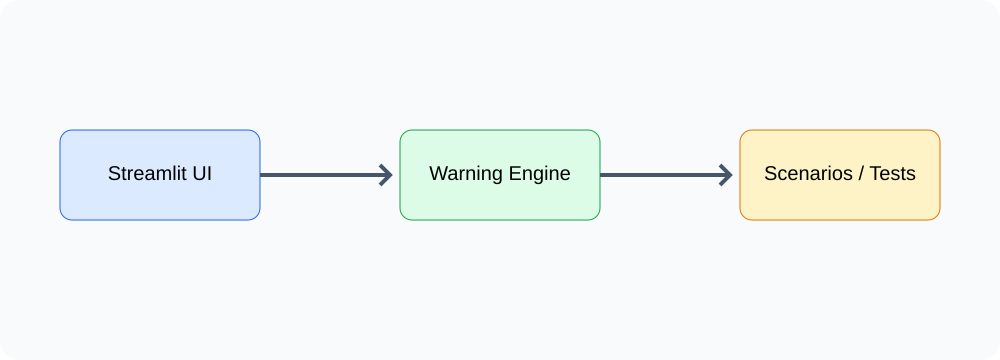
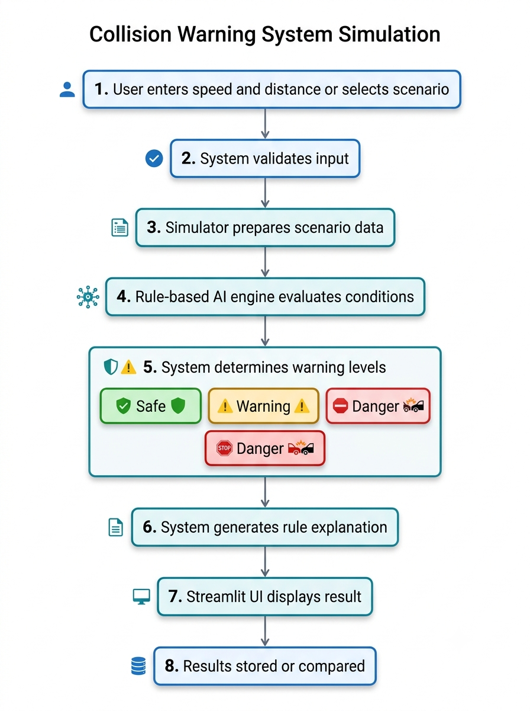
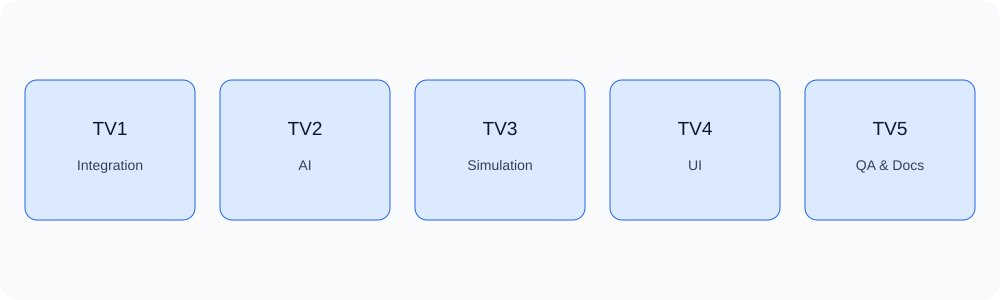

  

<h1 align="center">Collision Warning System Simulation</h1>

  <b>Bài tập lớn Trí tuệ nhân tạo – Mô phỏng hệ thống cảnh báo va chạm bằng Python và luật IF–THEN</b>

  
  
  
  
  

---

## Mục lục

1. [Giới thiệu](#giới-thiệu)
2. [Mục tiêu đề tài](#mục-tiêu-đề-tài)
3. [Phạm vi thực hiện](#phạm-vi-thực-hiện)
4. [Kiến trúc dự án](#kiến-trúc-dự-án)
5. [Luồng xử lý chính](#luồng-xử-lý-chính)
6. [Công nghệ sử dụng](#công-nghệ-sử-dụng)
7. [Phân công 5 thành viên](#phân-công-5-thành-viên)
8. [Kế hoạch 4 tuần](#kế-hoạch-4-tuần)
9. [Quy trình làm việc GitHub](#quy-trình-làm-việc-github)
10. [Tiêu chí hoàn thành](#tiêu-chí-hoàn-thành)
11. [Tài liệu trong docs](#tài-liệu-trong-docs)

---

## Giới thiệu

Dự án **Mô phỏng hệ thống cảnh báo va chạm** là bài tập lớn môn **Trí tuệ nhân tạo**, tập trung vào việc xây dựng một chương trình có khả năng **đánh giá mức độ nguy cơ va chạm** dựa trên các dữ liệu đầu vào như **tốc độ xe** và **khoảng cách tới vật cản**.

Hệ thống được xây dựng theo hướng **AI dựa trên luật (Rule-Based System)**. Thay vì huấn luyện mô hình Machine Learning, nhóm sử dụng các **luật IF–THEN** và **ngưỡng cảnh báo** để phân loại kết quả thành 3 mức:

- **An toàn**
- **Cảnh báo**
- **Nguy hiểm**

Dự án ưu tiên tính **dễ hiểu, dễ giải thích, dễ kiểm thử và phù hợp với nhóm sinh viên 5 người** trong thời gian ngắn.

## Mục tiêu đề tài

- Mô phỏng dữ liệu đầu vào gồm tốc độ và khoảng cách.
- Xây dựng hệ thống AI suy diễn mức độ nguy cơ va chạm.
- Hiển thị kết quả bằng giao diện đơn giản.
- So sánh ít nhất **3 tình huống mô phỏng khác nhau**.
- Có giải thích lý do hệ thống đưa ra kết luận.
- Làm việc nhóm qua **GitHub Issues, Branches và Pull Requests**.

## Phạm vi thực hiện

### Có thực hiện

- Python
- Streamlit
- Luật IF–THEN
- Dữ liệu mô phỏng bằng CSV/JSON/Python list
- Unit test cơ bản
- Báo cáo, slide, demo

### Không thực hiện

- Docker
- SQL Database
- REST API
- Mô phỏng 3D
- Machine Learning / Deep Learning
- Hệ thống web tách frontend/backend phức tạp

## Kiến trúc dự án

  

Dự án được chia thành các khối chính:

1. **Giao diện Streamlit**: nơi người dùng nhập dữ liệu hoặc chọn kịch bản.
2. **main.py**: điều phối luồng xử lý giữa giao diện và các module.
3. **warning_engine.py**: bộ suy diễn AI dựa trên luật IF–THEN.
4. **simulator.py**: sinh dữ liệu mô phỏng và quản lý các kịch bản.
5. **tests/**: kiểm thử các hàm và tích hợp cơ bản.
6. **docs/**: lưu tài liệu hướng dẫn, phân công, yêu cầu và ghi chú cho từng thành viên.

## Luồng xử lý chính

  

Luồng xử lý cơ bản:

1. Người dùng nhập **tốc độ** và **khoảng cách** hoặc chọn một kịch bản sẵn có.
2. Hệ thống kiểm tra dữ liệu đầu vào.
3. Module AI tính toán và đối chiếu với bộ luật IF–THEN.
4. Hệ thống đưa ra mức cảnh báo.
5. Giao diện hiển thị kết quả và giải thích.
6. Có thể lưu kết quả để so sánh giữa các tình huống.

## Công nghệ sử dụng

| Thành phần | Công nghệ |
|---|---|
| Ngôn ngữ lập trình | Python |
| Giao diện | Streamlit |
| AI chính | Rule-Based Inference |
| Dữ liệu | CSV / JSON / Python list |
| Kiểm thử | unittest |
| Quản lý dự án | GitHub Issues, Branches, Pull Requests |
| Tài liệu | Markdown |
| Sơ đồ | SVG / Mermaid / ảnh tạo bằng Gemini |

## Phân công 5 thành viên

  

| Thành viên | Vai trò | Công việc chính |
|---|---|---|
| **TV1** | Nhóm trưởng / Integration | Điều phối, tích hợp hệ thống, theo dõi tiến độ, merge PR |
| **TV2** | AI Developer | Xây dựng thuật toán cảnh báo và bộ luật IF–THEN |
| **TV3** | Simulation Developer | Xây dựng dữ liệu và 3 tình huống mô phỏng |
| **TV4** | UI Developer | Xây dựng giao diện Streamlit và hiển thị kết quả |
| **TV5** | QA & Documentation | Viết test, ghi nhận lỗi, tổng hợp tài liệu và báo cáo |

## Kế hoạch 4 tuần

| Tuần | Thời gian | Trọng tâm |
|---|---|---|
| **Tuần 1** | 04/11 – 10/11 | Phân tích yêu cầu, chốt thiết kế, tài liệu tuần 1, đưa vào `main` |
| **Tuần 2** | 11/11 – 17/11 | Bắt đầu code từng module trên branch riêng |
| **Tuần 3** | 18/11 – 24/11 | Tích hợp, kiểm thử, sửa lỗi, hoàn thiện giao diện |
| **Tuần 4** | 25/11 – 30/11 | Hoàn thiện báo cáo, slide, chốt source code |
| **Buffer** | 01/12 – 02/12 | Tổng duyệt, sửa lỗi cuối và nộp bài |

## Quy trình làm việc GitHub

### Tuần 1

- Mỗi người làm file tài liệu được giao.
- Sau khi tự kiểm tra và được review, có thể **commit trực tiếp lên `main`**.
- Chỉ sửa đúng file mình phụ trách.

### Từ tuần 2 trở đi

- Mỗi thành viên theo flow từ issue week 1 tiếp tục làm các week sau.
- Tạo branch riêng từ `main`.
- Code và tự chạy test phần của mình.
- Push branch lên GitHub.
- Tự tạo Pull Request.
- Reviewer kiểm tra.
- Nhóm trưởng merge vào `main` nếu đạt yêu cầu.

## Tiêu chí hoàn thành

Một chức năng hoặc Issue được xem là hoàn thành khi:

- Có file/code đúng vị trí.
- Chạy được đúng chức năng mô tả.
- Không lỗi cú pháp.
- Có kết quả kiểm thử hoặc ảnh minh chứng.
- Được reviewer xác nhận.
- Được merge hoặc lưu vào tài liệu chính thức.

## Tài liệu trong docs

- `docs/gemini_image_prompts.md`: Prompt để dùng với Gemini tạo các ảnh sơ đồ.
- `docs/member-guides/TV1.md`: Hướng dẫn công việc của TV1.
- `docs/member-guides/TV2.md`: Hướng dẫn công việc của TV2.
- `docs/member-guides/TV3.md`: Hướng dẫn công việc của TV3.
- `docs/member-guides/TV4.md`: Hướng dẫn công việc của TV4.
- `docs/member-guides/TV5.md`: Hướng dẫn công việc của TV5.

---

<i>Collision Warning System Simulation · BTL Trí tuệ nhân tạo</i>

