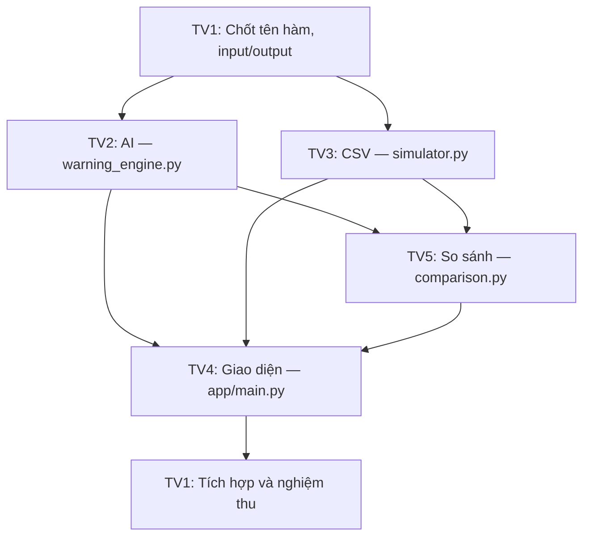

<p align="center">
  
</p>

# Mô phỏng hệ thống cảnh báo va chạm

> **Bài tập lớn môn Trí tuệ nhân tạo · 5 thành viên · Hạn nộp 24/11/2026**

Ứng dụng Python + Streamlit mô phỏng cách một **hệ chuyên gia dựa trên luật IF–THEN** đánh giá nguy cơ va chạm từ **tốc độ xe** và **khoảng cách tới vật cản**. Đầu ra có 3 mức **SAFE / WARNING / DANGER** kèm lời giải thích. Không dùng cảm biến thật; các thông số chỉ dành cho học tập, **không dùng để điều khiển xe**.

## 1. Chức năng cần hoàn thành

- Nhập tốc độ xe (km/h) và khoảng cách vật cản (m).
- Tính khoảng cách dừng và ngưỡng cảnh báo theo công thức giả định.
- Áp dụng 3 luật AI IF–THEN để trả mức cảnh báo, mã luật và giải thích.
- Nạp ít nhất 3 kịch bản từ CSV và đối chiếu kết quả dự kiến/thực tế.
- Hiển thị một trang Streamlit với kết quả và bảng so sánh.

**Không triển khai:** Docker, SQL, REST API, frontend/backend riêng, mô phỏng 3D, OpenCV, camera hay huấn luyện học máy. **Không bắt buộc viết unit test tự động**; nhóm chạy thử thủ công và lưu kết quả thật.

## 2. Kiến trúc và flow làm việc



### Trình tự bắt buộc

| Mốc | Người phụ trách | Hoàn thành khi | Người tiếp theo |
|---|---|---|---|
| **0 — Chốt giao diện hàm (17/11)** | **TV1 + cả nhóm** | Cả nhóm đồng ý tên hàm, key trong dict và header CSV ở mục 3 | TV2, TV3 |
| **1 — Hai module độc lập (18/11)** | **TV2, TV3** | Code chạy độc lập, dữ liệu mẫu đúng; commit lên `main` | TV5 |
| **2 — Đối chiếu (19/11)** | **TV5** | Gọi được AI + Simulator, có bảng PASS/FAIL/ERROR | TV4 |
| **3 — Giao diện (20/11)** | **TV4** | Nhập tay/chọn kịch bản, ba mức màu và bảng kết quả chạy được | TV1 |
| **4 — Tích hợp (21–22/11)** | **TV1 + cả nhóm** | Chạy demo thật, sửa lỗi theo đúng owner, chuẩn bị ảnh và Word | Cả nhóm |
| **5 — Chốt và nộp (23–24/11)** | **Cả nhóm** | Báo cáo Word, code, Markdown giải thích, chuẩn bị vấn đáp | Nộp bài |

**Có thể viết song song phần độc lập**, nhưng **không gọi module chưa hoàn thiện trên `main`**. TV4 có thể phác giao diện sớm, nhưng chỉ kết nối khi TV2/TV3/TV5 báo hàm đã chạy.

## 3. Hợp đồng giao tiếp giữa các file — KHÔNG tự đổi

Mọi thành viên **đọc mục này trước khi code**. Nếu buộc phải thay đổi, phải trao đổi với cả nhóm và sửa tài liệu + các file liên quan cùng lúc.

### TV2 — `src/warning_engine.py`

```python
assess_risk(speed_kmh: float, distance_m: float) -> dict
```

Ví dụ kết quả:

```python
{"level": "WARNING", "reason": "Khoảng cách thuộc vùng cảnh báo.",
 "rule_id": "R02", "stopping_distance_m": 44.44,
 "warning_distance_m": 66.67}
```

- `level` luôn là mã `SAFE`, `WARNING` hoặc `DANGER` (**không trả nhãn tiếng Việt trong field này**).
- `reason` và `rule_id` luôn có; 2 trường khoảng cách dùng để giải thích UI.
- Dữ liệu không hợp lệ (âm, NaN, vô cực, sai kiểu) → `ValueError`.
- Các ngưỡng chỉ phục vụ mô phỏng.

### TV3 — `src/simulator.py` và `data/scenarios.csv`

```python
load_scenarios() -> list[dict]
```

CSV dùng đúng header:

```csv
scenario_id,name,speed_kmh,distance_m,expected_action
SC01,An toàn,30,30,SAFE
SC02,Cảnh báo,30,20,WARNING
SC03,Nguy hiểm,30,10,DANGER
```

`load_scenarios()` trả các dict có 5 key trên; `speed_kmh` và `distance_m` là `float`. Không hard-code một danh sách thứ hai trong Python; CSV là nguồn duy nhất.

### TV5 — `src/comparison.py`

```python
compare_scenarios(scenarios: list[dict]) -> list[dict]
```

Mỗi dòng trả tối thiểu: `scenario_id`, `name`, `speed_kmh`, `distance_m`, `expected_action`, `actual_level`, `status` (`PASS`/`FAIL`/`ERROR`). Hàm gọi `assess_risk` của TV2, không tự chép lại luật.

### TV4 — `app/main.py`

- Gọi `assess_risk` để đánh giá dữ liệu nhập tay.
- Gọi `load_scenarios` và `compare_scenarios` để hiện bảng tình huống.
- Chuyển `level` thành `st.success()`, `st.warning()` hoặc `st.error()`; bắt `ValueError` và hiển thị lỗi rõ ràng.
- Không tự viết thêm luật IF–THEN vào file giao diện.
- Chạy từ thư mục gốc repo bằng `streamlit run app/main.py`; đảm bảo import `src.*` hoạt động.

### Thuật toán thống nhất từ W1-02

Với `v = speed_kmh / 3.6`, giả định `t = 1s`, `a = 5 m/s²`, `k = 1.5`:

```python
D_stop = v * t + v**2 / (2 * a)
D_warning = k * D_stop

if distance_m == 0 or distance_m <= D_stop:
    level = "DANGER"      # R01
elif distance_m <= D_warning:
    level = "WARNING"     # R02
else:
    level = "SAFE"        # R03
```

**Giá trị mẫu để cả nhóm kiểm tra:** `(30,30) → SAFE`, `(30,20) → WARNING`, `(30,10) → DANGER`, `(60,50) → WARNING`, `(60,20) → DANGER`. Trường hợp `distance_m=0` thuộc `DANGER` theo quyết định MVP, dù một tài liệu W1 cũ từng coi đây là dữ liệu lỗi.

## 4. Cấu trúc repository tối giản

```text
README.md
requirements.txt
app/
  main.py                 # TV4 — Streamlit
src/
  warning_engine.py       # TV2 — AI
  simulator.py            # TV3 — CSV
  comparison.py           # TV5 — sẽ tạo khi làm issue
data/
  scenarios.csv           # TV3 — các kịch bản
docs/
  KE_HOACH_MVP_24-11.md   # Kế hoạch chung
  week 1/                 # Bản gốc 5 tài liệu, không xóa
  code/                   # <username>/README.md, thành viên sẽ tạo
images/
  banner.svg
  architecture.svg
```

**Chú ý:** `src/comparison.py` và `docs/code/` là **file/thư mục dự kiến**, chưa có trước khi thành viên đưa bài lên. Không tạo file trống cho đủ cây.

## 5. Các issue đã gán

| Thành viên | GitHub | Issue | File chính |
|---|---|---|---|
| TV1 — Kiến trúc, tích hợp | `captainduycan-hub` | [#8](../../issues/8) | README, tổng hợp báo cáo |
| TV2 — Bộ luật AI | `foxyy163` | [#9](../../issues/9) | `src/warning_engine.py` |
| TV3 — Mô phỏng | `hathihongdao` | [#12](../../issues/12) | `src/simulator.py`, CSV |
| TV4 — Giao diện | `ledan823-spec` | [#11](../../issues/11) | `app/main.py` |
| TV5 — Đối chiếu | `nguyenvc2772-sys` | [#10](../../issues/10) | `src/comparison.py` |

## 6. Quy trình làm việc trên `main` để tránh lỗi

Vì nhóm chủ động **không dùng branch hoặc Pull Request**, mọi người phải tuân thủ:

1. **Nhận issue và thông báo nhóm** file định sửa. Mỗi người chỉ sửa file thuộc mình.
2. **Đồng bộ trước khi sửa**: `git pull --ff-only origin main`.
3. Code và **chạy thử chức năng độc lập**; tuyệt đối không push code lỗi cú pháp.
4. Thêm **file Markdown riêng** `docs/code/captainduycan-hub/README.md` … `docs/code/nguyenvc2772-sys/README.md`, giải thích ngắn gọn hàm, input/output, cách chạy, 1 ví dụ thực tế.
5. **Ngay trước khi push**, đồng bộ lại `main` bằng `git pull --ff-only origin main`, kiểm tra `git status`; commit **chỉ những file được giao** (không dùng `git add .` khi có file của người khác).
6. Push `main`, bình luận link commit vào issue. **Chỉ đóng issue khi người tiếp theo hoặc TV1 kiểm tra đã dùng được**.
7. Khi lỗi non-fast-forward, xung đột hoặc không thể pull: **dừng và hỏi nhóm trưởng**, không dùng `git push --force`, không ghi đè file người khác.

**Lưu ý:** Nếu có thay đổi chưa commit, `git pull --ff-only` có thể bị từ chối. Khi đó hãy lưu/commit phần của mình trước rồi đồng bộ an toàn, hoặc hỏi TV1; không tự xóa thay đổi.

**Đối với người dùng GitHub Web:** chỉ mở file mình phụ trách → Edit → Commit directly to `main`; trước khi lưu hãy kiểm tra file vẫn là bản mới nhất. Nếu GitHub báo conflict, dừng và báo nhóm.

## 7. Cách chạy và kiểm tra trước khi nộp

Python 3.10+:

```bash
pip install -r requirements.txt
streamlit run app/main.py
```

Kiểm tra thực tế:

- Nhập `30 km/h, 30 m` → SAFE.
- Nhập `30 km/h, 20 m` → WARNING.
- Nhập `30 km/h, 10 m` → DANGER.
- Chọn 3 kịch bản CSV và xem expected/actual.
- Nhập dữ liệu sai (nếu UI hỗ trợ) và xác nhận có thông báo lỗi.
- Chụp kết quả chạy thật để đưa vào báo cáo.

## 8. Tài liệu và báo cáo Word

**Giữ nguyên tài liệu Week 1:**

- [W1-01 — Kiến trúc](docs/week%201/architecture.md) và [System Design](docs/week%201/System%20Design.md).
- [W1-02 — Luật AI](docs/week%201/warning_rules.md).
- [W1-03 — Kịch bản](docs/week%201/simulation_scenarios.md).
- [W1-04 — Giao diện](docs/week%201/ui_design.md).
- [W1-05 — Yêu cầu và kế hoạch kiểm thử](docs/week%201/requirements_testplan.md).
- [Kế hoạch MVP mới](docs/KE_HOACH_MVP_24-11.md) là chuẩn thực hiện từ 17/11.

**Thư mục cá nhân:** [TV1](docs/code/captainduycan-hub/README.md) · [TV2](docs/code/foxyy163/README.md) · [TV3](docs/code/hathihongdao/README.md) · [TV4](docs/code/ledan823-spec/README.md) · [TV5](docs/code/nguyenvc2772-sys/README.md). Mỗi người tự điền mẫu của mình sau khi viết code.

**Bàn giao cá nhân:** code + `docs/code/<github-username>/README.md` + đoạn báo cáo Word về phần mình làm. Giải thích được code quan trọng hơn tài liệu dài.

**Báo cáo chung theo mẫu giảng viên:** 1. Tên đề tài; 2. Mục lục; 3. Phân công & đóng góp 5 người; 4. Phân tích bài toán; 5. Thuật toán/pseudocode; 6. Giao diện & kết quả demo thật; 7. Phụ lục (nếu có); 8. Tài liệu tham khảo.

**Ngày 23/11:** cả nhóm tập vấn đáp; **24/11:** nộp Word + mã nguồn/link GitHub trước giờ đóng hệ thống.

<p align="center"></p>
