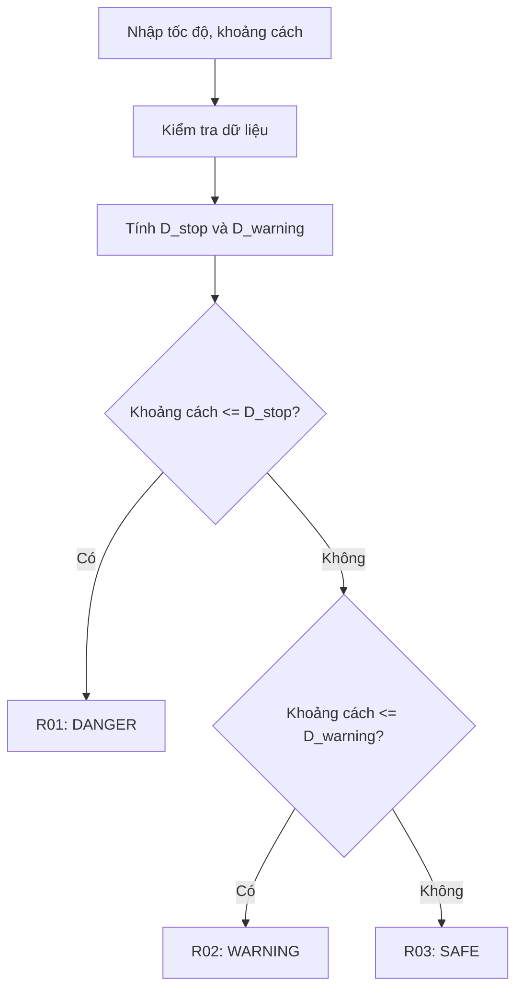
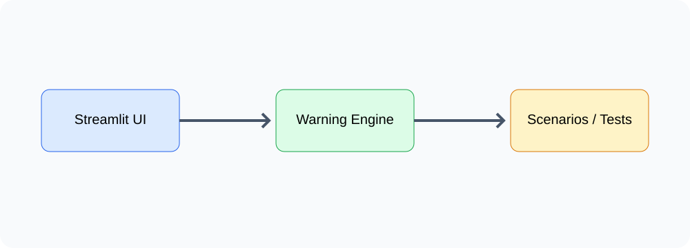

<p align="center"></p>

# Mô phỏng hệ thống cảnh báo va chạm

Bài tập lớn **Trí tuệ nhân tạo** — hệ chuyên gia **IF–THEN (Rule-Based AI)** viết bằng Python. Chương trình mô phỏng đánh giá rủi ro từ **tốc độ xe (km/h)** và **khoảng cách đến vật cản (m)**, sau đó đưa ra **SAFE / WARNING / DANGER** kèm giải thích.

> **Hạn nộp: 24/11/2026.** Đây là mô phỏng phục vụ học tập, **không** phải thiết bị cảnh báo an toàn giao thông thực tế.

## Tính năng MVP

1. Nhập tốc độ và khoảng cách trên giao diện Streamlit.
2. Đổi tốc độ sang m/s, tính khoảng cách dừng và ngưỡng cảnh báo giả định.
3. Áp dụng 3 luật IF–THEN, trả mức cảnh báo, lý do và mã luật.
4. Chạy ít nhất 3 tình huống từ CSV, đối chiếu kết quả.
5. Xem bảng đối chiếu kết quả kịch bản và kiểm tra thủ công bằng dữ liệu mẫu.

**Công nghệ:** Python, Streamlit, CSV, thư viện chuẩn. **Không sử dụng:** REST API, SQL, Docker, 3D, camera hay huấn luyện Machine Learning/Deep Learning.

## Cách suy luận

Với `v = speed_kmh / 3.6`, giả định thời gian phản ứng `t=1s`, độ lớn gia tốc phanh `a=5m/s²` và hệ số mở rộng cảnh báo `k=1.5`:

- `D_stop = v * t + v² / (2a)`
- `D_warning = k * D_stop`
- **DANGER (R01):** `distance_m == 0` hoặc `distance_m <= D_stop`
- **WARNING (R02):** `D_stop < distance_m <= D_warning`
- **SAFE (R03):** `distance_m > D_warning`

Các tham số là giả định cho bài học, không phải tiêu chuẩn an toàn thực tế.



## Cấu trúc repo đang sử dụng

```text
README.md                   # Tổng quan, hướng dẫn
requirements.txt            # Streamlit
app/main.py                 # Giao diện (TV4)
src/warning_engine.py       # Luật cảnh báo (TV2)
src/simulator.py            # Kịch bản mô phỏng (TV3)
data/scenarios.csv          # Dữ liệu kịch bản (TV3)
src/comparison.py           # So sánh expected/actual (TV5, sẽ tạo khi code)
docs/week 1/                # Giữ 5 tài liệu Week 1 gốc
docs/KE_HOACH_MVP_24-11.md  # Kế hoạch rút gọn
images/                     # Ảnh minh họa
```

Đây là cấu trúc đang được hoàn thiện qua các Pull Request, không phải tuyên bố các tính năng đã làm xong.

## Chạy chương trình

Yêu cầu Python 3.10+:

```bash
pip install -r requirements.txt
streamlit run app/main.py
```

Kiểm tra thủ công: chạy 3 kịch bản SAFE, WARNING, DANGER trên giao diện và đối chiếu cột kết quả dự kiến/thực tế. Mỗi thành viên bổ sung `docs/code/TVx.md` giải thích file mình viết, cách chạy và một ví dụ đầu vào/đầu ra.

## Tài liệu Week 1

Tài liệu gốc của cả 5 thành viên được giữ nguyên:

| Nhóm việc | Tài liệu |
|---|---|
| W1-01 — Kiến trúc & tích hợp | [architecture.md](docs/week%201/architecture.md), [System Design.md](docs/week%201/System%20Design.md) |
| W1-02 — Bộ luật AI | [warning_rules.md](docs/week%201/warning_rules.md) |
| W1-03 — Dữ liệu mô phỏng | [simulation_scenarios.md](docs/week%201/simulation_scenarios.md) |
| W1-04 — Giao diện | [ui_design.md](docs/week%201/ui_design.md) |
| W1-05 — Yêu cầu & kiểm thử | [requirements_testplan.md](docs/week%201/requirements_testplan.md) |

## Công việc đến 24/11

| Workstream | Issue | Bàn giao |
|---|---|---|
| TV1 — Tích hợp & báo cáo | [MVP-01](../../issues/8) | Kiểm tra chạy đồng bộ, README, ghép Word |
| TV2 — Luật cảnh báo | [MVP-02](../../issues/9) | `src/warning_engine.py` |
| TV3 — Kịch bản mô phỏng | [MVP-03](../../issues/12) | `src/simulator.py`, CSV |
| TV4 — Giao diện | [MVP-04](../../issues/11) | `app/main.py` |
| TV5 — Đối chiếu kết quả | [MVP-05](../../issues/10) | `src/comparison.py`, bảng kết quả thử thủ công |

- **17/11:** thống nhất tên hàm và công thức.
- **18–20/11:** code, tự chạy thử, push branch riêng, mở PR.
- **21–22/11:** review, tích hợp, thử 3 kịch bản, viết báo cáo Word.
- **23/11:** chốt mã nguồn, báo cáo và tập vấn đáp.
- **24/11:** nộp bài theo giờ đóng hệ thống.

Chi tiết: [Kế hoạch MVP và những khác biệt cần thống nhất](docs/KE_HOACH_MVP_24-11.md).

**Bàn giao của mỗi thành viên:** code thuộc module phụ trách + một file Markdown `docs/code/TVx.md` gồm mục đích, hàm chính, cách chạy, ví dụ input/output và phần tự giải thích (ngắn gọn). TV1 làm tài liệu tích hợp; không cần test tự động.

**Git workflow:** thành viên tự nhận issue → tạo branch riêng → commit → tự test → push → Pull Request → review → merge vào `main`.

## Hồ sơ nộp

**Báo cáo Word** theo mẫu của giảng viên: tên đề tài, mục lục, phân công có đóng góp của từng người, phân tích bài toán, thuật toán/pseudocode, ảnh giao diện và kết quả chạy thật, phụ lục (nếu cần), tài liệu tham khảo. Nộp kèm **mã nguồn hoặc liên kết GitHub**.


