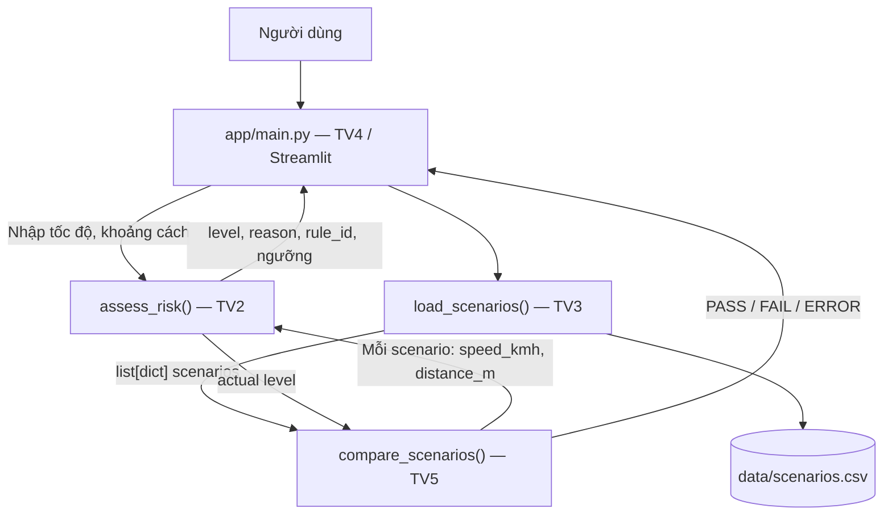

# TV1 — Kiến trúc, tích hợp và nghiệm thu (Issue #8)

> **Vai trò:** điều phối hợp đồng module, kiểm tra tích hợp, cập nhật README và tổng hợp báo cáo Word.  
> **GitHub:** `captainduycan-hub`  
> **Issue:** [#8 — MVP-01 Tích hợp kiến trúc, README và tổng hợp báo cáo](https://github.com/foxyy163/Mo-phong-he-thong-canh-bao-va-cham-TTNT/issues/8)  
> **Ngày rà soát snapshot ZIP:** 19/11/2026  
> **Phạm vi rà soát:** code và tài liệu có trong bản ZIP được cung cấp; không có metadata `.git` trong ZIP để xác minh lịch sử commit.

## 1. Phần việc của TV1

TV1 không viết thay module của TV2–TV5. Công việc chính:

1. Chốt và duy trì contract giao tiếp giữa các module.
2. Kiểm tra đúng cấu trúc file, đúng luồng gọi hàm và đúng dữ liệu đầu vào/đầu ra.
3. Chạy kiểm thử tích hợp, ghi nhận kết quả và báo lỗi cho đúng owner.
4. Cập nhật README chính, README cá nhân TV1, sơ đồ kiến trúc và báo cáo Word tổng hợp.
5. Chuẩn bị minh chứng chạy thật và checklist nghiệm thu Issue #8.

**Kết luận về phạm vi code:** TV1 không cần tạo thêm file Python như `contracts.py`, `orchestrator.py`, `integration.py` hoặc `api.py`. Kiến trúc MVP dùng các hàm Python gọi trực tiếp nhau trong một ứng dụng Streamlit.

## 2. Kiến trúc và luồng dữ liệu

Ứng dụng chạy một tiến trình Python. Streamlit là giao diện; AI Engine giữ luật IF–THEN; Simulator đọc CSV; Comparison gọi AI Engine để so kết quả kỳ vọng với kết quả tính được.



**Hai luồng sử dụng chính:**

- **Đánh giá nhập tay:** người dùng nhập tốc độ và khoảng cách → UI gọi `assess_risk()` → UI hiển thị mức cảnh báo, lý do, mã luật và hai ngưỡng.
- **Đánh giá kịch bản:** UI gọi `load_scenarios()` → Simulator đọc CSV → UI đưa danh sách vào `compare_scenarios()` → Comparison gọi `assess_risk()` cho từng dòng → trả bảng kết quả để UI hiển thị.

## 3. Contract đã đối chiếu với code trong ZIP

| Thành phần | File / hàm | Đầu vào | Đầu ra thực tế |
|---|---|---|---|
| TV2 — AI Engine | `src/warning_engine.py` / `assess_risk(speed_kmh, distance_m)` | Hai số hữu hạn không âm; km/h và m | Dict gồm `level`, `reason`, `rule_id`, `stopping_distance_m`, `warning_distance_m`; dữ liệu sai → `ValueError` |
| TV3 — Simulator | `src/simulator.py` / `load_scenarios(csv_path=...)` | CSV có 5 cột bắt buộc | `list[dict]`; mỗi dict có `scenario_id`, `name`, `speed_kmh`, `distance_m`, `expected_action`; hai trường số được ép `float` |
| TV5 — Comparison | `src/comparison.py` / `compare_scenarios(scenarios)` | Danh sách dict do TV3 cung cấp | Danh sách dict bổ sung `actual_level`, `status`; code còn trả `reason`, `rule_id`, hai ngưỡng và `error` |
| TV4 — UI | `app/main.py` | Nhập tay hoặc chọn kịch bản | Giao diện Streamlit hiển thị kết quả AI, thông báo lỗi và bảng đối chiếu |

CSV dùng chính xác header:

```csv
scenario_id,name,speed_kmh,distance_m,expected_action
```

Các mức chuẩn: `SAFE`, `WARNING`, `DANGER`. Trạng thái so sánh: `PASS`, `FAIL`, `ERROR`.

## 4. Thuật toán và quy tắc thống nhất

Với `v = speed_kmh / 3.6`, thời gian phản ứng giả định `t = 1 s`, độ giảm tốc giả định `a = 5 m/s²`, hệ số cảnh báo `k = 1.5`:

```text
D_stop    = v × t + v² / (2 × a)
D_warning = k × D_stop
```

| Ưu tiên | Điều kiện | Mức | Rule |
|---|---|---|---|
| 1 | `distance_m == 0` hoặc `distance_m <= D_stop` | DANGER | R01 |
| 2 | Không thuộc R01 và `distance_m <= D_warning` | WARNING | R02 |
| 3 | Còn lại | SAFE | R03 |

Ví dụ theo code hiện tại:

- 30 km/h: `D_stop ≈ 15,28 m`, `D_warning ≈ 22,92 m`.
- 60 km/h: `D_stop ≈ 44,44 m`, `D_warning ≈ 66,67 m`.
- `distance_m = 0` luôn trả `DANGER`, kể cả tốc độ bằng 0, theo quy ước MVP.

Đây là mô phỏng học tập với tham số giả định; không phải mô hình an toàn dùng cho xe thật.

## 5. Kết quả kiểm thử trên snapshot ZIP ngày 19/11/2026

### 5.1. Kiểm tra cú pháp và nạp module

| Hạng mục | Kết quả |
|---|---:|
| `app/main.py` biên dịch cú pháp | PASS |
| `src/warning_engine.py` biên dịch cú pháp | PASS |
| `src/simulator.py` biên dịch cú pháp | PASS |
| `src/comparison.py` biên dịch cú pháp | PASS |
| Tổng | **4/4 PASS** |

Kiểm tra bằng `py_compile` trong môi trường rà soát Python 3.13.5.

### 5.2. TV2 — AI Engine

Các kiểm thử do thành viên chạy trong PowerShell và gửi trong quá trình rà soát:

| Tốc độ (km/h) | Khoảng cách (m) | Kết quả | Rule | Đánh giá |
|---:|---:|---|---|---|
| 30 | 30 | SAFE | R03 | PASS |
| 30 | 20 | WARNING | R02 | PASS |
| 30 | 10 | DANGER | R01 | PASS |
| 60 | 50 | WARNING | R02 | PASS |
| 60 | 20 | DANGER | R01 | PASS |

Các trường hợp lỗi `(-10,20)`, `(30,-5)`, `(NaN,20)`, `(inf,20)`, `("abc",20)`, `(None,20)`, `(True,20)` đều phát sinh `ValueError`. Trường hợp biên `(30,0)` trả `DANGER`. Kết quả được gửi: **8/8 trường hợp đạt**.

### 5.3. TV3 — Simulator và CSV

`load_scenarios()` đọc được 5 dòng từ `data/scenarios.csv`. Mỗi dòng có đủ 5 key theo contract; `speed_kmh` và `distance_m` là `float`; các nhãn kỳ vọng nằm trong ba mức chuẩn.

### 5.4. TV2 + TV3 — kiểm thử kết hợp

Đã chạy lần lượt 5 kịch bản CSV qua `assess_risk()` và so sánh `level` với `expected_action`:

| Scenario | Expected | Actual | Status |
|---|---|---|---|
| SC01 | SAFE | SAFE | PASS |
| SC02 | WARNING | WARNING | PASS |
| SC03 | DANGER | DANGER | PASS |
| SC04 | WARNING | WARNING | PASS |
| SC05 | DANGER | DANGER | PASS |

Kết quả: **5/5 PASS**.

### 5.5. TV5 — Comparison

Đã chạy đúng lệnh được hướng dẫn từ thư mục gốc repository:

```bash
python -m src.comparison
```

Kết quả thực tế trên snapshot ZIP:

```text
SC01  SAFE     SAFE     PASS  R03
SC02  WARNING  WARNING  PASS  R02
SC03  DANGER   DANGER   PASS  R01
SC04  WARNING  WARNING  PASS  R02
SC05  DANGER   DANGER   PASS  R01
Tổng: {'PASS': 5, 'FAIL': 0, 'ERROR': 0}
```

Đã thử bổ sung nhánh xử lý của Comparison bằng dữ liệu kiểm tra tạm: một dòng hợp lệ trả `PASS`, một dòng có kết quả khác kỳ vọng trả `FAIL`, tốc độ âm và nhãn kỳ vọng không hợp lệ trả `ERROR`, phần tử không phải dict cũng không làm dừng toàn bộ danh sách. Đây là kiểm tra bổ sung trong phiên rà soát, không phải bộ test tự động được lưu trong repository.

### 5.6. TV4 — Streamlit UI

`app/main.py` đã có form nhập tốc độ/khoảng cách, nút đánh giá, lựa chọn kịch bản CSV, hiển thị ba mức cảnh báo, giải thích rule và bảng đối chiếu. File biên dịch cú pháp thành công.

Trong môi trường rà soát ZIP, thư viện `streamlit` chưa được cài nên **không khởi chạy lại trình duyệt từ môi trường này**. Tuy nhiên, ZIP có ảnh chụp ứng dụng tại `localhost:8502` cho các trạng thái SAFE, WARNING, DANGER và lỗi dữ liệu; đây là minh chứng do TV4 cung cấp trong repository.

Lệnh để nhóm tự chạy lại trên máy có cài dependency:

```bash
pip install -r requirements.txt
streamlit run app/main.py
```

## 6. Minh chứng trong repository

- [Ảnh giao diện SAFE](../ledan823-spec/safe.png)
- [Ảnh giao diện WARNING](../ledan823-spec/warning.png)
- [Ảnh giao diện DANGER](../ledan823-spec/danger.png)
- [Ảnh thông báo lỗi đầu vào](../ledan823-spec/error.png)
- [Ảnh TV3 đọc dữ liệu CSV](../hathihongdao/image-1.png)
- [Ảnh TV5 chạy bảng so sánh 5/5](../nguyenvc2772-sys/ket-qua.png)

## 7. Các điểm tài liệu cần chủ sở hữu cập nhật

TV1 không tự sửa file giải thích thuộc quyền sở hữu thành viên khác. Khi nghiệm thu tài liệu, cần nhờ đúng owner xử lý:

1. **TV4:** README TV4 liệt kê các hàm `_extract_risk_fields`, `_render_risk_output`, `_format_scenario`, nhưng code `app/main.py` trong ZIP thực tế định nghĩa `_format_num` và `_render_assessment_card`. Cần đồng bộ phần mô tả hàm theo code thật.
2. **TV2:** README TV2 còn ghi trạng thái “chờ ghép với giao diện, dữ liệu” và hai checkbox kiểm thử/tích hợp chưa đánh dấu, trong khi ZIP đã có TV3–TV5–TV4 và kiểm thử TV2 đã được thực hiện. Nhờ TV2 cập nhật trạng thái và kết quả.
3. **Ảnh UI TV4:** các ảnh SAFE/WARNING/DANGER đang hiển thị kết quả từ kịch bản đã chọn trong khi hai ô nhập tay vẫn giữ giá trị khác. Ảnh không sai luồng kịch bản, nhưng nên chụp lại với thông số nhập tay trùng kết quả hoặc làm rõ rằng kết quả đến từ kịch bản được chọn để tránh người chấm hiểu nhầm.
4. **Ảnh TV5:** ảnh terminal có ngày 12/11/2026; kết quả 5/5 đã được chạy lại trên snapshot ZIP trong phiên rà soát ngày 19/11/2026. Nên thay ảnh cũ bằng ảnh mới của nhóm nếu cần minh chứng ngày chạy gần nhất.
5. **Báo cáo Word:** ZIP không chứa mẫu Word của giảng viên, file Word của từng thành viên, họ tên hoặc MSSV. Báo cáo tổng hợp kèm theo vì vậy là bản dự thảo từ code và README; nhóm cần bổ sung thông tin hành chính và rà soát theo mẫu chính thức trước khi nộp.

## 8. Flow bàn giao và nghiệm thu Issue #8

1. Đồng bộ `main` mới nhất trước khi chỉnh sửa.
2. TV1 cập nhật các file thuộc phạm vi của TV1: `README.md`, `docs/code/captainduycan-hub/README.md`, báo cáo Word tổng hợp.
3. Không sửa code của TV2–TV5; gửi các điểm lệch tài liệu ở mục 7 về đúng owner.
4. Cả nhóm chạy lại `python -m src.comparison` và `streamlit run app/main.py` trên máy thành viên; chụp ảnh kết quả mới.
5. Bổ sung họ tên/MSSV, báo cáo đóng góp từng người và thông tin theo mẫu giảng viên.
6. Commit đúng file TV1 phụ trách; bình luận link commit và kết quả chạy vào Issue #8.
7. Chỉ đóng Issue #8 sau khi nhóm xác nhận bàn giao Word, README và demo tích hợp thành công.

## 9. Lệnh kiểm tra nhanh dành cho TV1

```powershell
# Đứng tại thư mục gốc repository
python -m src.comparison

# Khởi chạy giao diện (cần cài requirements.txt trước)
streamlit run app/main.py
```

**Trạng thái nghiệm thu tại thời điểm rà soát ZIP:** TV2, TV3 và TV5 đã được kiểm tra bằng lệnh Python; TV4 có code, compile pass và ảnh demo do thành viên cung cấp; chưa xác nhận trực tiếp việc khởi chạy lại Streamlit trong môi trường rà soát. Issue #8 chỉ nên đóng sau khi cả nhóm chạy demo cuối và hoàn tất báo cáo Word theo mẫu giảng viên.
