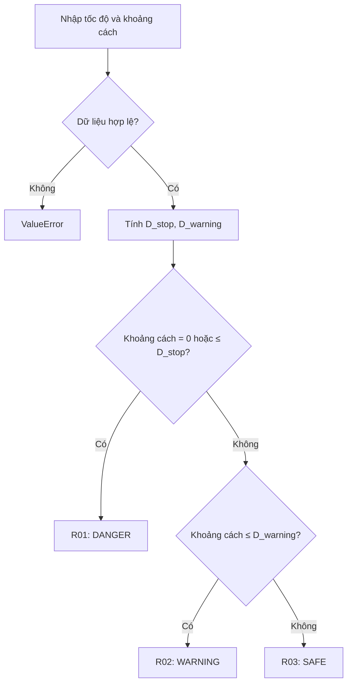

# TV2 — Bộ luật cảnh báo va chạm IF–THEN

- Thành viên: [@foxyy163](https://github.com/foxyy163)
- Issue: [#9](https://github.com/foxyy163/Mo-phong-he-thong-canh-bao-va-cham-TTNT/issues/9)
- Mã nguồn: [`src/warning_engine.py`](../../../src/warning_engine.py)
- Trạng thái: Đã viết code và tài liệu; chờ ghép với giao diện, dữ liệu của các thành viên.

## 1. Mục tiêu

Nhận **tốc độ xe** và **khoảng cách tới vật cản**, sau đó suy diễn mức rủi ro bằng ba luật IF–THEN. Đây là mô phỏng học tập để giải thích suy diễn dựa trên luật, **không phải hệ thống an toàn giao thông thực tế**.

Hàm chính:

```python
assess_risk(speed_kmh, distance_m)
```

- `speed_kmh`: tốc độ, đơn vị km/h.
- `distance_m`: khoảng cách đến vật cản, đơn vị mét.
- Hai giá trị phải là số hữu hạn và không âm; dữ liệu sai làm phát sinh `ValueError`.

Hàm trả về một từ điển có **đúng năm trường** để TV4/TV5 sử dụng:

| Trường | Ý nghĩa |
|---|---|
| `level` | `SAFE`, `WARNING` hoặc `DANGER` |
| `reason` | Giải thích ngắn lý do cảnh báo |
| `rule_id` | `R01`, `R02` hoặc `R03` |
| `stopping_distance_m` | Khoảng cách dừng tính bằng mét |
| `warning_distance_m` | Ngưỡng cảnh báo tính bằng mét |

## 2. Công thức đơn giản

Mô hình dùng các tham số **giả định cố định**, giúp cả nhóm tính tay và vấn đáp dễ dàng:

- Thời gian phản ứng `t = 1.0` giây.
- Gia tốc giảm tốc `a = 5.0` m/s².
- Hệ số cảnh báo `k = 1.5`.

Đổi tốc độ: `v = speed_kmh / 3.6` (m/s).

```text
D_stop    = v × t + v² / (2 × a)
D_warning = 1.5 × D_stop
```

`D_stop` gồm đoạn đường xe đi trong lúc người lái phản ứng và đoạn đường xe cần để giảm tốc đến khi dừng. `D_warning` lớn hơn để cảnh báo sớm.

Ví dụ tốc độ **60 km/h**: `v ≈ 16.67 m/s`, `D_stop ≈ 44.44 m`, `D_warning ≈ 66.67 m`. Nếu vật cản ở **50 m**, hệ thống trả `WARNING`.

## 3. Các luật suy diễn

Chương trình kiểm tra theo thứ tự ưu tiên **R01 → R02 → R03**:

| Luật | Điều kiện IF | Kết quả THEN |
|---|---|---|
| R01 | `distance_m == 0` **hoặc** `distance_m <= D_stop` | `DANGER` — nguy hiểm |
| R02 | Không thuộc R01 **và** `distance_m <= D_warning` | `WARNING` — cần chú ý |
| R03 | Không thuộc R01 và R02 | `SAFE` — an toàn theo mô hình |

Thứ tự quan trọng: nếu kiểm tra cảnh báo trước nguy hiểm, một trường hợp nguy hiểm cũng có thể bị gán nhầm thành cảnh báo thường. Trường hợp `distance_m == 0` luôn nguy hiểm, kể cả xe đứng yên.

### Luồng xử lý



## 4. Chạy thử độc lập

Đứng tại thư mục gốc của repo, chạy:

```bash
python -c "from src.warning_engine import assess_risk; print(assess_risk(60, 50))"
```

Kết quả mong đợi có `level: 'WARNING'`, `rule_id: 'R02'`, `stopping_distance_m ≈ 44.44`, `warning_distance_m ≈ 66.67`. Các số khoảng cách là `float`, không bắt buộc làm tròn trong dữ liệu trả về.

Các tình huống nên tự chạy thử:

| Tốc độ (km/h) | Khoảng cách (m) | Mức mong đợi | Luật |
|---:|---:|---|---|
| 30 | 30 | `SAFE` | R03 |
| 30 | 20 | `WARNING` | R02 |
| 30 | 10 | `DANGER` | R01 |
| 60 | 50 | `WARNING` | R02 |
| 60 | 20 | `DANGER` | R01 |
| 0 | 0 | `DANGER` | R01 |

Kiểm tra lỗi đầu vào bằng `assess_risk(-1, 10)` hoặc `assess_risk(30, float('nan'))`: phải nhận `ValueError`.

## 5. Phối hợp với các thành viên

1. **TV3** cung cấp tình huống qua `src/simulator.py` và `data/scenarios.csv`. TV2 không chỉnh các file đó.
2. **TV5** gọi `assess_risk(speed_kmh, distance_m)` cho từng tình huống để so sánh kết quả.
3. **TV4** dùng các trường `level`, `reason`, `rule_id` và ngưỡng khoảng cách để hiển thị Streamlit.
4. **TV1** kiểm tra lúc ghép chương trình và hoàn thiện báo cáo.

**Không đổi tên hàm hoặc các khóa kết quả** khi kết nối, để tránh lỗi tích hợp.

## 6. Tự chuẩn bị vấn đáp

**1. Tại sao đổi km/h sang m/s?** Vì thời gian dùng giây và gia tốc dùng m/s²; phải thống nhất đơn vị để tính ra mét.

**2. Đây có phải AI học máy không?** Không. Đây là AI dựa trên tri thức: người lập trình xác định các luật IF–THEN, chương trình suy diễn kết quả theo luật.

**3. Nếu khoảng cách đúng bằng `D_stop` thì sao?** Kết quả là `DANGER`, vì R01 dùng dấu `<=`.

**4. Vì sao khi tốc độ tăng thì khoảng cách dừng tăng nhanh?** Vì công thức chứa thành phần `v²`.

**5. Hạn chế của mô phỏng là gì?** Thời gian phản ứng và giảm tốc được đặt cố định; chưa xét thời tiết, mặt đường, xe khác hoặc cảm biến thật.

**6. TV5/TV4 nhận dữ liệu từ module như thế nào?** Gọi hàm `assess_risk` với hai số đầu vào và đọc năm trường của từ điển trả về.

## 7. Bàn giao

- [x] Đã viết module `src/warning_engine.py` theo hợp đồng chung.
- [x] Đã giải thích công thức, luật và ví dụ trong README.
- [ ] Chạy thử trực tiếp trên máy thành viên và đối chiếu bảng tình huống.
- [ ] Ghép thành công với module của TV5 và ứng dụng Streamlit của TV4.
