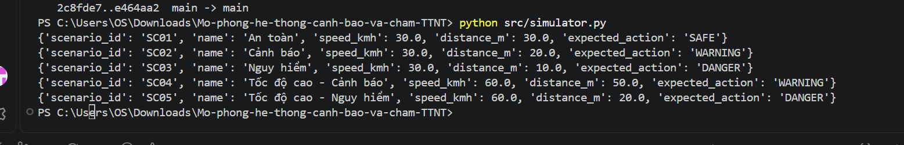

# TV3 — Đọc CSV và tạo kịch bản mô phỏng

> **Thành viên GitHub:** [@hathihongdao](https://github.com/hathihongdao)  
> **Issue được giao:** [#12](https://github.com/foxyy163/Mo-phong-he-thong-canh-bao-va-cham-TTNT/issues/12)  
> **Hạn bàn giao code/giải thích:** trước 21/11/2026  
> **Trạng thái:** Đã hoàn thành code và tài liệu giải thích.

Đọc [README chung](../../../README.md) trước khi code. **Code chính đặt đúng file trong repo**, không sao chép bản code riêng vào thư mục này. Thư mục cá nhân này dành cho giải thích, kết quả chạy và ảnh minh họa nếu có.

## 1. Công việc của mình

- **Phần phụ trách:** Đọc CSV và tạo kịch bản mô phỏng.
- **File code thuộc trách nhiệm:** `src/simulator.py`, `data/scenarios.csv`.
- **Mình đã hoàn thành những gì?** 
   - Chuẩn hóa file `data/scenarios.csv` theo đúng định dạng 5 cột thống nhất (`scenario_id,name,speed_kmh,distance_m,expected_action`) với 5 kịch bản kiểm thử phủ đủ 3 mức `SAFE`, `WARNING`, `DANGER` theo luật W1-02.
   - Xây dựng hàm `load_scenarios()` trong `src/simulator.py` sử dụng `csv.DictReader` của thư viện chuẩn Python để đọc dữ liệu từ CSV, ép kiểu số thực `float`, kiểm tra hợp lệ và loại bỏ hoàn toàn danh sách hard-code.

## 2. Giải thích cách code hoạt động

- **Hàm hoặc thành phần chính mình viết là gì?**
   - `load_scenarios(csv_path: str | Path = DEFAULT_CSV_PATH) -> list[dict]`: Hàm đọc toàn bộ các kịch bản mô phỏng từ file CSV và trả về danh sách các từ điển (`dict`) đã chuẩn hóa kiểu dữ liệu. Tham số `csv_path` mặc định tự động trỏ tới `data/scenarios.csv` tính từ thư mục gốc repository.
- **Dữ liệu đầu vào:**
   - `csv_path` (`str` hoặc `Path`): Đường dẫn tới file CSV gồm 5 cột: `scenario_id` (mã kịch bản), `name` (tên tình huống), `speed_kmh` (tốc độ xe, đơn vị{km/h}), `distance_m` (khoảng cách tới vật cản, đơn vị {m}), và `expected_action` (nhãn hành động kỳ vọng: `SAFE`, `WARNING` hoặc `DANGER`).
- **Dữ liệu đầu ra:** 
   - `list[dict]`: Danh sách các dictionary, mỗi phần tử chứa đúng 5 key tương ứng 5 cột CSV, trong đó `speed_kmh` và `distance_m` đã được chuyển sang kiểu số thực `float`.
- **Các bước xử lý chính:**
1. Kiểm tra sự tồn tại của file CSV qua `path.exists()`; nếu không tồn tại thì ném `FileNotFoundError`.
2. Mở file với mã hóa `UTF-8` bằng `csv.DictReader` và kiểm tra header xem có đủ 5 cột bắt buộc (`REQUIRED_COLUMNS`) hay không.
3. Duyệt từng dòng dữ liệu, ép kiểu `speed_kmh` và `distance_m` sang `float`, đồng thời kiểm tra giá trị phải là số hữu hạn không âm (`math.isfinite` và 0).
4. Làm sạch khoảng trắng thừa ở các trường chuỗi (`.strip()`), đóng gói thành `dict` chuẩn và thêm vào danh sách kết quả.
- **Chương trình của mình gọi module của ai?** 
   - Không gọi module của thành viên khác (chỉ dùng thư viện chuẩn Python: `csv`, `math`, `pathlib`). Đầu ra của `load_scenarios()` được bàn giao làm đầu vào cho TV5 (`compare_scenarios` trong `src/comparison.py`) và TV4 (`app/main.py`).

## 3. Cách chạy và kết quả thực tế

**Lệnh hoặc thao tác chạy:**

```bash
python src/simulator.py
```

| Ví dụ | Input       | Kết quả thực tế  | Đã kiểm tra? |
|-------|-------------|------------------|--------------|
| 1     |SC01,An toàn,|{'scenario_id':   |☑
        |30,30,SAFE   |'SC01', 'name':   |
        |             |'An toàn',        |
        |             |'speed_kmh': 30.0,|
        |             |'expected_action':| 
        |             |'SAFE'}           |  
| 2     |SC02,Cảnh báo|Trả về đúng dict  |☑
        |30,20,WARNING| với speend_kmh:  |
        |và SC03,Nguy | 30.0,distance_m: |
        |hiểm,30,10,  |20.0(WARNING) và  |
        |DANGER       |10.0(DANGER)      |

**Ảnh minh họa (nếu có):** lưu cùng thư mục này và chèn đường dẫn tương đối, ví dụ ``.


## 4. Câu hỏi tự chuẩn bị vấn đáp

1. CSV dùng những cột nào và lý do?
  CSV dùng 5 cột: scenario_id, name, speed_kmh, distance_m, expected_action. Trong đó scenario_id và name giúp định danh, hiển thị tình huống trên giao diện; speed_kmh và distance_m là hai thông số đầu vào truyền cho hàm AI (assess_risk); còn expected_action lưu nhãn kỳ vọng chuẩn để TV5 đối chiếu tự động ra kết quả PASS/FAIL.

2. Hàm load_scenarios() trả về dữ liệu gì?
   Hàm trả về một list[dict], mỗi dictionary tương ứng với một dòng kịch bản trong CSV và có đúng 5 key trùng tên 5 cột. Hai trường speed_kmh và distance_m được ép kiểu thành float để đưa trực tiếp vào tính toán vật lý mà không bị lỗi kiểu chuỗi (str).

3. Ba kịch bản SAFE/WARNING/DANGER được tạo như thế nào?
   Dựa trên công thức W1-02 t = 1s, a = 5m/s^2, k = 1.5, tại vận tốc $30km/h (v ~ 8.33 m/s ngưỡng dừng D_stop ~ 15.28mvà ngưỡng cảnh báo D_warning ~22.92m. Từ đó chọn 3 mốc khoảng cách đại diện: 30 m > D_warning -> SAFE), 20 m D_stop < 20 <= D_warning < WARNING), và 10 m (<= D_stop -> DANGER).

4. Dữ liệu sai định dạng được xử lý ra sao?
 Nếu file CSV không tồn tại, hàm ném FileNotFoundError. Nếu thiếu bất kỳ cột bắt buộc nào trong 5 cột chuẩn, hoặc giá trị speed_kmh / distance_m chứa chữ cái, ký tự lỗi, số âm, NaN hay vô cực, hàm bắt ngoại lệ và ném ValueError kèm thông báo rõ vị trí dòng lỗi.

## 5. Bàn giao

- [x] Code đã đưa lên `main`, đúng file được phân công.
- [x] Chạy thử được, không còn lỗi cú pháp.
- [x]README này đã thay các mục `TODO` / `_[Điền]_` bằng nội dung thật.
- [x] Đã ghi đường dẫn commit trong [issue #12](https://github.com/foxyy163/Mo-phong-he-thong-canh-bao-va-cham-TTNT/issues/12).
- [x] Đã thông báo thành viên phụ thuộc để họ tiếp tục công việc.

**Commit code:**: https://github.com/foxyy163/Mo-phong-he-thong-canh-bao-va-cham-TTNT/commit/6e908922062e22b13abfcba6c492bac2321530e6
