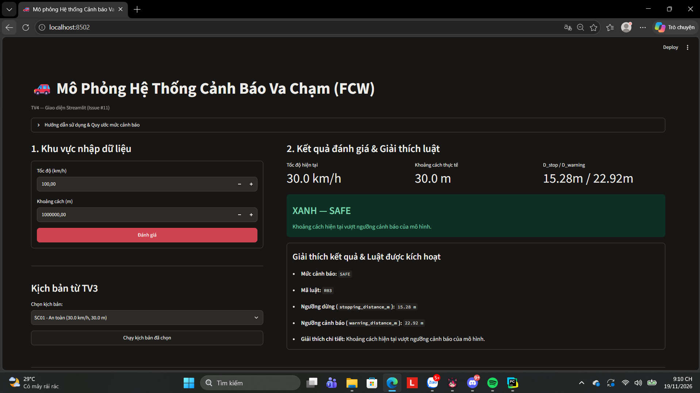
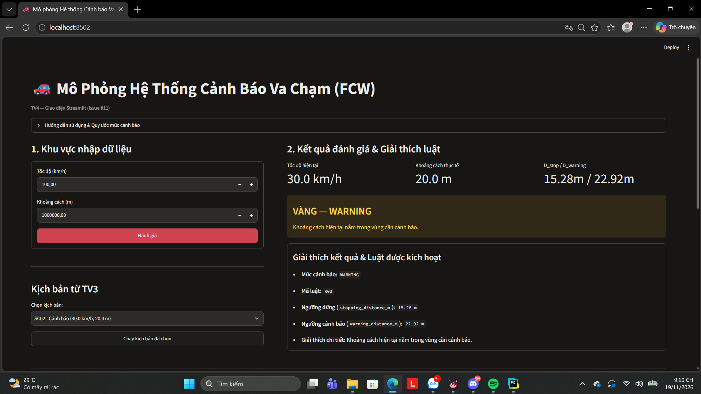
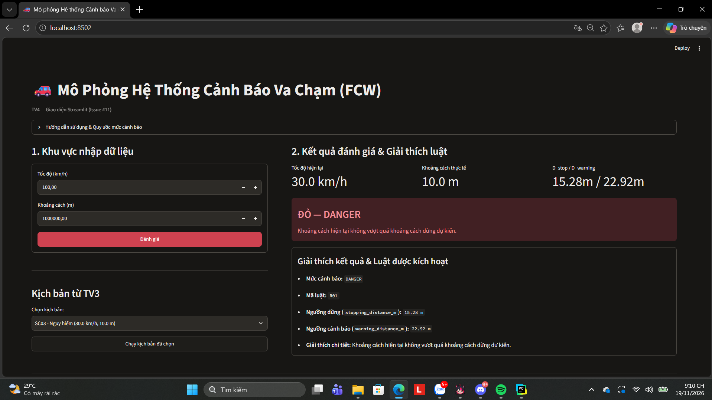
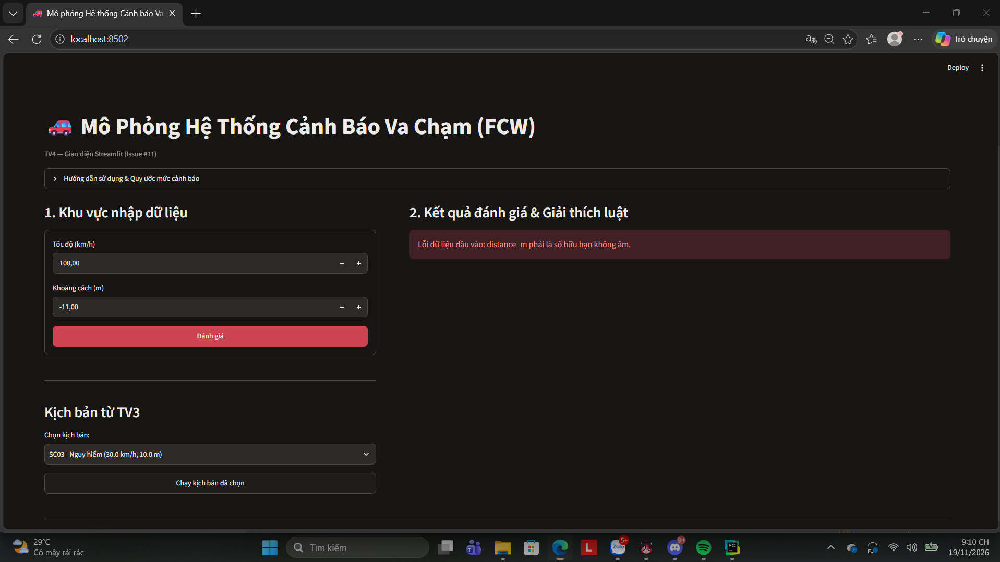

# TV4 — Giao diện Streamlit

> **Thành viên GitHub:** [@ledan823-spec](https://github.com/ledan823-spec)  
> **Issue được giao:** [#11](https://github.com/foxyy163/Mo-phong-he-thong-canh-bao-va-cham-TTNT/issues/11)  
> **Hạn bàn giao code/giải thích:** trước 21/11/2026  
> **Trạng thái:** Đã hoàn thiện code giao diện và tài liệu giải thích trên 'main'

Đọc [README chung](../../../README.md) trước khi code. **Code chính đặt đúng file trong repo**, không sao chép bản code riêng vào thư mục này. Thư mục cá nhân này dành cho giải thích, kết quả chạy và ảnh minh họa nếu có.

## 1. Công việc của mình

- **Phần phụ trách:** Giao diện Streamlit.
- **File code thuộc trách nhiệm:** `app/main.py`.
- **Mình đã hoàn thành những gì?** Xây dựng giao diện Streamlit một trang gồm tiêu đề dự án, hai ô `number_input` cho tốc độ (`km/h`) và khoảng cách (`m`), nút đánh giá, hiển thị trạng thái `SAFE` / `WARNING` / `DANGER` kèm mã luật và lý do, bắt lỗi `ValueError` bằng `st.error`, tích hợp danh sách kịch bản từ TV3 và bảng đối chiếu từ TV5 khi sẵn sàng.

## 2. Giải thích cách code hoạt động

- **Hàm hoặc thành phần chính mình viết là gì?** `_extract_risk_fields(result)`, `_render_risk_output(speed_kmh, distance_m)`, `_format_scenario(item)` cùng các thành phần giao diện Streamlit (`st.title`, `st.form`, `st.number_input`, `st.selectbox`, `st.dataframe`, `st.success`, `st.warning`, `st.error`) trong `app/main.py`.
- **Dữ liệu đầu vào:** `speed_kmh` (`float`, đơn vị `km/h`) và `distance_m` (`float`, đơn vị `m`) nhập từ giao diện hoặc trích xuất từ kịch bản được chọn.
- **Dữ liệu đầu ra:** Thông báo trạng thái (`SAFE`, `WARNING`, `DANGER`) hiển thị qua `st.success` / `st.warning` / `st.error`, kèm mã luật, lý do cảnh báo, thông báo lỗi thân thiện khi gặp `ValueError`, và bảng đối chiếu các kịch bản.
- **Các bước xử lý chính:**
 1. Thêm thư mục gốc repository vào `sys.path` để lệnh `streamlit run app/main.py` import module `src.*` ổn định từ thư mục gốc.
 2. Nhận giá trị `speed_kmh` và `distance_m` từ form nhập tay hoặc từ kịch bản do TV3 cung cấp.
 3. Gọi `assess_risk(speed_kmh, distance_m)` từ `src.warning_engine` và bắt `ValueError` để hiển thị `st.error` rõ ràng.
 4. Ánh xạ kết quả trả về sang `st.success` (`SAFE`), `st.warning` (`WARNING`), hoặc `st.error` (`DANGER`) cùng mã luật và lý do.
 5. Gọi `compare_scenarios(scenarios)` từ `src.comparison` khi khả dụng để hiển thị bảng đối chiếu kịch bản.
- **Chương trình của mình gọi module của ai?** Gọi `assess_risk(speed_kmh, distance_m)` từ `src.warning_engine` (TV2), `load_scenarios()` từ module kịch bản của TV3, và `compare_scenarios(scenarios)` từ `src.comparison` (TV5).

## 3. Cách chạy và kết quả thực tế

**Lệnh hoặc thao tác chạy:**

```bash
streamlit run app/main.py
```

| Ví dụ | Input | Kết quả thực tế | Đã kiểm tra? |
|---|---|---|---|
| 1 | speed_kmh = 30, distance_m = 30 | Trạng thái SAFE (xanh) hiển thị qua st.success cùng mã luật và lý do tương ứng | [x] |
| 2 | speed_kmh = 30, distance_m = 20 | Trạng thái WARNING (vàng) hiển thị qua st.warning cùng mã luật và lý do tương ứng | [x] |
| 3 | speed_kmh = 30, distance_m = 10 | Trạng thái DANGER (đỏ) hiển thị qua st.error cùng mã luật và lý do tương ứng | [x] |
| 4 | Nhập giá trị âm hoặc không hợp lệ gây ValueError | Hiển thị thông báo lỗi thân thiện qua st.error mà không làm sập ứng dụng | [x] |

**Ảnh minh họa (nếu có):** lưu cùng thư mục này và chèn đường dẫn tương đối, ví dụ ``.




## 4. Câu hỏi tự chuẩn bị vấn đáp

1. Vì sao dùng Streamlit?
   - **Trả lời:** Streamlit cho phép dựng nhanh giao diện web tương tác trực tiếp bằng Python, phù hợp để nhập thông số tốc độ/khoảng cách, chọn kịch bản và hiển thị kết quả đánh giá rủi ro cùng bảng đối chiếu mà không cần tách riêng frontend phức tạp.

2. Giao diện gọi hàm AI và Simulator thế nào?
   - **Trả lời:** Giao diện gọi trực tiếp assess_risk(speed_kmh, distance_m) từ src.warning_engine để lấy kết quả đánh giá rủi ro, gọi load_scenarios() để lấy danh sách kịch bản từ TV3, và gọi compare_scenarios(scenarios) từ src.comparison (TV5) để hiển thị bảng so sánh; giao diện không tự sao chép luật cảnh báo hay đọc lại CSV bằng đoạn code riêng.

3. SAFE/WARNING/DANGER được hiển thị bằng màu nào?
   - **Trả lời:** SAFE hiển thị bằng st.success (màu xanh), WARNING hiển thị bằng st.warning (màu vàng), và DANGER hiển thị bằng st.error (màu đỏ), đi kèm mã luật và lý do.

4. Có thể chạy demo nhập tay và kịch bản ra sao?
   - **Trả lời:** Chạy streamlit run app/main.py từ thư mục gốc repo, nhập lần lượt (30, 30) cho SAFE, (30, 20) cho WARNING, (30, 10) cho DANGER rồi bấm Đánh giá; ở phần kịch bản bên dưới, chọn kịch bản từ danh sách của TV3, bấm Chạy kịch bản đã chọn và xem bảng đối chiếu từ TV5.

## 5. Bàn giao

- [x] Code đã đưa lên `main`, đúng file được phân công.
- [x] Chạy thử được, không còn lỗi cú pháp.
- [x] README này đã thay các mục `TODO` / `_[Điền]_` bằng nội dung thật.
- [ ] Đã ghi đường dẫn commit trong [issue #11](https://github.com/foxyy163/Mo-phong-he-thong-canh-bao-va-cham-TTNT/issues/11).
- [ ] Đã thông báo thành viên phụ thuộc để họ tiếp tục công việc.

**Commit code:** _[Dán link commit tại đây sau khi hoàn thành.]_
