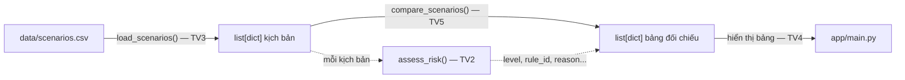
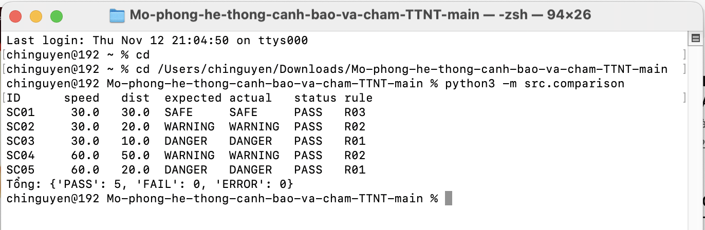

# TV5 — So sánh kết quả kỳ vọng và thực tế

> **Thành viên GitHub:** [@nguyenvc2772-sys](https://github.com/nguyenvc2772-sys)  
> **Issue được giao:** [#10](https://github.com/foxyy163/Mo-phong-he-thong-canh-bao-va-cham-TTNT/issues/10)  
> **Hạn bàn giao code/giải thích:** trước 21/11/2026  
> **Trạng thái:** Đã hoàn thành code và tài liệu giải thích. Đã chạy thử với code thật của TV2 và dữ liệu thật của TV3.

Đọc [README chung](../../../README.md) trước khi code. **Code chính đặt đúng file trong repo**, không sao chép bản code riêng vào thư mục này. Thư mục cá nhân này dành cho giải thích, kết quả chạy và ảnh minh họa nếu có.

## 1. Công việc của mình

- **Phần phụ trách:** So sánh kết quả kỳ vọng và thực tế.
- **File code thuộc trách nhiệm:** `src/comparison.py`.
- **Mình đã hoàn thành những gì?**
  - Viết hàm `compare_scenarios(scenarios)` đúng hợp đồng ở README chung mục 3.
  - Với mỗi kịch bản, gọi `assess_risk` của TV2 rồi so `expected_action` (từ CSV của TV3) với `level` mà AI trả về, ra kết quả `PASS` / `FAIL` / `ERROR`.
  - Một kịch bản lỗi không làm dừng cả bảng; các kịch bản còn lại vẫn được so sánh.
  - Có chế độ chạy thử: `python -m src.comparison` in bảng đối chiếu và số lượng PASS/FAIL/ERROR.
  - Chạy thử bảng kiểm tra tay bắt buộc của W1-05 và ghi lại hạn chế của mô phỏng (mục 3).

### Luồng dữ liệu giữa các module



## 2. Giải thích cách code hoạt động

- **Hàm hoặc thành phần chính mình viết là gì?**
  - `compare_scenarios(scenarios: list[dict]) -> list[dict]` — hàm chính, thành viên khác gọi hàm này.
  - `_compare_one(scenario: dict) -> dict` — hàm phụ xử lý **một** kịch bản (dấu `_` nghĩa là chỉ dùng nội bộ).
  - `_normalize_expected(value)` — bỏ khoảng trắng thừa và viết hoa `expected_action` lấy từ CSV.
  - Hằng số `VALID_LEVELS = ("SAFE", "WARNING", "DANGER")` — ba mã hợp lệ.
- **Dữ liệu đầu vào:** danh sách dict lấy từ `load_scenarios()` của TV3. Mỗi dict có `scenario_id` (str), `name` (str), `speed_kmh` (float, km/h), `distance_m` (float, m), `expected_action` (`SAFE`/`WARNING`/`DANGER`).
- **Dữ liệu đầu ra:** danh sách dict cùng độ dài và cùng thứ tự với đầu vào. Mỗi dòng có các key sau:

  | Key | Ý nghĩa | Khi `ERROR` |
  |---|---|---|
  | `scenario_id`, `name`, `speed_kmh`, `distance_m`, `expected_action` | Sao chép từ CSV | giữ nguyên |
  | `actual_level` | Mức do AI tính: `SAFE`/`WARNING`/`DANGER` | `None` |
  | `status` | `PASS` / `FAIL` / `ERROR` | `"ERROR"` |
  | `reason` | Lời giải thích của AI (TV2) | `""` |
  | `rule_id` | `R01` / `R02` / `R03` | `""` |
  | `stopping_distance_m`, `warning_distance_m` | Hai ngưỡng khoảng cách AI dùng (m) | `None` |
  | `error` | Nội dung lỗi | mô tả lỗi |

  Bảy key đầu (đến `status`) là phần **bắt buộc** theo hợp đồng của nhóm trưởng; bốn key còn lại mình thêm để giao diện giải thích được *vì sao* ra kết quả đó.
- **Các bước xử lý chính:**
  1. Duyệt từng kịch bản trong danh sách; nếu phần tử không phải dict thì coi như dữ liệu rỗng và sẽ ra `ERROR`, không làm chương trình dừng.
  2. Kiểm tra `expected_action` có thuộc `SAFE/WARNING/DANGER` hay không (đã bỏ khoảng trắng, viết hoa). Không thuộc → `ERROR`.
  3. Gọi `assess_risk(speed_kmh, distance_m)` của TV2 trong khối `try/except`. Nếu AI ném lỗi (ví dụ số âm, NaN, sai kiểu) → `ERROR`, ghi nội dung lỗi vào `error`.
  4. Kiểm tra `level` AI trả về có **đúng** một trong ba mã chuẩn không. Không đúng → `ERROR`.
  5. So sánh `actual_level` với `expected_action`: bằng nhau → `PASS`, khác nhau → `FAIL`.
- **Chương trình của mình gọi module của ai?**
  - `assess_risk(speed_kmh, distance_m)` của TV2 (`src/warning_engine.py`) để lấy kết quả thực tế. **Mình không chép lại luật IF–THEN**, nên nếu TV2 chỉnh luật thì kết quả so sánh tự cập nhật theo.
  - `load_scenarios()` của TV3 (`src/simulator.py`) — chỉ dùng trong phần chạy thử `__main__`. Hàm `compare_scenarios` không tự đọc CSV mà nhận danh sách từ bên ngoài.

### Ý nghĩa PASS / FAIL / ERROR (phân biệt rõ)

| Status | Khi nào | Ý nghĩa với nhóm |
|---|---|---|
| `PASS` | AI chạy được và `actual_level == expected_action` | Luật AI khớp với kỳ vọng |
| `FAIL` | AI chạy được nhưng ra mức **khác** kỳ vọng | Luật AI hoặc `expected_action` trong CSV bị sai — cần xem lại |
| `ERROR` | Không thể so sánh (dữ liệu sai, kỳ vọng lạ, AI trả mã lạ) | Lỗi dữ liệu hoặc lỗi tích hợp — xem cột `error` |

### Mình có thể giải thích những dòng xử lý quan trọng nào?

**1. Cô lập lỗi từng kịch bản** — đây là lý do một dòng lỗi không làm sập cả bảng:

```python
try:
    result = assess_risk(row["speed_kmh"], row["distance_m"])
except Exception as exc:
    row["error"] = f"{type(exc).__name__}: {exc}"
    return row          # dòng này giữ status = "ERROR", các kịch bản khác vẫn chạy
```

**2. Kiểm tra AI có tuân thủ hợp đồng không** — `actual_level` phải *đúng* `SAFE/WARNING/DANGER`, mình không tự sửa chữ hoa/thường. Nếu TV2 trả nhãn sai (ví dụ `"An toàn"`), bảng báo `ERROR` ngay thay vì che lỗi:

```python
actual = result.get("level") if isinstance(result, dict) else None
if actual not in VALID_LEVELS:
    row["error"] = f"assess_risk trả level ngoài SAFE/WARNING/DANGER: {result!r}"
    return row
```

Ngược lại `expected_action` là do người gõ trong CSV nên mình chấp nhận sai khác nhỏ (khoảng trắng, chữ hoa/thường).

**3. Quyết định PASS/FAIL** — một dòng duy nhất:

```python
row["status"] = "PASS" if actual == expected else "FAIL"
```

## 3. Cách chạy và kết quả thực tế

**Lệnh hoặc thao tác chạy:**

```bash
# Đứng ở thư mục gốc của repo
git pull --ff-only origin main
python -m src.comparison
```

> Cũng chạy được bằng `python src/comparison.py`. Lệnh `python -m src.comparison` là cách chuẩn vì giống cách giao diện import module. Chỉ dùng thư viện chuẩn của Python nên không cần cài thêm gói nào. Trên macOS/Linux dùng `python3` thay cho `python`.

**Kết quả chạy thật** (với `src/warning_engine.py` của TV2 và `data/scenarios.csv` của TV3 trên `main`, commit `4915ebf`):

```text
ID      speed   dist  expected actual   status rule
SC01     30.0   30.0  SAFE     SAFE     PASS   R03
SC02     30.0   20.0  WARNING  WARNING  PASS   R02
SC03     30.0   10.0  DANGER   DANGER   PASS   R01
SC04     60.0   50.0  WARNING  WARNING  PASS   R02
SC05     60.0   20.0  DANGER   DANGER   PASS   R01
Tổng: {'PASS': 5, 'FAIL': 0, 'ERROR': 0}
```

| Ví dụ | Input (km/h, m) | Kết quả thực tế | Đã kiểm tra? |
|---|---|---|---|
| 1. SC01 | 30, 30 — kỳ vọng `SAFE` | `SAFE`, luật R03 → **PASS** | ☑ |
| 2. SC02 | 30, 20 — kỳ vọng `WARNING` | `WARNING`, luật R02 (D_stop ≈ 15.28 m < 20 ≤ D_warning ≈ 22.92 m) → **PASS** | ☑ |
| 3. SC03 | 30, 10 — kỳ vọng `DANGER` | `DANGER`, luật R01 → **PASS** | ☑ |
| 4. SC04 | 60, 50 — kỳ vọng `WARNING` | `WARNING`, luật R02 → **PASS** | ☑ |
| 5. SC05 | 60, 20 — kỳ vọng `DANGER` | `DANGER`, luật R01 → **PASS** | ☑ |

### Kết quả kiểm tra tích hợp với module của TV2 và TV3

Chạy trên `main` (commit `4915ebf`):

- **TV3 — `load_scenarios()`:** trả 5 dict, mỗi dict đủ đúng 5 key; `speed_kmh` và `distance_m` là `float`; `expected_action` đều thuộc `SAFE/WARNING/DANGER` và có đủ cả 3 mức.
- **TV2 — `assess_risk()`:** trả đúng 5 trường (`level`, `reason`, `rule_id`, `stopping_distance_m`, `warning_distance_m`); `level` là mã chuẩn, `rule_id` thuộc `R01/R02/R03`.
- **Ghép lại:** `compare_scenarios(load_scenarios())` ra 5/5 `PASS`. Hai module đủ điều kiện để TV4 kết nối giao diện.

### Bảng kiểm tra tay bắt buộc của W1-05

| Dữ liệu | Expected (W1-05) | Kết quả thực tế | Khớp? |
|---|---|---|---|
| 30 km/h, 30 m | SAFE | `SAFE` (R03) — trùng SC01 | ☑ |
| 30 km/h, 20 m | WARNING | `WARNING` (R02) — trùng SC02 | ☑ |
| 30 km/h, 10 m | DANGER | `DANGER` (R01) — trùng SC03 | ☑ |
| 60 km/h, 50 m | WARNING | `WARNING` (R02) — trùng SC04 | ☑ |
| Tốc độ âm (ví dụ −20 km/h, 40 m) | ValueError / thông báo lỗi | `assess_risk` ném `ValueError: speed_kmh phải là số hữu hạn không âm.`; qua `compare_scenarios` dòng đó thành `ERROR` kèm nội dung lỗi | ☑ |

### Các trường hợp biên và lỗi đã thử

| Tình huống | Kết quả | Giải thích |
|---|---|---|
| Kỳ vọng `SAFE` nhưng input `30 km/h, 10 m` | `FAIL` | AI ra `DANGER`, khác kỳ vọng |
| `36 km/h, 20 m` (đúng bằng `D_stop`) | `DANGER` → PASS | R01 dùng dấu `<=` |
| `36 km/h, 30 m` (đúng bằng `D_warning`) | `WARNING` → PASS | R02 dùng dấu `<=` |
| `0 km/h, 0 m` | `DANGER` → PASS | Quy ước MVP: khoảng cách 0 luôn nguy hiểm |
| Tốc độ âm / `NaN` / `inf` / chuỗi / `None` | `ERROR` | `ValueError` của TV2 được bắt lại |
| `expected_action = "An toàn"` (nhãn tiếng Việt) | `ERROR` | Không thuộc `SAFE/WARNING/DANGER` |
| `expected_action = " safe "` | `PASS` | Đã bỏ khoảng trắng và viết hoa |
| AI trả `level` viết thường hoặc thiếu `level` | `ERROR` | Vi phạm hợp đồng, không tự sửa |
| Phần tử trong danh sách không phải dict | `ERROR` | Không làm chương trình dừng |
| Danh sách rỗng | `[]` | Không lỗi |

### Đánh giá và hạn chế của mô phỏng (dùng cho báo cáo Word)

**Đánh giá:** với 5 kịch bản mẫu phủ đủ 3 mức, hệ thống đạt 5/5 `PASS`. Các ca biên (`distance_m` bằng đúng `D_stop` hoặc `D_warning`, xe đứng yên) và dữ liệu sai (số âm, `NaN`, `inf`, chuỗi) đều cho kết quả đúng như thiết kế, kịch bản lỗi chỉ ảnh hưởng đúng dòng của nó.

**Hạn chế và lưu ý:**

- **PASS chỉ nghĩa là AI nhất quán với CSV.** `expected_action` trong CSV được tính theo cùng công thức W1-02 mà TV2 cài đặt, nên PASS không chứng minh công thức đúng với xe thật.
- **Chỉ có 5 kịch bản mẫu** (đủ 3 mức), không phủ hết mọi tổ hợp tốc độ/khoảng cách.
- **Chỉ so nhãn mức cảnh báo.** Mình không so nội dung `reason` và không kiểm tra giao diện.
- **Tham số cố định theo giả định học tập:** `t = 1 s`, `a = 5 m/s²`, `k = 1.5`; chưa xét thời tiết, mặt đường, xe khác hay cảm biến thật (theo README của TV2). Hệ thống chỉ phục vụ học tập, không dùng cho xe thật.
- **Bộ 12 test case trong bản thiết kế Week 1 gốc của W1-05 dùng ngưỡng cũ (1,5 s / 3 s)**, nằm trong phần tham khảo của `docs/week 1/requirements_testplan.md`. Chạy với công thức MVP hiện hành, trong 8 ca bình thường và biên (TC-01 đến TC-08) có 6 ca cho cùng kết quả, riêng **TC-02** (60 km/h, 35 m) và **TC-08** (72 km/h, 60 m) ra `DANGER` thay vì `WARNING`. Theo chỉ dẫn của nhóm, quy ước MVP được ưu tiên; đây không phải lỗi code. Ngoài ra Week 1 từng đề xuất giới hạn tốc độ ≤ 200 và khoảng cách ≤ 500, còn code MVP chỉ yêu cầu số hữu hạn không âm.

**Ảnh minh họa:** kết quả chạy thật lệnh `python3 -m src.comparison` trên bản tải về từ `main` (5/5 kịch bản `PASS`).



## 4. Câu hỏi tự chuẩn bị vấn đáp

1. expected_action và actual_level khác nhau ra sao?
   - **Trả lời:** `expected_action` là mức cảnh báo *con người dự kiến* cho kịch bản, ghi sẵn trong CSV (do TV3 cung cấp). `actual_level` là mức *AI thực sự tính ra* khi gọi `assess_risk` (do TV2 viết). Đối chiếu hai giá trị này để kiểm tra luật AI có cho kết quả đúng như kỳ vọng hay không.

2. PASS/FAIL/ERROR được xác định thế nào?
   - **Trả lời:** `PASS` khi `actual_level` bằng `expected_action`. `FAIL` khi AI chạy bình thường nhưng ra mức khác kỳ vọng. `ERROR` khi không thể so sánh: dữ liệu sai khiến `assess_risk` ném `ValueError`, `expected_action` không nằm trong `SAFE/WARNING/DANGER`, hoặc AI trả `level` ngoài ba mã chuẩn.

3. Hàm compare_scenarios(scenarios) nhận và trả dữ liệu gì?
   - **Trả lời:** Nhận một danh sách dict kịch bản (kết quả của `load_scenarios()`), trả một danh sách dict cùng độ dài và thứ tự. Mỗi dòng gồm thông tin kịch bản, `actual_level`, `status`, và thêm `reason`, `rule_id`, hai ngưỡng khoảng cách và `error`.

4. Bạn xử lý trường hợp một kịch bản bị lỗi như thế nào?
   - **Trả lời:** Mỗi kịch bản được xử lý trong `try/except` riêng. Lỗi chỉ biến dòng đó thành `ERROR` kèm nội dung ở cột `error`, `actual_level` là `None`; các kịch bản khác vẫn chạy bình thường nên giao diện không bị sập.

5. Vì sao không viết lại luật IF–THEN trong `comparison.py`?
   - **Trả lời:** Vì nếu chép luật ra hai nơi thì có thể lệch nhau, và khi đó so sánh chỉ là so luật của mình với chính nó. Gọi trực tiếp `assess_risk` của TV2 thì kết quả đối chiếu phản ánh đúng hệ thống thật, và tuân theo hợp đồng "không tự chép lại luật" của nhóm.

6. PASS toàn bộ có chứng minh hệ thống cảnh báo đúng ngoài đời không?
   - **Trả lời:** Không. PASS chỉ cho biết code của TV2 cho kết quả nhất quán với CSV của TV3, mà CSV được tính theo cùng công thức giả định. Công thức dùng tham số cố định (`t = 1 s`, `a = 5 m/s²`, `k = 1.5`) và không có cảm biến thật, nên đây là mô phỏng học tập.

7. Vì sao cần dữ liệu SAFE/WARNING/DANGER?
   - **Trả lời:** Ba mức tương ứng ba nhánh của luật AI (R03 → `SAFE`, R02 → `WARNING`, R01 → `DANGER`). Bộ kịch bản phải có đủ cả ba mức thì mới kiểm tra được từng nhánh; nếu chỉ có một mức, luật sai ở hai nhánh còn lại vẫn không bị phát hiện. Ngoài ra ba mã này là chuẩn chung giữa TV2, TV3, TV4 nên có thể so sánh trực tiếp bằng `==` mà không phải quy đổi nhãn.

## 5. Bàn giao

### Hướng dẫn cho thành viên làm tiếp (TV4 và TV1)

**TV4 — dùng trong `app/main.py`:**

```python
import sys
from pathlib import Path

# BẮT BUỘC: Streamlit chạy file trong app/ nên phải thêm thư mục gốc repo vào sys.path,
# nếu không sẽ lỗi "ModuleNotFoundError: No module named 'src'".
sys.path.insert(0, str(Path(__file__).resolve().parent.parent))

import streamlit as st
from src.simulator import load_scenarios
from src.comparison import compare_scenarios

rows = compare_scenarios(load_scenarios())        # list[dict]
st.dataframe(rows)                                # hiện thẳng thành bảng

passed = sum(r["status"] == "PASS" for r in rows)
st.write(f"PASS {passed}/{len(rows)}")
for r in rows:
    if r["status"] == "PASS":
        st.success(f"{r['scenario_id']}: {r['actual_level']}")
    elif r["status"] == "FAIL":
        st.warning(f"{r['scenario_id']}: kỳ vọng {r['expected_action']}, thực tế {r['actual_level']}")
    else:
        st.error(f"{r['scenario_id']}: {r['error']}")
```

Mình đã chạy thử đoạn trên trong Streamlit với dữ liệu thật: hiện đủ 5 dòng PASS và không lỗi. Bỏ dòng `sys.path.insert` thì lỗi `No module named 'src'`.

Những điều cần nhớ khi hiển thị:

- `status` chỉ có `PASS`, `FAIL`, `ERROR` (viết hoa). Gợi ý màu: `PASS` → `st.success`, `FAIL` → `st.warning`, `ERROR` → `st.error`.
- Dòng `ERROR` có `actual_level = None` và `stopping_distance_m = None`; **hãy kiểm tra `None` trước khi làm tròn hoặc format số**, và hiện nội dung cột `error` cho người dùng đọc.
- `speed_kmh`, `distance_m` và hai cột ngưỡng là `float` nhiều chữ số thập phân; nên làm tròn khi hiển thị (ví dụ `round(x, 2)`), không làm tròn trong dữ liệu.
- Đừng tự so sánh `expected_action` với `actual_level` trong giao diện; dùng `status` đã tính sẵn.
- Với dữ liệu người dùng nhập tay, vẫn gọi `assess_risk` trực tiếp và bắt `ValueError`. `compare_scenarios` chỉ dành cho các kịch bản từ CSV.

**TV1 — khi tích hợp và nghiệm thu:**

1. Chạy `python -m src.comparison` từ thư mục gốc; kỳ vọng `Tổng: {'PASS': 5, 'FAIL': 0, 'ERROR': 0}`.
2. Nếu thấy `ERROR` với nội dung "level ngoài SAFE/WARNING/DANGER" nghĩa là `warning_engine.py` đang trả nhãn sai hợp đồng.
3. Nếu thấy `FAIL`, so `expected_action` trong `data/scenarios.csv` với kết quả tính tay trong README của TV2 để biết lỗi nằm ở CSV hay luật AI.
4. Nếu chạy báo "Không đọc được kịch bản từ CSV", lỗi nằm ở `data/scenarios.csv` (thiếu cột hoặc giá trị không phải số), không phải ở `comparison.py`.
5. Hợp đồng đã chốt, **không đổi tên** hàm `compare_scenarios` và các key trong bảng ở mục 2 nếu không báo cả nhóm.

### Danh sách kiểm tra bàn giao

- [x] Code đã đưa lên `main`, đúng file được phân công.
- [x] Chạy thử được, không còn lỗi cú pháp.
- [x] README này đã thay các mục `TODO` / `_[Điền]_` bằng nội dung thật.
- [ ] Đã ghi đường dẫn commit trong [issue #10](https://github.com/foxyy163/Mo-phong-he-thong-canh-bao-va-cham-TTNT/issues/10).
- [ ] Đã thông báo thành viên phụ thuộc để họ tiếp tục công việc.

**Commit code:** [9426984](https://github.com/foxyy163/Mo-phong-he-thong-canh-bao-va-cham-TTNT/commit/9426984a84c27d0fe4b73147127d3ad85665a267) — thêm `src/comparison.py`.  
**Commit tài liệu:** [6ba9a6a](https://github.com/foxyy163/Mo-phong-he-thong-canh-bao-va-cham-TTNT/commit/6ba9a6a1266f4351db3e0a9b0575f24ed261fae0) — README giải thích (ảnh kết quả `ket-qua.png` nằm cùng thư mục).
