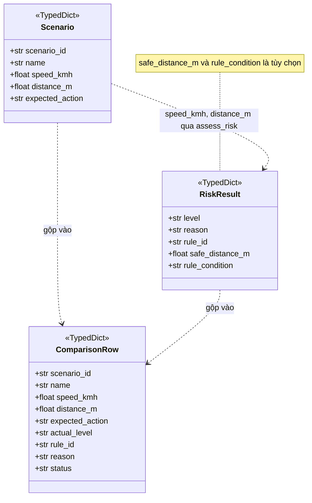
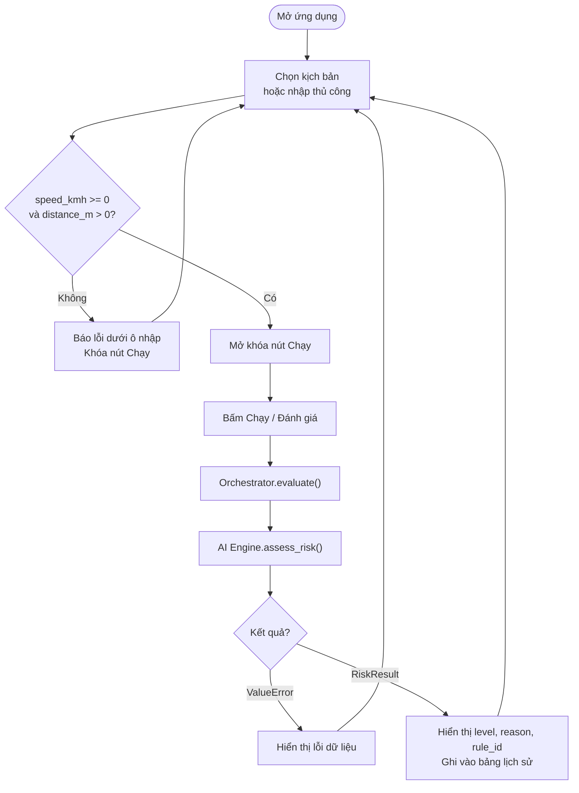
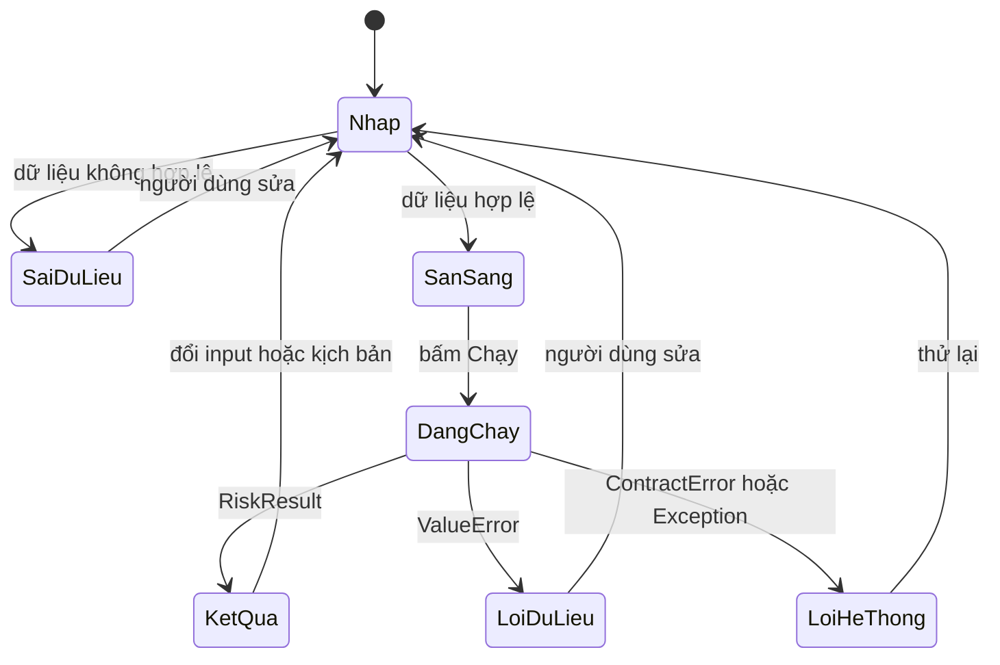
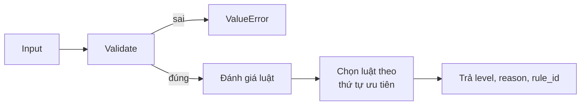
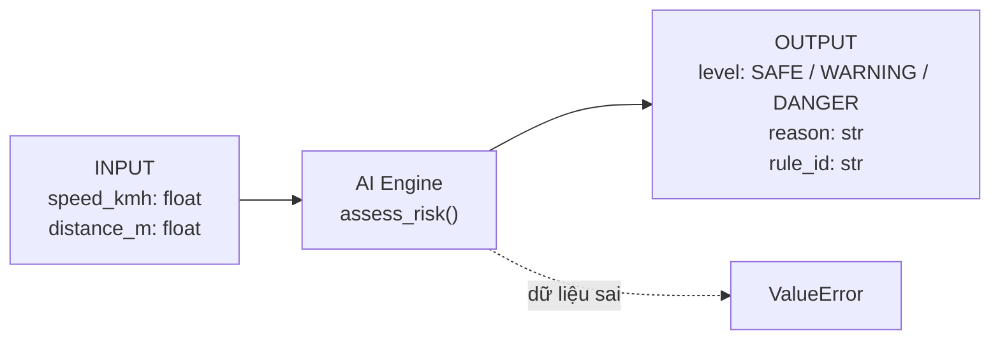

# Week 1 – System Design

> **Dự án:** Mô phỏng hệ thống cảnh báo va chạm (Forward Collision Warning – FCW)
> **Issue:** W1-01 – System Architecture & Integration
> **Phiên bản contract:** `v1.0` (DRAFT – chờ xác nhận, xem mục 16)
> **Mục đích:** Đặc tả chi tiết và ràng buộc giao tiếp giữa các module trước khi code Week 2.
> **Đọc cùng:** [`architecture.md`](architecture.md) (kiến trúc tổng thể, sơ đồ, quy trình tích hợp)

---

## Mục lục

1. [Vai trò tài liệu và nguồn sự thật](#1-vai-trò-tài-liệu-và-nguồn-sự-thật)
2. [Mục tiêu và phạm vi](#2-mục-tiêu-và-phạm-vi)
3. [Cấu trúc module](#3-cấu-trúc-module)
4. [Đặc tả dữ liệu](#4-đặc-tả-dữ-liệu)
5. [Giao diện hàm](#5-giao-diện-hàm)
6. [Hợp đồng lỗi](#6-hợp-đồng-lỗi)
7. [Luồng giao diện](#7-luồng-giao-diện)
8. [Bộ luật cảnh báo](#8-bộ-luật-cảnh-báo)
9. [Kiểm tra nhất quán kịch bản và luật](#9-kiểm-tra-nhất-quán-kịch-bản-và-luật)
10. [Đối chiếu code hiện tại với contract](#10-đối-chiếu-code-hiện-tại-với-contract)
11. [Các trường hợp kiểm thử tối thiểu](#11-các-trường-hợp-kiểm-thử-tối-thiểu)
12. [Quyết định kỹ thuật](#12-quyết-định-kỹ-thuật)
13. [Quy ước đặt tên](#13-quy-ước-đặt-tên)
14. [Quy trình Git và kiểm soát thay đổi](#14-quy-trình-git-và-kiểm-soát-thay-đổi)
15. [Vấn đề còn mở](#15-vấn-đề-còn-mở)
16. [Xác nhận và checklist trước Week 2](#16-xác-nhận-và-checklist-trước-week-2)
17. [Kết luận](#17-kết-luận)

---

## 1. Vai trò tài liệu và nguồn sự thật

Mỗi nội dung chỉ được định nghĩa **ở một nơi**. Các tài liệu khác chỉ tham chiếu.

| Nội dung | Nguồn sự thật | Owner |
|---|---|---|
| Kiến trúc, module, sơ đồ, tích hợp | `architecture.md` | TV1 |
| Contract dữ liệu và hàm (tài liệu này) | `system_design.md` | TV1 |
| Ngưỡng, luật IF–THEN, `rule_id`, thứ tự ưu tiên | `warning_rules.md` | TV2 |
| Danh sách kịch bản và `expected_action` | `simulation_scenarios.md` + `data/scenarios.csv` | TV3 |
| Bố cục, thông báo, thành phần Streamlit | `ui_design.md` | TV4 |
| Yêu cầu, PEAS, test case | `requirements_testplan.md` | TV5 |

**Nguyên tắc xung đột:** nếu hai tài liệu mâu thuẫn, tài liệu sở hữu nội dung đó được ưu tiên. Riêng giá trị `expected_action` của kịch bản **phải khớp** `warning_rules.md` (xem mục 9).

---

## 2. Mục tiêu và phạm vi

### 2.1. Mục tiêu

Mô phỏng khả năng đánh giá nguy cơ va chạm dựa trên **tốc độ phương tiện** và **khoảng cách đến vật cản**, bằng Rule-Based Inference (luật IF–THEN), phân loại thành `SAFE`, `WARNING`, `DANGER`. Giao diện Streamlit cho phép nhập dữ liệu hoặc chọn kịch bản.

### 2.2. Phạm vi

| Có thực hiện | Không thực hiện |
|---|---|
| Python 3.10+, Streamlit | Machine Learning, Deep Learning |
| Rule-Based AI | Database, REST API, Docker |
| Simulator + CSV | Frontend/backend tách biệt |
| Unit test (`unittest`) | Cảm biến thật, điều khiển xe thật |
| So sánh kịch bản | Mô phỏng 3D |
| Hiển thị mức cảnh báo, lý do, mã luật | |
| Quản lý bằng GitHub | |

### 2.3. Giả định mô phỏng (theo W1-03)

Xe chạy đường thẳng, vận tốc coi là hằng số tại thời điểm đánh giá, vật cản là vật tĩnh cùng làn, hệ thống đánh giá **một bước thời gian** (không mô phỏng chuỗi thời gian).

---

## 3. Cấu trúc module

```text
project/
├── app/
│   └── main.py                 # UI Streamlit
├── src/
│   ├── __init__.py
│   ├── contracts.py            # Level, TypedDict, exception dùng chung
│   ├── warning_engine.py       # assess_risk()
│   ├── simulator.py            # load_scenarios()
│   └── orchestrator.py         # evaluate(), run_scenario(), ...
├── data/
│   └── scenarios.csv
├── tests/
│   ├── __init__.py
│   ├── test_contract.py
│   ├── test_warning.py
│   ├── test_simulator.py
│   └── test_orchestrator.py
└── docs/
    └── week1/
        ├── architecture.md
        ├── system_design.md
        ├── warning_rules.md
        ├── simulation_scenarios.md
        ├── ui_design.md
        ├── requirements_testplan.md
        └── assets/
```

| Thành phần | Trách nhiệm |
|---|---|
| `app/main.py` | Hiển thị, nhập liệu, ánh xạ `level` → màu/nhãn. Chỉ gọi Orchestrator |
| `src/orchestrator.py` | Điều phối, kiểm tra contract, so `expected_action` với kết quả |
| `src/warning_engine.py` | Kiểm tra input, áp luật, trả `RiskResult` |
| `src/simulator.py` | Đọc và kiểm tra **định dạng** kịch bản từ CSV |
| `src/contracts.py` | Kiểu dữ liệu, hằng số, exception dùng chung |
| `tests/` | Kiểm thử theo contract |

> Repo hiện có `docs/week 1/` và `docs/huong dan/` (có dấu cách). Nên đổi thành `docs/week1/` và `docs/huong-dan/` bằng `git mv` để link không bị lỗi.

---

## 4. Đặc tả dữ liệu

### 4.1. Đầu vào của AI Engine

| Tên | Kiểu | Đơn vị | Điều kiện hợp lệ |
|---|---|---|---|
| `speed_kmh` | `float` | km/h | `>= 0`, hữu hạn |
| `distance_m` | `float` | m | `> 0`, hữu hạn |

Chấp nhận `int` và `float` (số nguyên được hiểu như `float`). **Không** chấp nhận `bool`, `None`, chuỗi.

### 4.2. Bảng kiểm tra dữ liệu (do AI Engine thực hiện)

| Trường hợp | Ví dụ | Kết quả |
|---|---|---|
| Hợp lệ | `(80.0, 15.0)` | Chạy luật |
| Tốc độ bằng 0 | `(0, 20)` | **Hợp lệ**, kết quả theo luật (kỳ vọng `SAFE`, TV2 xác nhận) |
| Tốc độ âm | `(-1, 10)` | `ValueError` |
| Khoảng cách bằng 0 | `(50, 0)` | `ValueError` |
| Khoảng cách âm | `(50, -5)` | `ValueError` |
| NaN hoặc vô cực | `(float("nan"), 10)` | `ValueError` |
| `None`, chuỗi, `bool` | `("abc", 10)` | `ValueError` |

**Về `distance_m = 0`:** trong phạm vi mô phỏng *cảnh báo trước va chạm*, 0 m là dữ liệu không hợp lệ. UI có thể hiển thị thông điệp riêng ("Khoảng cách bằng 0 m: va chạm đã xảy ra…") nhưng vẫn **khóa nút Chạy** và **không** gọi AI. Nếu sau này muốn mô phỏng trạng thái "đã va chạm" thì phải thiết kế một trạng thái/domain riêng, không tự coi `distance_m = 0` là `DANGER`.

**Về giá trị biên:** `warning_rules.md` phải ghi rõ mỗi ngưỡng dùng `>=`, `>`, `<=` hay `<`, vì test biên phụ thuộc vào đó.

### 4.3. Đầu ra của AI Engine (`RiskResult`)

```python
{
    "level": "DANGER",
    "reason": "Tốc độ cao và khoảng cách rất gần.",
    "rule_id": "R03",
}
```

| Field | Kiểu | Bắt buộc | Ràng buộc |
|---|---|:---:|---|
| `level` | `str` | Có | Thuộc `{"SAFE", "WARNING", "DANGER"}` |
| `reason` | `str` | Có | Không rỗng, tiếng Việt, người dùng đọc hiểu được |
| `rule_id` | `str` | Có | Khớp `^R\d{2}$` (ví dụ `R01`), theo `warning_rules.md` |

**Field tùy chọn (đề xuất, chờ TV2 và TV4 xác nhận):**

| Field | Kiểu | Dùng cho |
|---|---|---|
| `safe_distance_m` | `float` | Thẻ "Khoảng cách an toàn khuyến nghị" trên UI |
| `rule_condition` | `str` | Hiển thị biểu thức `IF … THEN …` của luật |

UI **phải** đọc field tùy chọn bằng `result.get("safe_distance_m")` và ẩn phần hiển thị nếu không có. Thêm field tùy chọn không phải là thay đổi phá contract.

Luật mặc định (khi không luật nào khớp) cũng phải có `rule_id` riêng, do `warning_rules.md` đặt tên.

### 4.4. Mã mức cảnh báo và ánh xạ giao diện

Giá trị nội bộ: `SAFE`, `WARNING`, `DANGER`. AI Engine **chỉ trả mã**, không trả tên hiển thị.

| `level` | Mã màu UI | Nhãn hiển thị | Thành phần Streamlit | Màu |
|---|---|---|---|---|
| `SAFE` | GREEN | 🟢 AN TOÀN | `st.success()` | `#28a745` |
| `WARNING` | YELLOW | 🟡 CẢNH BÁO | `st.warning()` | `#ffc107` |
| `DANGER` | RED | 🔴 NGUY HIỂM | `st.error()` | `#dc3545` |

Bảng ánh xạ này nằm **trong `app/main.py`**. `GREEN/YELLOW/RED` không được xuất hiện trong `src/`.

**Đối chiếu với `ui_design.md` mục 8:**

| Field `ui_design.md` mong đợi | Quy về contract |
|---|---|
| `speed`, `distance` | `speed_kmh`, `distance_m` |
| `scenario` (tên kịch bản) | UI và Orchestrator giữ, **không** truyền vào `assess_risk()` |
| `alert_level` (`GREEN`…) | UI suy ra từ `level` |
| `alert_label` | UI suy ra từ `level` |
| `safe_distance` | `safe_distance_m` (tùy chọn) |
| `rule_id` | `rule_id` |
| `rule_condition` | `rule_condition` (tùy chọn) |
| `explanation` | `reason` |

### 4.5. Kịch bản (`Scenario`) và `scenarios.csv`

Header CSV chuẩn:

```csv
scenario_id,name,speed_kmh,distance_m,expected_action
```

| Cột | Kiểu | Ràng buộc |
|---|---|---|
| `scenario_id` | `str` | Duy nhất, khớp `^SC_\d{2}_[A-Z0-9_]+$` |
| `name` | `str` | Tên hiển thị; để trống thì UI dùng `scenario_id` |
| `speed_kmh` | `float` | Ép kiểu được |
| `distance_m` | `float` | Ép kiểu được |
| `expected_action` | `str` | Thuộc `{"SAFE", "WARNING", "DANGER"}` |

- `scenario_id`, `name`, `expected_action` **không** truyền vào `assess_risk()`.
- Tên cột `expected_action` giữ theo W1-03, nhưng giá trị dùng **cùng tập** với `level`.
- Simulator kiểm tra **định dạng** (đủ cột, ép kiểu, enum, ID không trùng). Kiểm tra **khoảng giá trị** (âm, 0) là việc của AI Engine, để quy tắc không bị viết hai lần.
- CSV là nguồn kịch bản **duy nhất**. Danh sách `SCENARIOS` hard-code trong `simulator.py` sẽ bị bỏ.

### 4.6. Dòng so sánh (`ComparisonRow`)

| Field | Kiểu | Ghi chú |
|---|---|---|
| `scenario_id`, `name`, `speed_kmh`, `distance_m`, `expected_action` | như `Scenario` | Sao chép từ kịch bản |
| `actual_level` | `str \| None` | `level` do AI trả; `None` nếu `ERROR` |
| `rule_id` | `str \| None` | `None` nếu `ERROR` |
| `reason` | `str` | Lý do từ AI, hoặc thông báo lỗi nếu `ERROR` |
| `status` | `str` | `PASS` nếu `actual_level == expected_action`; `FAIL` nếu khác; `ERROR` nếu AI ném `ValueError` |

### 4.7. Mã mẫu `src/contracts.py`

```python
"""Kiểu dữ liệu, hằng số và exception dùng chung. Không import module nào khác của dự án."""

from typing import Literal, TypedDict

Level = Literal["SAFE", "WARNING", "DANGER"]
LEVELS: tuple[str, ...] = ("SAFE", "WARNING", "DANGER")


class _RiskResultRequired(TypedDict):
    level: Level
    reason: str
    rule_id: str


class RiskResult(_RiskResultRequired, total=False):
    safe_distance_m: float   # tùy chọn
    rule_condition: str      # tùy chọn


class Scenario(TypedDict):
    scenario_id: str
    name: str
    speed_kmh: float
    distance_m: float
    expected_action: Level


class ComparisonRow(TypedDict):
    scenario_id: str
    name: str
    speed_kmh: float
    distance_m: float
    expected_action: Level
    actual_level: "Level | None"
    rule_id: "str | None"
    reason: str
    status: Literal["PASS", "FAIL", "ERROR"]


class ScenarioDataError(ValueError):
    """File kịch bản sai định dạng (Simulator ném)."""


class ContractError(RuntimeError):
    """Kết quả của module vi phạm contract (Orchestrator ném)."""
```



---

## 5. Giao diện hàm

### 5.1. Tổng hợp

```python
# src/warning_engine.py  (TV2)
def assess_risk(speed_kmh: float, distance_m: float) -> RiskResult: ...

# src/simulator.py  (TV3)
def load_scenarios(path: Path | None = None) -> list[Scenario]: ...

# src/orchestrator.py  (TV1)
def evaluate(speed_kmh: float, distance_m: float) -> RiskResult: ...
def list_scenarios() -> list[Scenario]: ...
def run_scenario(scenario: Scenario) -> ComparisonRow: ...
def run_all_scenarios() -> list[ComparisonRow]: ...
```

### 5.2. Quy ước từng hàm

| Hàm | Quy ước |
|---|---|
| `assess_risk` | Thuần hàm, không đọc file, không import Streamlit, không biết `scenario_id`. Dữ liệu sai → `ValueError` |
| `load_scenarios` | `path=None` thì dùng `data/scenarios.csv` tính từ vị trí file code. File thiếu → `FileNotFoundError`. Sai định dạng → `ScenarioDataError` (ghi rõ số dòng, tên cột) |
| `evaluate` | Gọi `assess_risk`, kiểm tra kết quả, trả lại **nguyên cấu trúc** `RiskResult`. `ValueError` đi tiếp, không nuốt |
| `run_scenario` | Chỉ lấy `speed_kmh`, `distance_m` truyền vào AI. `ValueError` → `status = "ERROR"`, không ném ra ngoài |
| `run_all_scenarios` | Gọi `list_scenarios()` rồi `run_scenario()` từng dòng. Một dòng lỗi không dừng các dòng khác |

### 5.3. Cách các module gọi nhau

UI gọi Orchestrator:

```python
result = evaluate(speed_kmh, distance_m)
result["level"]; result["reason"]; result["rule_id"]
```

Orchestrator gọi AI từ dữ liệu Simulator:

```python
for sc in load_scenarios():
    result = assess_risk(sc["speed_kmh"], sc["distance_m"])   # chỉ hai trường này
```

---

## 6. Hợp đồng lỗi

| Tình huống | Ai phát hiện | Exception | UI xử lý |
|---|---|---|---|
| Input AI sai (mục 4.2) | AI Engine | `ValueError` | `st.error` nói rõ trường sai, khóa nút Chạy |
| CSV không tìm thấy | Simulator | `FileNotFoundError` | Ghi log, `st.warning`, vẫn cho nhập tay |
| CSV sai định dạng | Simulator | `ScenarioDataError` | Ghi log, `st.warning`, vẫn cho nhập tay |
| Kết quả AI thiếu field, `level` lạ, `reason` rỗng, `rule_id` sai dạng | Orchestrator | `ContractError` | Ghi log, thông báo chung |
| Lỗi khác | Bất kỳ | `Exception` | Ghi log, thông báo chung, không hiện traceback |

Thứ tự `except` ở UI: `ScenarioDataError` trước `ValueError` (vì kế thừa `ValueError`), sau đó `ContractError`, cuối cùng `Exception`.

---

## 7. Luồng giao diện



Trạng thái của UI:



UI có thể hiển thị: tốc độ, khoảng cách, mức cảnh báo, lý do, mã luật, lịch sử hoặc bảng so sánh kịch bản.

---

## 8. Bộ luật cảnh báo

Bộ luật chính thức nằm ở `docs/week1/warning_rules.md` (TV2). Tài liệu này **không** định nghĩa lại ngưỡng.



Yêu cầu đối với `warning_rules.md` để contract hoạt động:

1. Mỗi luật có `rule_id` dạng `R01`, `R02`…, cả luật mặc định.
2. Thứ tự ưu tiên khi nhiều luật cùng đúng được viết rõ (gợi ý: kiểm tra `DANGER` trước, `WARNING` sau, mặc định `SAFE`).
3. Mỗi ngưỡng ghi rõ `>=`, `>`, `<=`, `<`.
4. Ghi rõ cách xử lý `speed_kmh = 0`.
5. Tối thiểu 6 ví dụ, trong đó có ví dụ tại biên.

---

## 9. Kiểm tra nhất quán kịch bản và luật

### 9.1. Nguyên tắc

```text
Với mọi kịch bản:  expected_action == assess_risk(speed_kmh, distance_m)["level"]
```

Nếu không khớp thì **scenario và luật chưa thống nhất**. Không sửa test để che sai lệch; phải xác định nguyên nhân (luật sai, hay `expected_action` sai) rồi sửa đúng nơi, theo nguồn sự thật ở mục 1.

### 9.2. Kết quả rà soát tài liệu hiện có

Các tài liệu hiện dùng **bốn bộ giá trị khác nhau**. Bảng dưới đối chiếu `expected` của từng tài liệu với kết quả của `assess_risk()` trong repo hiện tại (ngưỡng: `DANGER` khi `speed ≥ 80` và `distance ≤ 10`; `WARNING` khi `speed ≥ 40` và `distance ≤ 20`).

| Nguồn | km/h | m | Expected | Code hiện tại | Khớp |
|---|---:|---:|---|---|:---:|
| `system_design.md` (bản cũ) / `scenarios.csv` | 30 | 40 | SAFE | SAFE | ✅ |
| như trên | 50 | 15 | WARNING | WARNING | ✅ |
| như trên | 90 | 8 | DANGER | DANGER | ✅ |
| W1-03 `SC_01_SAFE` | 40 | 50 | SAFE | SAFE | ✅ |
| W1-03 `SC_02_WARN` | 60 | 25 | WARNING | **SAFE** | ❌ |
| W1-03 `SC_03_DANG` | 80 | 15 | DANGER | **WARNING** | ❌ |
| W1-03 `SC_04_TEST_DIST` | 80 | 80 | SAFE | SAFE | ✅ |
| `ui_design.md` kịch bản 1 | 40 | 35 | SAFE | SAFE | ✅ |
| `ui_design.md` kịch bản 2 | 65 | 28 | WARNING | **SAFE** | ❌ |
| `ui_design.md` kịch bản 3 | 90 | 15 | DANGER | **WARNING** | ❌ |

Ngoài ra:

- `data/scenarios.csv` hiện chỉ có cột `name,speed_kmh,distance_m` (thiếu `scenario_id`, `expected_action`).
- `ui_design.md` còn nêu luật `IF Tốc độ > 80 AND Khoảng cách < 25m` (mã `R05`), khác ngưỡng trong code.
- Bản cũ của tài liệu này vừa dùng bộ `30/40, 50/15, 90/8`, vừa nhắc "Scenario 80 km/h – 15 m", tức tự mâu thuẫn.

### 9.3. Nguyên nhân gốc và hướng xử lý (đề xuất, TV2 quyết định)

Ngưỡng cố định trong code hiện tại (`distance ≤ 10`, `distance ≤ 20`) **không phụ thuộc tốc độ**, nên 80 km/h cách 15 m (xe đi 22 m/s, chỉ còn khoảng 0,7 giây) vẫn chỉ ra `WARNING`. Một cách mô tả phù hợp hơn với bài toán là dùng **khoảng cách theo thời gian** (time headway):

```text
headway_s = distance_m / (speed_kmh / 3.6)
```

Thử với toàn bộ 10 dòng ở trên, cách chia sau **khớp tất cả `expected`** của cả bốn nguồn:

| Điều kiện (gợi ý) | Mức |
|---|---|
| `headway_s < 1.0` | DANGER |
| `1.0 ≤ headway_s < 2.0` | WARNING |
| `headway_s ≥ 2.0` | SAFE |

| km/h | m | headway (s) | Mức theo gợi ý |
|---:|---:|---:|---|
| 30 | 40 | 4,80 | SAFE |
| 50 | 15 | 1,08 | WARNING |
| 90 | 8 | 0,32 | DANGER |
| 40 | 50 | 4,50 | SAFE |
| 60 | 25 | 1,50 | WARNING |
| 80 | 15 | 0,68 | DANGER |
| 80 | 80 | 3,60 | SAFE |
| 40 | 35 | 3,15 | SAFE |
| 65 | 28 | 1,55 | WARNING |
| 90 | 15 | 0,60 | DANGER |

Đây là **gợi ý để TV2 cân nhắc**, không phải quyết định của W1-01. Nếu TV2 giữ ngưỡng cố định thì TV3 và TV4 phải đổi kịch bản cho khớp. Với `speed_kmh = 0` thì headway không xác định, `warning_rules.md` phải quy định riêng (kỳ vọng `SAFE`).

**Việc cần chốt (cả nhóm):**

1. TV2 công bố `warning_rules.md` với ngưỡng cuối cùng.
2. TV3 chốt **một** bộ kịch bản trong `simulation_scenarios.md` và `scenarios.csv`, đối chiếu với luật của TV2.
3. TV4 cập nhật ví dụ và bảng lịch sử trong `ui_design.md` theo bộ kịch bản đó.
4. TV5 dùng chính bộ kịch bản đó làm test.

---

## 10. Đối chiếu code hiện tại với contract

Code hiện tại là bản khung, chưa theo contract `v1.0`. Danh sách việc phải đổi trong Week 2:

| File | Hiện tại | Cần theo contract | Owner |
|---|---|---|---|
| `src/warning_engine.py` | `level` là `"Nguy hiểm"`, `"Cảnh báo"`, `"An toàn"` | `level` là `DANGER`/`WARNING`/`SAFE` | TV2 |
| `src/warning_engine.py` | Không có `rule_id` | Thêm `rule_id` | TV2 |
| `src/warning_engine.py` | `distance_m < 0` mới lỗi, `distance_m = 0` được chấp nhận | `distance_m <= 0` → `ValueError` | TV2 |
| `src/warning_engine.py` | Chưa chặn NaN, inf, `None`, chuỗi, `bool` | `ValueError` | TV2 |
| `src/warning_engine.py` | Trả `dict[str, str]` | Trả `RiskResult` | TV2 |
| `src/simulator.py` | Danh sách `SCENARIOS` hard-code, khóa `name` | Hàm `load_scenarios()` đọc CSV | TV3 |
| `data/scenarios.csv` | Cột `name,speed_kmh,distance_m` | `scenario_id,name,speed_kmh,distance_m,expected_action` | TV3 |
| `app/main.py` | Chỉ hiển thị thông báo mẫu | UI đầy đủ, chỉ gọi Orchestrator | TV4 |
| `tests/test_warning.py` | Kiểm tra `"Nguy hiểm"` | Kiểm tra `"DANGER"` và các case mục 11 | TV5 |
| `tests/test_simulator.py` | Kiểm tra `len(SCENARIOS) == 3` | Kiểm tra `load_scenarios()` | TV5 |
| `src/orchestrator.py`, `src/contracts.py` | Chưa có | Tạo mới | TV1 |
| `requirements.txt` | `streamlit` | Ghi phiên bản, ví dụ `streamlit>=1.30` | TV1 |

---

## 11. Các trường hợp kiểm thử tối thiểu

`TC-I` (invalid) không phụ thuộc ngưỡng nên có thể viết ngay. `TC-L` (level) phải lấy giá trị cụ thể từ `warning_rules.md` và bộ kịch bản đã chốt ở mục 9. TV5 là owner của bảng test case cuối cùng trong `requirements_testplan.md`.

| ID | Mục tiêu | Input | Kỳ vọng |
|---|---|---|---|
| TC-C1 | Output đủ field | một input hợp lệ bất kỳ | có `level`, `reason`, `rule_id` |
| TC-C2 | `level` hợp lệ | như trên | `level ∈ {SAFE, WARNING, DANGER}` |
| TC-C3 | `rule_id` đúng dạng | như trên | khớp `^R\d{2}$` |
| TC-C4 | `reason` không rỗng | như trên | `len(reason) > 0` |
| TC-L1 | SAFE | kịch bản SAFE đã chốt | `SAFE` |
| TC-L2 | WARNING | kịch bản WARNING đã chốt | `WARNING` |
| TC-L3 | DANGER | kịch bản DANGER đã chốt | `DANGER` |
| TC-L4 | Tốc độ bằng 0 | `(0, 20)` | Hợp lệ, theo `warning_rules.md` (kỳ vọng `SAFE`) |
| TC-L5 | Giá trị tại ngưỡng | mỗi ngưỡng: dưới, đúng, trên | theo `>=`/`>` đã ghi |
| TC-I1 | Tốc độ âm | `(-1, 10)` | `ValueError` |
| TC-I2 | Khoảng cách bằng 0 | `(50, 0)` | `ValueError` |
| TC-I3 | Khoảng cách âm | `(50, -5)` | `ValueError` |
| TC-I4 | NaN / inf | `(float("nan"), 10)` | `ValueError` |
| TC-I5 | Sai kiểu | `("abc", 10)`, `(None, 10)`, `(True, 10)` | `ValueError` |
| TC-S1 | Simulator đọc CSV | `scenarios.csv` chuẩn | `list[Scenario]` đủ field, ≥ 3 phần tử |
| TC-S2 | CSV thiếu cột | file thiếu `expected_action` | `ScenarioDataError` |
| TC-S3 | `expected_action` lạ | giá trị `"RED"` | `ScenarioDataError` |
| TC-S4 | `scenario_id` trùng | hai dòng cùng ID | `ScenarioDataError` |
| TC-O1 | Khớp kịch bản | `run_all_scenarios()` | mọi dòng `PASS` |
| TC-O2 | Dòng lỗi không làm dừng | một dòng `distance_m = 0` | dòng đó `ERROR`, các dòng khác vẫn chạy |
| TC-O3 | Vi phạm contract | AI giả trả thiếu `rule_id` | `ContractError` |

---

## 12. Quyết định kỹ thuật

| # | Quyết định | Lý do |
|---|---|---|
| D1 | Kiến trúc phân tầng: `UI → Orchestrator → AI Engine / Simulator` | Tách trách nhiệm, test được từng phần |
| D2 | Không dùng REST API; module giao tiếp bằng gọi hàm | Chạy trong một ứng dụng Python, giảm độ phức tạp |
| D3 | Không dùng Database; kịch bản lưu CSV | Đủ cho phạm vi, dễ sửa tay |
| D4 | AI Engine độc lập UI, không import Streamlit | Test bằng `unittest` thuần |
| D5 | UI không chứa luật | Luật ở một nơi duy nhất |
| D6 | Input chuẩn: `speed_kmh: float`, `distance_m: float` | Không trộn `speed`, `velocity`, `distance` |
| D7 | Output chuẩn: `level`, `reason`, `rule_id` | Cả nhóm dùng chung một cấu trúc |
| D8 | Mỗi kịch bản có `scenario_id` | Dễ test, dễ truy vết |
| D9 | `level` nội bộ là `SAFE/WARNING/DANGER`; `GREEN/YELLOW/RED` chỉ ở UI | Tránh phụ thuộc ngôn ngữ và giao diện |
| D10 | `distance_m <= 0` là không hợp lệ | Phạm vi là cảnh báo *trước* va chạm |
| D11 | Một quy tắc kiểm tra khoảng giá trị (ở AI Engine), một loại exception (`ValueError`) | Tránh viết quy tắc hai lần, UI chỉ bắt một loại lỗi |
| D12 | Tách `orchestrator.py` và `contracts.py` | Test được điều phối, tránh TV1 và TV4 cùng sửa `main.py` |
| D13 | CSV là nguồn kịch bản duy nhất | Tránh hai danh sách lệch nhau |
| D14 | Python 3.10+ | Code đã dùng `dict[str, str]`; contract dùng `X \| None` |

---

## 13. Quy ước đặt tên

| Nhóm | Tên |
|---|---|
| Input | `speed_kmh`, `distance_m` |
| Output | `level`, `reason`, `rule_id` (tùy chọn: `safe_distance_m`, `rule_condition`) |
| Mức cảnh báo | `SAFE`, `WARNING`, `DANGER` |
| Scenario | `scenario_id`, `name`, `speed_kmh`, `distance_m`, `expected_action` |
| So sánh | `actual_level`, `status` (`PASS`/`FAIL`/`ERROR`) |
| Luật | `R01`, `R02`, `R03`… |
| Hàm | `assess_risk`, `load_scenarios`, `evaluate`, `list_scenarios`, `run_scenario`, `run_all_scenarios` |
| Exception | `ValueError`, `ScenarioDataError`, `ContractError` |
| Branch | `feature/<module>-<mô tả>` |

Mã Python dùng `snake_case`; tên lớp `PascalCase`; hằng số `UPPER_CASE`.

---

## 14. Quy trình Git và kiểm soát thay đổi

**Week 1:** mỗi người commit đúng file tài liệu của mình lên `main` sau khi được review.

**Từ Week 2:**

```text
main → branch riêng → code → chạy test → push → Pull Request → review → TV1 merge
```

Điều kiện merge: test chạy xanh, không vi phạm bảng import (xem `architecture.md` mục 10), không đổi contract khi chưa thông báo.

Khi contract thay đổi, phải cập nhật **trong cùng một PR**: code, tests, UI, Simulator và tài liệu này, đồng thời tăng phiên bản (`v1.0` → `v1.1`). Quy trình đầy đủ ở `architecture.md` mục 12.

---

## 15. Vấn đề còn mở

| # | Vấn đề | Đề xuất | Cần xác nhận | Hạn |
|---|---|---|---|---|
| O1 | Bốn bộ kịch bản khác nhau (mục 9.2) | Chốt một bộ, đối chiếu với luật | TV2, TV3, TV4 | 10/11 |
| O2 | Cách tính ngưỡng: cố định hay theo headway | Cân nhắc headway (mục 9.3) | TV2 | 10/11 |
| O3 | Field tùy chọn `safe_distance_m`, `rule_condition` | Cho phép, UI dùng `.get()` | TV2, TV4 | 10/11 |
| O4 | `speed_kmh = 0` | Hợp lệ, kỳ vọng `SAFE` | TV2 | 10/11 |
| O5 | Giá trị biên (`>=` hay `>`) | Ghi rõ từng ngưỡng | TV2 | 10/11 |
| O6 | Tách `orchestrator.py`, `contracts.py` | Chấp nhận | Cả nhóm | 10/11 |
| O7 | Đổi tên `docs/week 1` → `docs/week1` | Chấp nhận | Cả nhóm | 10/11 |
| O8 | CSV thêm cột `name` | Chấp nhận | TV3 | 10/11 |
| O9 | Giới hạn trên của slider (`ui_design.md` ghi 200 km/h và 250 km/h, 300 m và 1000 m) | UI chọn một giá trị; AI Engine **không** đặt giới hạn trên | TV4 | 10/11 |
| O10 | `ui_design.md` mục 8 dùng `GREEN/YELLOW/RED`, `alert_label` | Sửa theo mục 4.4 | TV4 | 10/11 |

---

## 16. Xác nhận và checklist trước Week 2

### 16.1. Nội dung mỗi thành viên cần xác nhận

| Thành viên | Xác nhận |
|---|---|
| TV1 | Kiến trúc, `contracts.py`, `orchestrator.py`, tích hợp |
| TV2 | Bộ luật, `rule_id`, output, ngưỡng biên, `speed_kmh = 0`, field tùy chọn |
| TV3 | Schema kịch bản, CSV, bộ kịch bản cuối cùng |
| TV4 | Input/output UI, ánh xạ `level` → màu, xử lý lỗi |
| TV5 | Test case theo contract, khả năng kiểm thử |

### 16.2. Checklist

**Architecture**

- [x] Module đã xác định.
- [x] Sơ đồ Mermaid (thành phần, phụ thuộc, sequence, lỗi, tích hợp).
- [x] Luồng dữ liệu đã xác định.
- [x] Giao diện hàm đã xác định.
- [x] Hợp đồng lỗi đã xác định.

**Data**

- [x] `speed_kmh`, `distance_m` thống nhất.
- [x] `level`, `reason`, `rule_id` thống nhất.
- [x] Schema `Scenario`, `ComparisonRow` đã xác định.

**AI (TV2)**

- [ ] Xác nhận toàn bộ luật và `rule_id`.
- [ ] Xác nhận trường hợp biên và `speed_kmh = 0`.
- [ ] Xác nhận field tùy chọn.

**Simulation (TV3)**

- [ ] Xác nhận schema CSV mới.
- [ ] Chốt một bộ kịch bản và đối chiếu với luật (mục 9).

**UI (TV4)**

- [ ] Xác nhận UI chỉ gọi Orchestrator, không chứa luật.
- [ ] Sửa `ui_design.md` mục 8 theo mục 4.4.

**Tests (TV5)**

- [ ] Xác nhận test theo contract (mục 11).
- [ ] Test đủ SAFE/WARNING/DANGER và input không hợp lệ.

**Repo (TV1)**

- [ ] Đổi tên thư mục `docs/week 1` → `docs/week1`.
- [ ] Đẩy khung `contracts.py`, `orchestrator.py` ngày đầu Week 2.

---

## 17. Kết luận

Sau khi các điểm ở mục 15 được xác nhận, Week 2 triển khai theo contract chung:



Mục tiêu của `system_design.md` là bảo đảm cả 5 thành viên dùng cùng một quy ước. Điều kiện để tài liệu này trở thành cơ sở chung cho code Week 2 là **bộ kịch bản và bộ luật được thống nhất** (mục 9), vì đây là chỗ các tài liệu hiện đang lệch nhau nhiều nhất.
