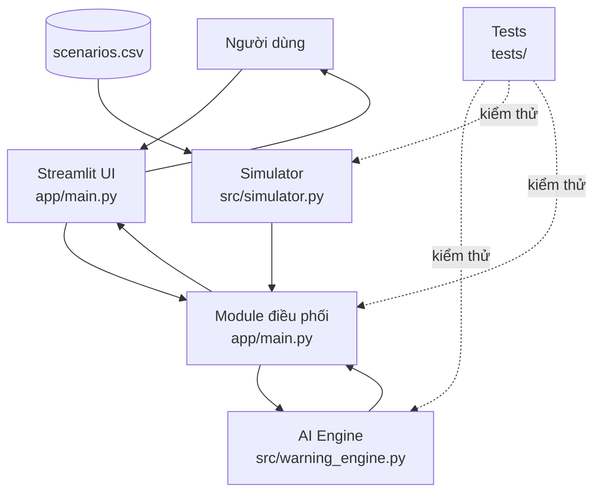
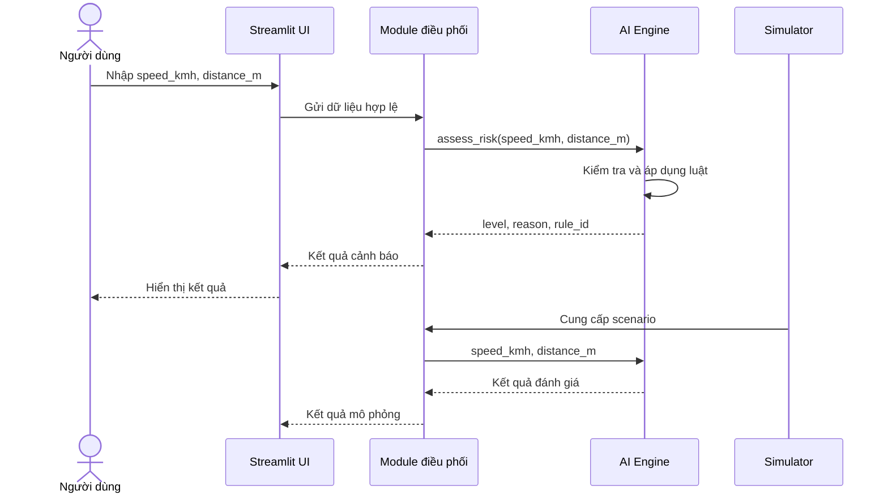

# W1-01 – Thiết kế kiến trúc hệ thống và quy ước giao tiếp module

> **Dự án:** Mô phỏng hệ thống cảnh báo va chạm
> **Môn:** Trí tuệ nhân tạo
> **Week:** 1
> **Vai trò:** System Architecture & Integration

---

## 1. Mục tiêu

Tài liệu này xác định kiến trúc tổng thể và quy ước giao tiếp giữa các module của hệ thống mô phỏng cảnh báo va chạm.

Mục tiêu chính:

- Chia hệ thống thành các module độc lập để 5 thành viên có thể phát triển song song từ Week 2.
- Xác định trách nhiệm của từng module.
- Chuẩn hóa dữ liệu đầu vào và đầu ra.
- Thống nhất giao diện hàm giữa UI, AI Engine và Simulator.
- Xác định luồng dữ liệu và nguyên tắc phụ thuộc giữa các module.
- Giảm phụ thuộc chéo và hạn chế xung đột khi tích hợp code.
- Làm cơ sở để viết `system_design.md` sau khi hoàn tất W1-02 đến W1-05.

---

# 2. Phạm vi kiến trúc

Hệ thống được xây dựng dưới dạng ứng dụng Python đơn giản, sử dụng Streamlit làm giao diện và Rule-Based Inference làm bộ suy diễn.

Kiến trúc chỉ tập trung vào mô phỏng và cảnh báo trong phạm vi bài tập.

### Trong phạm vi

- Streamlit UI.
- Module điều phối.
- Rule-Based AI Engine.
- Simulator.
- Dữ liệu mô phỏng.
- Unit test.
- Tài liệu và tích hợp GitHub.

### Ngoài phạm vi

- Machine Learning / Deep Learning.
- Database.
- REST API.
- Docker.
- Frontend/backend tách biệt.
- Điều khiển phương tiện thực tế.
- Mô phỏng 3D.
- Kết nối cảm biến thật.

---

# 3. Kiến trúc tổng thể

Hệ thống gồm 5 thành phần chính:

| Module           | File / thư mục                           | Vai trò                                 |
| ---------------- | ---------------------------------------- | --------------------------------------- |
| Streamlit UI     | `app/main.py`                            | Nhận input và hiển thị kết quả          |
| Module điều phối | `app/main.py`                            | Kết nối UI với các module xử lý         |
| AI Engine        | `src/warning_engine.py`                  | Suy diễn mức cảnh báo bằng luật IF–THEN |
| Simulator        | `src/simulator.py`, `data/scenarios.csv` | Cung cấp dữ liệu/kịch bản mô phỏng      |
| Tests            | `tests/`                                 | Kiểm tra tính đúng đắn của các module   |

Kiến trúc hướng đến nguyên tắc:

> **UI nhập/xuất dữ liệu – AI xử lý luật – Simulator cung cấp dữ liệu – Tests kiểm tra – Module điều phối kết nối các thành phần.**

---

# 4. Sơ đồ kiến trúc



---

# 5. Trách nhiệm của từng module

## 5.1. Streamlit UI

File chính:

```text
app/main.py
```

### Nhiệm vụ

- Hiển thị giao diện.
- Cho phép người dùng nhập:
  - `speed_kmh`
  - `distance_m`
- Cho phép lựa chọn kịch bản mô phỏng.
- Kiểm tra các điều kiện nhập liệu cơ bản.
- Gọi module điều phối.
- Hiển thị:
  - mức cảnh báo,
  - lý do,
  - mã luật.
- Hiển thị bảng so sánh hoặc lịch sử nếu được triển khai.

### Không chịu trách nhiệm

- Không tự viết luật IF–THEN.
- Không tự quyết định `SAFE/WARNING/DANGER`.
- Không thay thế AI Engine.
- Không chứa logic suy diễn.

---

# 6. Module điều phối

Module điều phối có nhiệm vụ kết nối UI với AI Engine và Simulator.

Trong cấu trúc hiện tại, `app/main.py` là entry point của Streamlit. Sang Week 2, phần xử lý điều phối có thể được tổ chức rõ hơn trong file này hoặc tách thành module riêng nếu nhóm thống nhất.

### Nhiệm vụ

```text
UI
 ↓
Nhận input
 ↓
Gọi AI Engine
 ↓
Nhận kết quả
 ↓
Trả kết quả cho UI
```

### Nguyên tắc

Module điều phối không tự chứa bộ luật cảnh báo.

Ví dụ:

```python
result = assess_risk(speed_kmh, distance_m)
```

sau đó chuyển kết quả cho UI.

---

# 7. AI Engine

File:

```text
src/warning_engine.py
```

### Nhiệm vụ

- Nhận `speed_kmh` và `distance_m`.
- Kiểm tra điều kiện dữ liệu đầu vào.
- Áp dụng bộ luật IF–THEN.
- Xác định mức cảnh báo.
- Sinh lý do cảnh báo.
- Trả về mã luật đã kích hoạt.

Giao diện hàm chính:

```python
assess_risk(
    speed_kmh: float,
    distance_m: float
) -> dict
```

AI Engine phải hoạt động độc lập với Streamlit.

---

# 8. Simulator

File:

```text
src/simulator.py
data/scenarios.csv
```

### Nhiệm vụ

- Cung cấp các kịch bản mô phỏng.
- Sinh hoặc đọc các cặp:
  - `speed_kmh`
  - `distance_m`
- Gửi dữ liệu cho AI Engine thông qua module điều phối.
- Có thể lưu `scenario_id` để nhận diện kịch bản.
- Có thể lưu kết quả dự kiến để phục vụ kiểm thử.

### Simulator không chịu trách nhiệm

- Không tự suy diễn mức cảnh báo.
- Không tự viết lại luật AI.
- Không quyết định kết quả thực tế thay cho AI Engine.

---

# 9. Tests

Thư mục:

```text
tests/
```

### Nhiệm vụ

Kiểm tra:

- Input hợp lệ.
- Input không hợp lệ.
- Các mức cảnh báo.
- Các trường hợp biên.
- Kết quả trả về có đúng cấu trúc không.
- Simulator có cung cấp dữ liệu đúng format không.
- Kết quả thực tế có phù hợp với kết quả dự kiến của scenario hay không.

Tests không được thay đổi logic của AI hoặc UI.

---

# 10. Quy ước dữ liệu đầu vào

Để các module có thể lập trình độc lập, dữ liệu đầu vào phải được thống nhất.

## 10.1. `speed_kmh`

| Thuộc tính | Quy ước     |
| ---------- | ----------- |
| Tên        | `speed_kmh` |
| Kiểu       | `float`     |
| Đơn vị     | km/h        |
| Điều kiện  | `>= 0`      |

Ví dụ:

```python
speed_kmh = 80.0
```

---

## 10.2. `distance_m`

| Thuộc tính | Quy ước      |
| ---------- | ------------ |
| Tên        | `distance_m` |
| Kiểu       | `float`      |
| Đơn vị     | mét          |
| Điều kiện  | `> 0`        |

Ví dụ:

```python
distance_m = 15.0
```

---

# 11. Input contract

Input tối thiểu mà AI Engine nhận:

```python
assess_risk(
    speed_kmh: float,
    distance_m: float
)
```

Ví dụ:

```python
result = assess_risk(80.0, 15.0)
```

Simulator có thể chứa thêm metadata:

```python
{
    "scenario_id": "SC_03_DANGER",
    "speed_kmh": 80.0,
    "distance_m": 15.0,
    "expected_action": "DANGER"
}
```

Nhưng `scenario_id` và `expected_action` **không phải input bắt buộc của AI Engine**.

---

# 12. Quy ước dữ liệu đầu ra

AI Engine phải trả về một object dạng dictionary.

Chuẩn tối thiểu:

```python
{
    "level": "DANGER",
    "reason": "Tốc độ cao và khoảng cách rất gần.",
    "rule_id": "R03"
}
```

## Các trường

| Field     | Kiểu  | Ý nghĩa                |
| --------- | ----- | ---------------------- |
| `level`   | `str` | Mức cảnh báo           |
| `reason`  | `str` | Giải thích kết quả     |
| `rule_id` | `str` | Mã luật được kích hoạt |

---

# 13. Chuẩn hóa mức cảnh báo

Để tránh phụ thuộc vào ngôn ngữ giao diện, hệ thống nên sử dụng mã nội bộ:

```text
SAFE
WARNING
DANGER
```

UI có thể ánh xạ sang:

| Internal level | UI           |
| -------------- | ------------ |
| `SAFE`         | 🟢 An toàn   |
| `WARNING`      | 🟡 Cảnh báo  |
| `DANGER`       | 🔴 Nguy hiểm |

Không nên để AI Engine trả trực tiếp:

```text
"An toàn"
"Cảnh báo"
"Nguy hiểm"
```

vì tên hiển thị thuộc trách nhiệm của UI.

---

# 14. `rule_id`

Mỗi luật AI cần có mã định danh riêng.

Ví dụ:

```text
R01
R02
R03
...
```

Tuy nhiên, **mã chính thức phải lấy theo W1-02**.

AI Engine không được tự ý đổi mã luật sau khi `system_design.md` đã được nhóm chốt.

Ví dụ:

```python
{
    "level": "WARNING",
    "reason": "Khoảng cách gần so với tốc độ.",
    "rule_id": "R02"
}
```

---

# 15. Giao diện hàm giữa các module

## AI Engine

```python
def assess_risk(
    speed_kmh: float,
    distance_m: float
) -> dict:
    ...
```

### Input

```text
speed_kmh
distance_m
```

### Output

```text
level
reason
rule_id
```

---

## Simulator → AI Engine

Simulator cung cấp:

```python
speed_kmh
distance_m
```

Sau đó gọi:

```python
assess_risk(speed_kmh, distance_m)
```

Simulator không truyền trực tiếp object Streamlit vào AI.

---

## UI → AI Engine

UI không tự tính cảnh báo.

Thay vào đó:

```python
result = assess_risk(
    speed_kmh,
    distance_m
)
```

Sau đó UI đọc:

```python
result["level"]
result["reason"]
result["rule_id"]
```

---

# 16. Luồng dữ liệu chính



---

# 17. Luồng xử lý lỗi

Lỗi được chia thành hai nhóm.

## 17.1. Lỗi dữ liệu đầu vào

Ví dụ:

```text
speed_kmh < 0
distance_m <= 0
```

AI Engine có thể phát sinh:

```python
ValueError
```

UI có trách nhiệm hiển thị thông báo dễ hiểu cho người dùng.

---

## 17.2. Lỗi hệ thống

Ví dụ:

- Không đọc được file scenario.
- Module AI không tồn tại.
- Dictionary kết quả thiếu field.
- Lỗi runtime.

Không nên để lỗi kỹ thuật hiển thị trực tiếp cho người dùng cuối.

UI nên hiển thị thông báo tổng quát, đồng thời log lỗi nếu cần.

---

# 18. Nguyên tắc phụ thuộc module

| Module       | Được phụ thuộc vào      | Không nên phụ thuộc vào     |
| ------------ | ----------------------- | --------------------------- |
| UI           | Module điều phối        | Luật AI trực tiếp           |
| Orchestrator | UI / AI / Simulator     | Chi tiết luật               |
| AI Engine    | Không phụ thuộc UI      | Streamlit                   |
| Simulator    | Data / Orchestrator     | UI                          |
| Tests        | Các module cần kiểm thử | Logic riêng thay thế module |

Nguyên tắc quan trọng:

> **AI Engine không phụ thuộc Streamlit.**

> **Simulator không quyết định kết quả AI.**

> **UI không chứa luật AI.**

---

# 19. Cách các thành viên làm việc độc lập

### TV2 – AI Developer

Chỉ cần đảm bảo:

```python
assess_risk(speed_kmh, distance_m)
```

trả đúng output contract.

---

### TV3 – Simulation Developer

Chỉ cần tạo dữ liệu đúng:

```python
{
    "scenario_id": "...",
    "speed_kmh": ...,
    "distance_m": ...,
    "expected_action": "..."
}
```

---

### TV4 – UI Developer

Chỉ cần gọi interface:

```python
result = assess_risk(speed, distance)
```

và hiển thị:

```python
result["level"]
result["reason"]
result["rule_id"]
```

---

### TV5 – QA

Viết test dựa trên contract:

```python
assert "level" in result
assert "reason" in result
assert "rule_id" in result
```

---

# 20. Kiểm soát thay đổi interface

Sau khi nhóm chốt contract, không được tự ý đổi:

```text
speed_kmh
distance_m
level
reason
rule_id
assess_risk(...)
```

Nếu cần thay đổi:

1. Thông báo cho các thành viên liên quan.
2. Kiểm tra ảnh hưởng đến UI/Simulation/Tests.
3. Cập nhật `system_design.md`.
4. Cập nhật code liên quan.
5. Chạy lại test.

---

# 21. Điểm cần thống nhất trước Week 2

Trong quá trình rà soát tài liệu hiện tại, có một số điểm cần nhóm thống nhất trước khi code.

## 21.1. Chuẩn mã mức cảnh báo

Một số tài liệu UI sử dụng:

```text
GREEN
YELLOW
RED
```

Trong khi kiến trúc đề xuất:

```text
SAFE
WARNING
DANGER
```

### Quyết định cần chốt

Khuyến nghị sử dụng:

```text
SAFE
WARNING
DANGER
```

làm giá trị nội bộ.

UI chỉ hiển thị:

```text
🟢 An toàn
🟡 Cảnh báo
🔴 Nguy hiểm
```

---

## 21.2. Điều kiện `distance_m`

Các tài liệu hiện tại có cách mô tả khác nhau đối với `distance_m = 0`.

Đề xuất:

```text
distance_m > 0
```

đối với cảnh báo trước va chạm.

`distance_m <= 0` được xem là dữ liệu không hợp lệ đối với phạm vi mô phỏng hiện tại.

---

## 21.3. Kịch bản 80 km/h – 15 m

Phải đối chiếu với bộ luật W1-02.

Không được để:

```text
Simulator → DANGER
AI Engine → WARNING
Tests → một kết quả khác
```

Kết quả của scenario phải được xác định từ **bộ luật AI chính thức**.

---

# 22. Phương án tích hợp Week 2

Thứ tự tích hợp đề xuất:

```text
Bước 1:
TV2 hoàn thiện AI Engine
        ↓
Bước 2:
TV3 hoàn thiện Simulator
        ↓
Bước 3:
TV5 kiểm thử AI + Simulator
        ↓
Bước 4:
TV4 kết nối Streamlit
        ↓
Bước 5:
TV1 tích hợp toàn hệ thống
        ↓
Bước 6:
Chạy toàn bộ test
        ↓
Bước 7:
Demo
```

---

# 23. Checklist hoàn thành W1-01

- [x] Xác định các module chính.
- [x] Xác định trách nhiệm từng module.
- [x] Thiết kế kiến trúc tổng thể.
- [x] Có Mermaid architecture.
- [x] Có sequence diagram.
- [x] Xác định luồng dữ liệu.
- [x] Xác định `speed_kmh`.
- [x] Xác định `distance_m`.
- [x] Xác định `level`.
- [x] Xác định `reason`.
- [x] Xác định `rule_id`.
- [x] Đề xuất interface `assess_risk()`.
- [x] Xác định nguyên tắc phụ thuộc module.
- [x] Xác định phương án tích hợp Week 2.
- [ ] Thành viên AI xác nhận output contract.
- [ ] Thành viên Simulation xác nhận scenario contract.
- [ ] Thành viên UI xác nhận input/output contract.
- [ ] Thành viên QA xác nhận contract có thể kiểm thử.
- [ ] Review bởi ít nhất một thành viên khác.

---

# 24. Kết luận

Kiến trúc được thiết kế theo hướng module hóa, trong đó UI, Simulator, AI Engine và Tests có thể phát triển độc lập.

Điểm quan trọng nhất của kiến trúc là **chuẩn hóa giao tiếp dữ liệu**, thay vì để mỗi module tự định nghĩa tên biến và format kết quả.

Contract chính của hệ thống:

```text
INPUT
speed_kmh
distance_m

        ↓

AI ENGINE

        ↓

OUTPUT
level
reason
rule_id
```

Contract này là cơ sở để các thành viên triển khai độc lập trong Week 2 và tích hợp mà không cần thay đổi logic của module khác.
