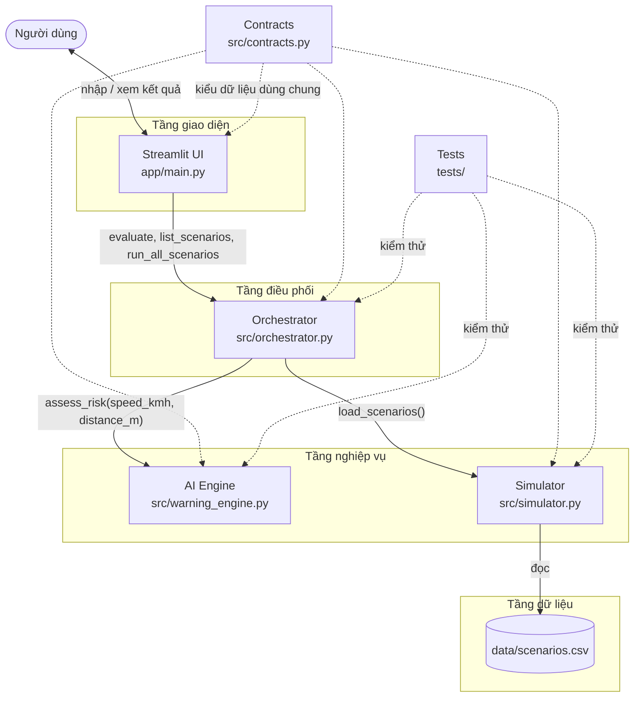
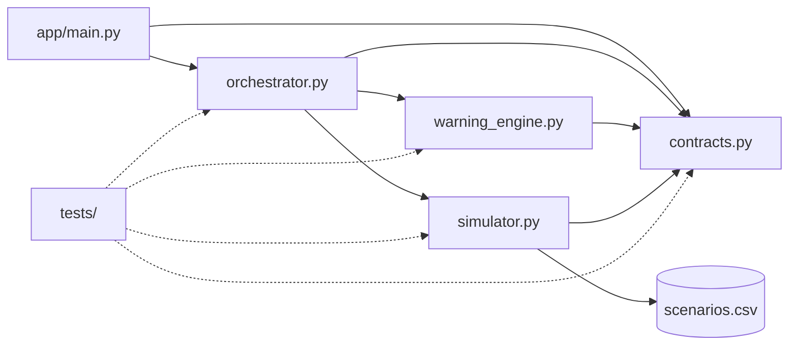
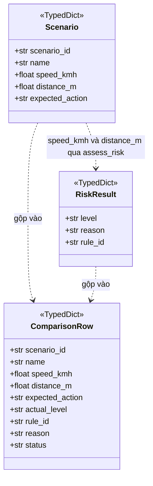
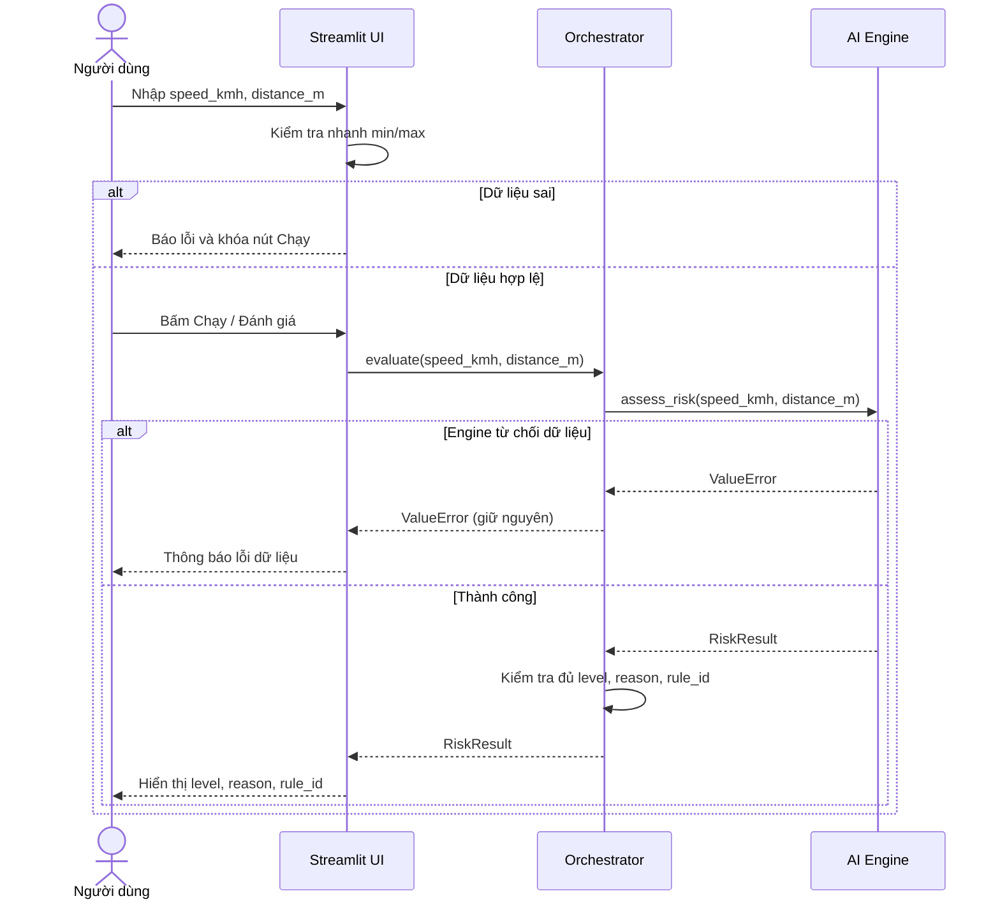
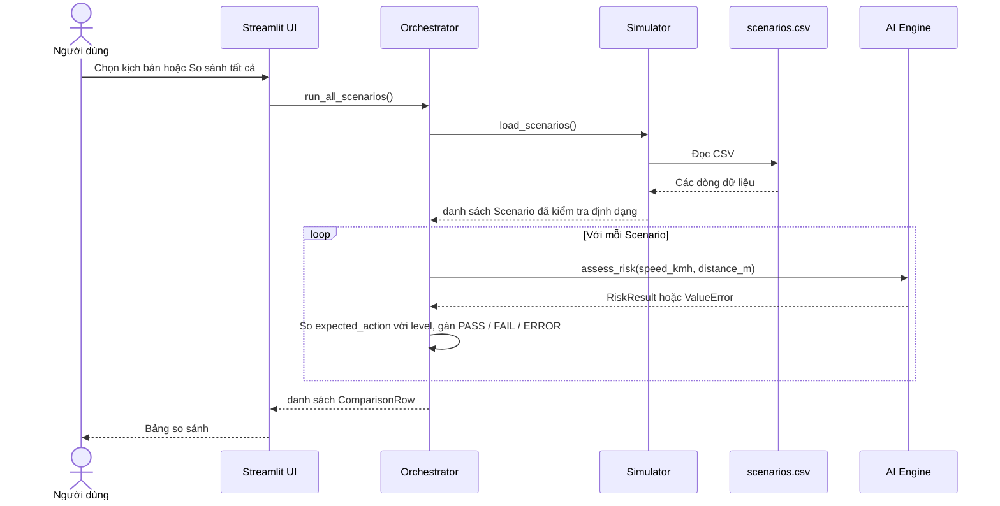
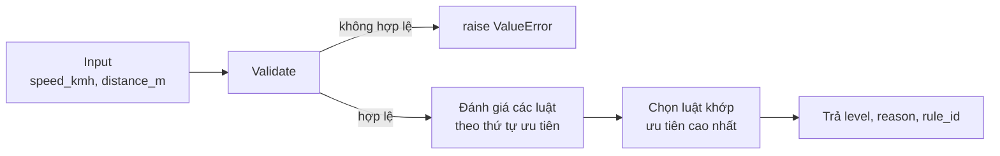
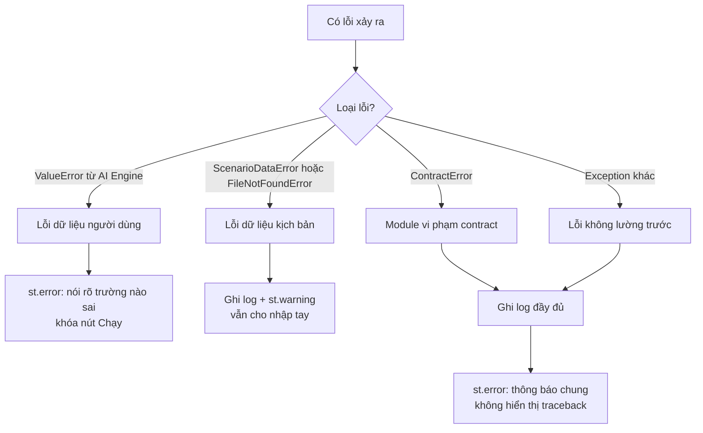
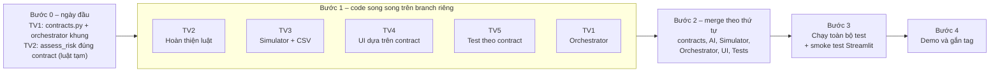

# W1-01 – Thiết kế kiến trúc hệ thống và quy ước giao tiếp module

> **Dự án:** Mô phỏng hệ thống cảnh báo va chạm (Forward Collision Warning – FCW)
> **Môn:** Trí tuệ nhân tạo
> **Issue:** W1-01 – System Architecture & Integration
> **Phiên bản contract:** `v1.0` (DRAFT – chờ TV2, TV3, TV4, TV5 xác nhận)
> **Tài liệu liên quan:**
> [`system_design.md`](system_design.md) (đặc tả chi tiết contract) ·
> `warning_rules.md` (W1-02) ·
> `simulation_scenarios.md` (W1-03) ·
> `ui_design.md` (W1-04) ·
> `requirements_testplan.md` (W1-05)

---

## Mục lục

1. [Giới thiệu](#1-giới-thiệu)
2. [Mục tiêu và phạm vi](#2-mục-tiêu-và-phạm-vi)
3. [Lựa chọn kiến trúc và lý do chia module](#3-lựa-chọn-kiến-trúc-và-lý-do-chia-module)
4. [Cấu trúc dự án và danh sách module](#4-cấu-trúc-dự-án-và-danh-sách-module)
5. [Sơ đồ kiến trúc](#5-sơ-đồ-kiến-trúc)
6. [Trách nhiệm từng module](#6-trách-nhiệm-từng-module)
7. [Quy ước dữ liệu đầu vào và đầu ra](#7-quy-ước-dữ-liệu-đầu-vào-và-đầu-ra)
8. [Luồng xử lý dữ liệu](#8-luồng-xử-lý-dữ-liệu)
9. [Xử lý lỗi](#9-xử-lý-lỗi)
10. [Nguyên tắc phụ thuộc và quyền sở hữu file](#10-nguyên-tắc-phụ-thuộc-và-quyền-sở-hữu-file)
11. [Phương án tích hợp Week 2](#11-phương-án-tích-hợp-week-2)
12. [Kiểm soát thay đổi interface](#12-kiểm-soát-thay-đổi-interface)
13. [Điểm cần thống nhất trước Week 2](#13-điểm-cần-thống-nhất-trước-week-2)
14. [Đối chiếu với câu hỏi hướng dẫn W1-01](#14-đối-chiếu-với-câu-hỏi-hướng-dẫn-w1-01)
15. [Checklist hoàn thành W1-01](#15-checklist-hoàn-thành-w1-01)
16. [Kết luận](#16-kết-luận)

---

## 1. Giới thiệu

### 1.1. Hệ thống giải quyết vấn đề gì?

Va chạm phía trước thường xảy ra khi người lái nhận ra khoảng cách quá muộn so với tốc độ đang chạy. Hệ thống cảnh báo va chạm (FCW) theo dõi **tốc độ xe** và **khoảng cách đến vật cản phía trước**, rồi cảnh báo sớm để người lái kịp phản ứng.

Dự án này **mô phỏng** hệ thống đó bằng Python. Thay vì dùng cảm biến thật, dữ liệu tốc độ và khoảng cách được nhập tay hoặc lấy từ các kịch bản có sẵn. Bộ suy diễn là **Rule-Based System** (luật IF–THEN), phân loại nguy cơ thành ba mức:

```text
SAFE      → An toàn
WARNING   → Cảnh báo
DANGER    → Nguy hiểm
```

### 1.2. Mục đích của tài liệu này

Năm thành viên sẽ code song song từ Week 2. Nếu mỗi người tự đặt tên biến, tự chọn định dạng kết quả thì lúc ghép code sẽ lỗi. Tài liệu này chốt:

- hệ thống gồm những module nào, module nào được phép gọi module nào;
- dữ liệu đi vào, đi ra mỗi module có tên, kiểu và đơn vị gì;
- lỗi được báo và xử lý ở đâu;
- ai sở hữu file nào, tích hợp theo thứ tự nào.

> Các ngưỡng cảnh báo **không** được định nghĩa ở đây. Nguồn chính thức là `warning_rules.md` (W1-02). Các ngưỡng chỉ phục vụ mô phỏng học tập, không phải tiêu chuẩn an toàn cho xe thật.

---

## 2. Mục tiêu và phạm vi

### 2.1. Mục tiêu kiến trúc

- Chia hệ thống thành các module độc lập để phát triển song song.
- Chuẩn hóa dữ liệu vào/ra và giao diện hàm giữa các module.
- Giữ **luật AI ở đúng một nơi** (`warning_engine.py`), UI và Simulator không chứa luật.
- Cho phép test AI, Simulator, Orchestrator mà **không cần chạy Streamlit**.
- Giảm xung đột Git bằng cách mỗi người chỉ sửa file của mình.

### 2.2. Trong phạm vi

Python 3.10+ · Streamlit · Rule-Based AI · Simulator + CSV · `unittest` · so sánh kịch bản · hiển thị mức cảnh báo, lý do, mã luật · quản lý bằng GitHub.

### 2.3. Ngoài phạm vi

Machine Learning / Deep Learning · Database · REST API · Docker · tách frontend/backend · cảm biến thật · điều khiển xe thật · mô phỏng 3D.

---

## 3. Lựa chọn kiến trúc và lý do chia module

### 3.1. Vì sao không viết tất cả trong một file?

| Vấn đề khi viết một file | Lợi ích khi chia module |
|---|---|
| 5 người cùng sửa một file → conflict liên tục | Mỗi người một file riêng |
| Luật AI lẫn với code giao diện, khó test | AI Engine test được bằng `unittest`, không cần Streamlit |
| Đổi giao diện có thể làm hỏng luật | Đổi UI không ảnh hưởng AI |
| Khó giải thích khi báo cáo | Mỗi module có một nhiệm vụ rõ |

### 3.2. Các phương án đã cân nhắc

| Phương án | Đánh giá | Quyết định |
|---|---|---|
| Một file `main.py` | Nhanh lúc đầu, nhưng conflict và khó test | Loại |
| Client–server (REST API + frontend riêng) | Quá phức tạp cho bài tập, nằm ngoài phạm vi | Loại |
| **Ứng dụng Python một tiến trình, chia tầng (layered)** | Đơn giản, module giao tiếp bằng gọi hàm, dễ test | **Chọn** |

### 3.3. Kiến trúc chọn: phân tầng trong một ứng dụng Python

```text
Tầng giao diện   : app/main.py            (Streamlit)
Tầng điều phối   : src/orchestrator.py
Tầng nghiệp vụ   : src/warning_engine.py  |  src/simulator.py
Tầng dữ liệu     : data/scenarios.csv
Dùng chung       : src/contracts.py       (kiểu dữ liệu, hằng số, exception)
```

Các module giao tiếp bằng **gọi hàm** và **dict/TypedDict của Python**. Không có mạng, không có API.

---

## 4. Cấu trúc dự án và danh sách module

```text
project/
├── app/
│   └── main.py                  # Streamlit UI (entry point)
├── src/
│   ├── __init__.py
│   ├── contracts.py             # Level, TypedDict, exception dùng chung
│   ├── warning_engine.py        # AI Engine: assess_risk()
│   ├── simulator.py             # Nạp và kiểm tra kịch bản
│   └── orchestrator.py          # Điều phối UI ↔ AI ↔ Simulator
├── data/
│   └── scenarios.csv            # Nguồn dữ liệu kịch bản duy nhất
├── tests/
│   ├── __init__.py
│   ├── test_contract.py         # Kiểm tra output đúng contract
│   ├── test_warning.py
│   ├── test_simulator.py
│   └── test_orchestrator.py
├── docs/
│   └── week1/
│       ├── architecture.md          (W1-01)
│       ├── system_design.md         (W1-01)
│       ├── warning_rules.md         (W1-02)
│       ├── simulation_scenarios.md  (W1-03)
│       ├── ui_design.md             (W1-04)
│       ├── requirements_testplan.md (W1-05)
│       └── assets/
└── requirements.txt
```

| Module | File | Vai trò | Owner |
|---|---|---|---|
| Streamlit UI | `app/main.py` | Nhập dữ liệu, hiển thị kết quả | TV4 |
| Orchestrator | `src/orchestrator.py` | Kết nối UI với AI và Simulator, kiểm tra contract | TV1 |
| AI Engine | `src/warning_engine.py` | Kiểm tra input, áp luật IF–THEN, trả kết quả | TV2 |
| Simulator | `src/simulator.py`, `data/scenarios.csv` | Nạp, kiểm tra kịch bản | TV3 |
| Contracts | `src/contracts.py` | Định nghĩa kiểu dữ liệu và hằng số dùng chung | TV1 |
| Tests | `tests/` | Kiểm thử theo contract | TV5 |

> **Thay đổi so với bản trước:** tách Orchestrator khỏi `app/main.py` thành `src/orchestrator.py`, và thêm `src/contracts.py`. Lý do: nếu điều phối nằm trong file Streamlit thì không thể unit test và TV1, TV4 cùng sửa một file. **Cần cả nhóm xác nhận** (xem mục 13).

> **Lưu ý thư mục:** repo hiện có `docs/week 1/` (có dấu cách). Nên đổi thành `docs/week1/` bằng `git mv "docs/week 1" docs/week1` để khớp đường dẫn trong các tài liệu và tránh lỗi link.

---

## 5. Sơ đồ kiến trúc

### 5.1. Sơ đồ thành phần



### 5.2. Sơ đồ phụ thuộc (hướng `import`)

Mũi tên A → B nghĩa là *A được phép import B*. Không có mũi tên ngược.



Quy tắc đọc sơ đồ:

- `app/main.py` **chỉ import** `orchestrator` và `contracts`. UI không import `warning_engine` hay `simulator`.
- `warning_engine.py` và `simulator.py` **không import nhau** và **không import Streamlit**.
- `contracts.py` là lá của đồ thị: không import module nào trong dự án.

---

## 6. Trách nhiệm từng module

### 6.1. Streamlit UI – `app/main.py` (TV4)

**Làm:**

- Hiển thị giao diện theo `ui_design.md`.
- Cho nhập `speed_kmh`, `distance_m` hoặc chọn kịch bản.
- Kiểm tra nhanh để phản hồi sớm (khóa nút Chạy khi sai). Đây chỉ là phản hồi UX, **AI Engine mới là nơi quyết định dữ liệu có hợp lệ hay không**.
- Gọi Orchestrator, hiển thị `level`, `reason`, `rule_id`, bảng so sánh, lịch sử.
- Ánh xạ `level` sang màu, nhãn, icon, `st.success/warning/error`.
- Bắt exception và hiển thị thông báo dễ hiểu.

**Không làm:** viết luật IF–THEN, tự quyết định SAFE/WARNING/DANGER, import trực tiếp AI Engine hay Simulator.

### 6.2. Orchestrator – `src/orchestrator.py` (TV1)

**Làm:**

- Cung cấp API cho UI (xem mục 7.5).
- Gọi `assess_risk()` và nhận kết quả.
- Kiểm tra kết quả có đủ `level`, `reason`, `rule_id` và `level` hợp lệ; nếu không thì ném `ContractError`.
- Với kịch bản: lấy dữ liệu từ Simulator, gọi AI, so `expected_action` với `level` để ra `PASS` / `FAIL` / `ERROR`.

**Không làm:** chứa luật cảnh báo, import Streamlit, nuốt lỗi dữ liệu của AI (phải để `ValueError` đi tiếp cho UI xử lý).

### 6.3. AI Engine – `src/warning_engine.py` (TV2)

**Làm:**

- Nhận `speed_kmh`, `distance_m`.
- Kiểm tra dữ liệu, sai thì ném `ValueError`.
- Áp bộ luật theo `warning_rules.md` và thứ tự ưu tiên đã quy định.
- Trả `RiskResult` gồm `level`, `reason`, `rule_id`.

**Không làm:** import Streamlit, trả chuỗi hiển thị như `"Nguy hiểm"`, đọc CSV, biết đến `scenario_id`.

### 6.4. Simulator – `src/simulator.py`, `data/scenarios.csv` (TV3)

**Làm:**

- Đọc `data/scenarios.csv` và trả danh sách `Scenario`.
- Kiểm tra **định dạng** dữ liệu: đủ cột, ép kiểu `float`, `expected_action` thuộc `SAFE/WARNING/DANGER`, `scenario_id` không trùng.
- Là nơi duy nhất đọc file kịch bản (CSV là **nguồn dữ liệu duy nhất**, không lặp lại danh sách trong code).

**Không làm:** tự suy diễn mức cảnh báo, viết lại luật, kiểm tra khoảng giá trị của tốc độ/khoảng cách (việc của AI Engine), quyết định kết quả thay AI.

### 6.5. Tests – `tests/` (TV5)

**Làm:** kiểm tra input hợp lệ/không hợp lệ, ba mức cảnh báo, trường hợp biên, output đúng contract, Simulator đúng định dạng, kết quả AI khớp `expected_action`.

**Không làm:** sửa logic của AI hoặc UI để test qua. Test sai lệch phải được báo lại và thống nhất, không "sửa test cho xanh".

---

## 7. Quy ước dữ liệu đầu vào và đầu ra

> Đặc tả đầy đủ (bảng kiểm tra dữ liệu, mã nguồn mẫu `contracts.py`, CSV schema) nằm ở [`system_design.md`](system_design.md). Mục này là bản tóm tắt để tra nhanh.

### 7.1. Đầu vào của AI Engine

| Tên | Kiểu | Đơn vị | Điều kiện hợp lệ |
|---|---|---|---|
| `speed_kmh` | `float` | km/h | `>= 0`, hữu hạn (không NaN, không inf) |
| `distance_m` | `float` | m | `> 0`, hữu hạn |

Không dùng đồng thời `speed`, `velocity`, `distance`… cho cùng một ý nghĩa.

### 7.2. Đầu ra của AI Engine (`RiskResult`)

```python
{
    "level": "DANGER",
    "reason": "Tốc độ cao và khoảng cách rất gần.",
    "rule_id": "R03",
}
```

| Field | Kiểu | Bắt buộc | Ý nghĩa |
|---|---|:---:|---|
| `level` | `str` | Có | Một trong `SAFE`, `WARNING`, `DANGER` |
| `reason` | `str` | Có | Giải thích bằng tiếng Việt, không rỗng |
| `rule_id` | `str` | Có | Mã luật theo `warning_rules.md`, dạng `R01`, `R02`… |

### 7.3. Mã mức cảnh báo và ánh xạ giao diện

AI Engine **chỉ trả mã nội bộ**. Tên hiển thị, màu và icon thuộc trách nhiệm UI.

| `level` (nội bộ) | Mã màu của UI | Hiển thị |
|---|---|---|
| `SAFE` | GREEN | 🟢 An toàn |
| `WARNING` | YELLOW | 🟡 Cảnh báo |
| `DANGER` | RED | 🔴 Nguy hiểm |

`GREEN/YELLOW/RED` chỉ tồn tại trong tầng UI, **không** đi qua ranh giới AI Engine.

### 7.4. Kịch bản (`Scenario`) và dòng so sánh (`ComparisonRow`)

`Scenario` (một dòng trong `scenarios.csv`):

| Field | Kiểu | Ghi chú |
|---|---|---|
| `scenario_id` | `str` | Duy nhất, dạng `SC_01_SAFE` |
| `name` | `str` | Tên hiển thị trên UI (nếu trống dùng `scenario_id`) |
| `speed_kmh` | `float` | Cùng quy ước với 7.1 |
| `distance_m` | `float` | Cùng quy ước với 7.1 |
| `expected_action` | `str` | Cùng tập giá trị với `level` |

`scenario_id`, `name`, `expected_action` **không** được truyền vào `assess_risk()`.

`ComparisonRow` (kết quả Orchestrator trả cho bảng so sánh): `scenario_id`, `name`, `speed_kmh`, `distance_m`, `expected_action`, `actual_level`, `rule_id`, `reason`, `status` (`PASS` | `FAIL` | `ERROR`).



### 7.5. Giao diện hàm giữa các module

| Module | Hàm | Trả về |
|---|---|---|
| AI Engine | `assess_risk(speed_kmh: float, distance_m: float)` | `RiskResult` |
| Simulator | `load_scenarios(path: Path \| None = None)` | `list[Scenario]` |
| Orchestrator | `evaluate(speed_kmh, distance_m)` | `RiskResult` (cùng dạng với `assess_risk`) |
| Orchestrator | `list_scenarios()` | `list[Scenario]` |
| Orchestrator | `run_scenario(scenario)` | `ComparisonRow` |
| Orchestrator | `run_all_scenarios()` | `list[ComparisonRow]` |

UI gọi `evaluate()` và nhận đúng cấu trúc của `assess_risk()`, nên TV4 có thể làm giao diện chỉ với contract `RiskResult`.

---

## 8. Luồng xử lý dữ liệu

### 8.1. Nhập tay



### 8.2. Chạy / so sánh kịch bản



### 8.3. Quy trình bên trong AI Engine



Thứ tự ưu tiên khi nhiều luật cùng đúng do `warning_rules.md` quy định.

---

## 9. Xử lý lỗi

### 9.1. Phân loại

| Loại lỗi | Phát hiện ở | Exception | Xử lý tại UI |
|---|---|---|---|
| Dữ liệu nhập sai (âm, 0, NaN, rỗng, không phải số) | AI Engine | `ValueError` | `st.error` với thông báo cụ thể, khóa nút Chạy |
| File kịch bản thiếu hoặc sai định dạng | Simulator | `FileNotFoundError`, `ScenarioDataError` | `st.warning`, ghi log, **vẫn cho nhập tay** |
| Kết quả AI thiếu field hoặc `level` lạ | Orchestrator | `ContractError` | Thông báo chung, ghi log |
| Lỗi không lường trước | Bất kỳ | `Exception` | Thông báo chung, ghi log |

### 9.2. Luồng xử lý



### 9.3. Nguyên tắc

1. **Một quy tắc kiểm tra khoảng giá trị**: nằm ở AI Engine. UI chỉ kiểm tra sớm để tiện cho người dùng.
2. **Chỉ một loại exception cho input sai**: `ValueError`. Kể cả `None`, chuỗi, `bool`, NaN, inf đều quy về `ValueError` để UI chỉ bắt một loại.
3. Lỗi kỹ thuật không hiển thị cho người dùng cuối; ghi bằng `logging`.
4. Một kịch bản lỗi không được làm hỏng cả bảng so sánh: dòng đó ghi `status = "ERROR"`, các dòng khác vẫn chạy.

---

## 10. Nguyên tắc phụ thuộc và quyền sở hữu file

### 10.1. Nguyên tắc phụ thuộc

| Module | Được phép import | Không được import |
|---|---|---|
| UI (`app/main.py`) | `orchestrator`, `contracts` | `warning_engine`, `simulator` |
| Orchestrator | `warning_engine`, `simulator`, `contracts` | `streamlit` |
| AI Engine | `contracts` | `streamlit`, `simulator`, `orchestrator` |
| Simulator | `contracts` | `streamlit`, `warning_engine`, `orchestrator` |
| Tests | mọi module trong `src/` | logic riêng thay thế module |

> **AI Engine không phụ thuộc Streamlit. Simulator không quyết định kết quả AI. UI không chứa luật AI.**

### 10.2. Quyền sở hữu file (giảm conflict)

| File / thư mục | Owner | Người khác muốn sửa |
|---|---|---|
| `src/warning_engine.py`, `docs/week1/warning_rules.md` | TV2 | Nhờ TV2 hoặc PR có TV2 review |
| `src/simulator.py`, `data/scenarios.csv`, `simulation_scenarios.md` | TV3 | Như trên |
| `app/main.py`, `ui_design.md` | TV4 | Như trên |
| `tests/`, `requirements_testplan.md` | TV5 | TV2/TV3 thêm test case bằng PR cho TV5 review |
| `src/orchestrator.py`, `src/contracts.py`, `architecture.md`, `system_design.md` | TV1 | Đổi contract phải theo mục 12 |

### 10.3. Chạy chương trình và import

Chạy từ **thư mục gốc dự án**:

```bash
streamlit run app/main.py
python -m unittest discover -s tests
```

Streamlit đưa thư mục `app/` (không phải thư mục gốc) vào `sys.path`, nên `from src.orchestrator import ...` có thể báo `ModuleNotFoundError`. Quy ước: đầu `app/main.py` thêm thư mục gốc vào `sys.path`:

```python
import sys
from pathlib import Path

sys.path.insert(0, str(Path(__file__).resolve().parent.parent))
```

Đường dẫn file dữ liệu luôn tính từ vị trí file code (`Path(__file__)`), không dùng đường dẫn tương đối theo thư mục đang chạy.

---

## 11. Phương án tích hợp Week 2

Thứ tự tuần tự "AI → Simulator → Test → UI → Integration" khiến TV4 và TV5 phải chờ. Để mọi người làm **song song**, TV1 và TV2 đẩy lên `main` **ngay đầu Week 2** một bộ khung chạy được (stub), các bên còn lại code dựa trên contract.



### 11.1. Quy trình Git

```text
main → branch riêng (feature/<module>-<mô tả>) → code → chạy test → push
     → Pull Request → reviewer kiểm tra → TV1 merge
```

Ví dụ tên branch: `feature/ai-engine`, `feature/simulator`, `feature/ui`, `feature/tests`, `feature/orchestrator`.

### 11.2. Điều kiện để merge một PR

- Chạy `python -m unittest discover -s tests` không lỗi.
- Không đổi tên field, tên hàm, mã `level` đã chốt (nếu đổi: theo mục 12).
- Không import vi phạm bảng mục 10.1.
- Có ít nhất một reviewer xác nhận.

### 11.3. Smoke test khi tích hợp xong

1. `streamlit run app/main.py` mở được trang.
2. Chọn từng kịch bản trong CSV → ra mức cảnh báo, lý do, mã luật.
3. Bảng so sánh: mọi dòng `PASS` (hoặc `FAIL` có lý do đã thống nhất).
4. Nhập tốc độ âm, khoảng cách 0 → có thông báo lỗi, không crash.

---

## 12. Kiểm soát thay đổi interface

Sau khi nhóm chốt, **không tự ý đổi**:

```text
speed_kmh, distance_m
level, reason, rule_id
SAFE / WARNING / DANGER
assess_risk(...), evaluate(...), load_scenarios(...)
tên cột CSV
```

Khi cần đổi:

1. Báo các thành viên liên quan và ghi vào Issue/PR.
2. Đánh giá ảnh hưởng đến UI, Simulator, Tests, Orchestrator.
3. Cập nhật `system_design.md` và tăng phiên bản contract (`v1.0` → `v1.1`).
4. Sửa code và test liên quan **trong cùng một PR**.
5. Chạy lại toàn bộ test.

Thêm field **tùy chọn** vào `RiskResult` (ví dụ `safe_distance_m`) không phá contract, miễn là bên dùng đọc bằng `result.get(...)`.

---

## 13. Điểm cần thống nhất trước Week 2

Chi tiết bằng chứng và đề xuất xử lý nằm ở `system_design.md` mục 9, 10 và 15. Tóm tắt:

| # | Vấn đề | Cần ai xác nhận |
|---|---|---|
| 1 | **Bộ kịch bản thiếu thống nhất.** Mỗi tài liệu dùng bộ giá trị khác nhau (system design, `simulation_scenarios.md`, `ui_design.md`, `scenarios.csv`). Với code hiện tại, 60 km/h – 25 m và 80 km/h – 15 m cho kết quả khác `expected_action` của W1-03. | TV2, TV3, TV4 |
| 2 | Chuẩn mã mức cảnh báo: `SAFE/WARNING/DANGER` nội bộ; UI tự ánh xạ sang `GREEN/YELLOW/RED`. `ui_design.md` mục 8 cần sửa cho khớp. | TV4 |
| 3 | `distance_m = 0` là dữ liệu **không hợp lệ** (code hiện tại đang chấp nhận 0). | TV2, TV4 |
| 4 | `ui_design.md` cần `safe_distance`, `rule_condition`, `explanation`. Đề xuất: `explanation` = `reason`; `safe_distance_m` và `rule_condition` là field **tùy chọn**. | TV2, TV4 |
| 5 | Tách `src/orchestrator.py` và `src/contracts.py` (mục 4). | Cả nhóm |
| 6 | Đổi tên thư mục `docs/week 1` → `docs/week1`. | Cả nhóm |
| 7 | CSV thêm cột `name`; CSV là nguồn kịch bản duy nhất, bỏ danh sách trùng trong `simulator.py`. | TV3 |

---

## 14. Đối chiếu với câu hỏi hướng dẫn W1-01

| Nhóm câu hỏi | Trả lời ở mục |
|---|---|
| A1–A2: Hệ thống giải quyết gì, cần thành phần nào | 1, 4 |
| A3: Nhiệm vụ từng thành phần | 6 |
| A4–A5: Vì sao chia module, kiến trúc phù hợp | 3 |
| B6–B8: UI tương tác module nào, vai trò Simulator và AI | 5, 6 |
| B9: Trình tự truyền dữ liệu | 8 |
| B10: Xử lý khi module lỗi | 9 |
| C11–C14: Đầu vào, đơn vị, kiểu, đầu ra | 7 |
| C15: Làm sao lập trình riêng mà vẫn ghép được | 7, 10, 11, 12 |
| D16–D18: Sơ đồ, kết nối trực tiếp, luồng dữ liệu | 5, 8 |
| E: Sản phẩm (giới thiệu, module, sơ đồ, luồng, bảng I/O, tích hợp Week 2) | 1, 4, 5, 8, 7, 11 |

---

## 15. Checklist hoàn thành W1-01

- [x] Đã phân tích các thành phần hệ thống.
- [x] Đã xây dựng sơ đồ kiến trúc (thành phần, phụ thuộc, sequence, lỗi, tích hợp).
- [x] Đã mô tả chức năng và giới hạn từng module.
- [x] Đã chuẩn hóa `speed_kmh`, `distance_m`, `level`, `reason`, `rule_id`.
- [x] Đã chuẩn hóa `Scenario` và `ComparisonRow`.
- [x] Đã định nghĩa giao diện hàm giữa các module.
- [x] Đã quy định nguyên tắc phụ thuộc và quyền sở hữu file.
- [x] Đã có phương án xử lý lỗi.
- [x] Đã có phương án tích hợp Week 2.
- [ ] TV2 xác nhận output contract và `rule_id`.
- [ ] TV3 xác nhận schema scenario và CSV.
- [ ] TV4 xác nhận input/output UI.
- [ ] TV5 xác nhận contract có thể kiểm thử.
- [ ] Ít nhất một thành viên khác review.

---

## 16. Kết luận

Hệ thống là một ứng dụng Python phân tầng, gồm UI, Orchestrator, AI Engine, Simulator và Tests, dùng chung một lớp `contracts`. Điểm cốt lõi là **chuẩn hóa giao tiếp**, không để mỗi module tự đặt tên và định dạng.

```text
INPUT                      AI ENGINE                   OUTPUT
speed_kmh: float   ──►   assess_risk()   ──►   level   : SAFE | WARNING | DANGER
distance_m: float                              reason  : str
                                               rule_id : str
```

Contract này là cơ sở để 5 thành viên code độc lập trong Week 2 và ghép lại mà không cần sửa logic của nhau.
