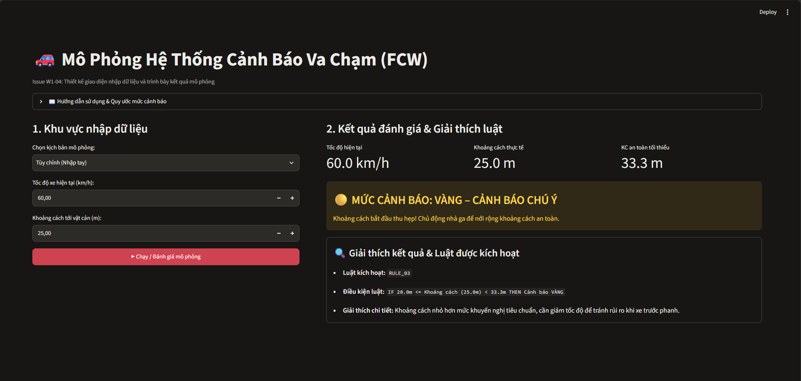

# THIẾT KẾ GIAO DIỆN HỆ THỐNG (UI DESIGN)

- **Đề tài:** Mô phỏng hệ thống cảnh báo va chạm (Forward Collision Warning System)
- **Issue:** W1-04 – Thiết kế giao diện Streamlit
- **Vai trò:** UI Developer
- **Tài liệu bàn giao:** `docs/week1/ui_design.md`

---

## 1. Mục tiêu thiết kế

Thiết kế giao diện ứng dụng web đơn trang (Single-Page Application) bằng thư viện **Streamlit** trên nền tảng Python nhằm phục vụ hai mục đích cốt lõi: **nhập dữ liệu đầu vào** và **trình bày kết quả mô phỏng cảnh báo va chạm**.

Các tiêu chí thiết kế cụ thể:
- **Đơn giản, trực quan, dễ sử dụng:** Toàn bộ thao tác nhập thông số và quan sát kết quả diễn ra trên một màn hình duy nhất (chia 2 cột đối xứng), không cần chuyển trang phức tạp.
- **Phản hồi rõ ràng 3 mức độ cảnh báo:** Thể hiện trực quan 3 trạng thái **Xanh (An toàn) – Vàng (Cảnh báo) – Đỏ (Nguy hiểm)** thông qua màu sắc chuẩn, biểu tượng (icon) và nhãn văn bản.
- **Minh bạch hóa quá trình suy diễn:** Hiển thị rõ luật (Rule) nào được kích hoạt và lý do hệ thống đưa ra mức cảnh báo tương ứng với tốc độ và khoảng cách hiện tại.
- **Tối ưu cho báo cáo và thuyết trình:** Cung cấp sẵn danh sách các kịch bản giao thông mẫu để minh họa nhanh, kết hợp bảng lưu lịch sử giúp dễ dàng đối chiếu kết quả giữa các kịch bản.

---

## 2. Danh sách thành phần giao diện

Giao diện màn hình chính được chia thành **4 khu vực chức năng** rõ rệt:

### 2.1. Khu vực Tiêu đề & Hướng dẫn (Header Area)
- **Tiêu đề chính:** Hiển thị tên hệ thống *"Mô phỏng Hệ thống Cảnh báo Va chạm"*.
- **Khung hướng dẫn sử dụng:** Đặt trong hộp thu gọn (Expander) ngay dưới tiêu đề, giúp người dùng mới nắm bắt nhanh quy trình 3 bước thao tác và quy ước ý nghĩa của 3 màu cảnh báo mà không làm rối màn hình chính.

### 2.2. Khu vực Nhập dữ liệu & Điều khiển (Input Area - Cột bên trái)
- **Bộ chọn kịch bản mô phỏng:** Danh sách thả xuống cho phép chọn *"Tùy chỉnh (Nhập tay)"* hoặc các kịch bản giao thông có sẵn (VD: *Đô thị an toàn*, *Quốc lộ đông đúc*, *Bám đuôi trên cao tốc*). Khi chọn kịch bản mẫu, thông số tốc độ và khoảng cách sẽ tự động cập nhật.
- **Trường nhập Tốc độ:** Kết hợp thanh trượt (Slider) để kéo nhanh khi thuyết trình và ô nhập số (Number Input) để nhập chính xác các giá trị biên khi kiểm thử. Đơn vị đo hiển thị trực tiếp trên nhãn: **`km/h`**.
- **Trường nhập Khoảng cách:** Kết hợp thanh trượt và ô nhập số để thiết lập khoảng cách từ xe đến vật cản/xe phía trước. Đơn vị đo hiển thị trực tiếp trên nhãn: **`m`**.
- **Nút Chạy / Đánh giá mô phỏng:** Nút bấm chính (Primary Button) để kích hoạt hệ thống suy diễn đánh giá rủi ro va chạm. Nút này chỉ được phép hoạt động khi cả tốc độ và khoảng cách đều hợp lệ.

### 2.3. Khu vực Hiển thị kết quả & Giải thích (Output Area - Cột bên phải)
- **Thẻ tóm tắt thông số (Metrics):** Hiển thị lại **Tốc độ hiện tại (`km/h`)**, **Khoảng cách hiện tại (`m`)** và **Khoảng cách an toàn khuyến nghị (`m`)** ngay phía trên kết quả để người xem dễ đối chiếu.
- **Khung hiển thị trạng thái cảnh báo:** Hộp thông báo kích thước lớn đổi màu theo 3 trạng thái (**Xanh / Vàng / Đỏ**) kèm tên trạng thái bằng chữ in hoa và khuyến nghị hành động tức thì.
- **Khung giải thích kết quả & Luật kích hoạt:** Đặt ngay bên dưới hộp cảnh báo, trình bày chi tiết:
  - Mã luật được kích hoạt (VD: `R01`, `R03`, `R05`).
  - Biểu thức điều kiện của luật (dạng `IF ... THEN ...`).
  - Lời giải thích chi tiết (so sánh khoảng cách thực tế với khoảng cách phanh/phản ứng an toàn theo tốc độ).

### 2.4. Khu vực Đối chiếu & Lịch sử kịch bản (Comparison Area - Chân trang)
- **Bảng so sánh kết quả:** Ghi nhận lại các lần chạy mô phỏng trong phiên làm việc (gồm: *Kịch bản, Tốc độ, Khoảng cách, Mức cảnh báo, Luật kích hoạt*) để phục vụ việc so sánh trực tiếp giữa các tình huống.

---

## 3. Bản phác thảo giao diện (Wireframe)

> **Tệp hình ảnh thiết kế minh họa:** Lưu tại `docs/week1/assets/ui_wireframe.png`



### Sơ đồ bố cục khung (Layout Wireframe):

```text
+---------------------------------------------------------------------------------------+
|  [ICON] MÔ PHỎNG HỆ THỐNG CẢNH BÁO VA CHẠM                                            |
|  [+] Hướng dẫn sử dụng & Quy ước 3 mức cảnh báo (Nhấn để mở rộng / thu gọn)           |
+-------------------------------------+-------------------------------------------------+
|  KHU VỰC NHẬP DỮ LIỆU (CỘT TRÁI)    |  KHU VỰC HIỂN THỊ KẾT QUẢ (CỘT PHẢI)            |
|                                     |                                                 |
|  1. Chọn kịch bản mô phỏng:         |  [Thẻ thông số đầu vào & Tham chiếu]            |
|  +-------------------------------+  |  +---------------+ +---------------+ +--------+ |
|  | Kịch bản 3: Bám đuôi cao tốc v|  |  | Tốc độ xe     | | Khoảng cách   | | KC An  | |
|  +-------------------------------+  |  | 90.0 km/h     | | 15.0 m        | | toàn   | |
|                                     |  +---------------+ +---------------+ | 50.0 m | |
|  2. Nhập Tốc độ xe (km/h):          |                                      +--------+ |
|  +---------------------+  [-][+]    |  [Hộp hiển thị 3 mức cảnh báo: Xanh/Vàng/Đỏ]   |
|  | 90.0                |            |  +--------------------------------------------+ |
|  +---------------------+            |  | 🔴 CẢNH BÁO ĐỎ: NGUY HIỂM VA CHẠM!        | |
|  |---------(o)---------|            |  | Khoảng cách quá gần so với tốc độ hiện tại.| |
|  0                   200 km/h       |  | Yêu cầu giảm tốc và phanh ngay lập tức!    | |
|                                     |  +--------------------------------------------+ |
|  3. Nhập Khoảng cách (m):           |                                                 |
|  +---------------------+  [-][+]    |  [Khung giải thích kết quả & Luật kích hoạt]    |
|  | 15.0                |            |  +--------------------------------------------+ |
|  +---------------------+            |  | 🔍 GIẢI THÍCH CHI TIẾT & LUẬT KÍCH HOẠT    | |
|  |--(o)----------------|            |  | - Luật kích hoạt: R05                      | |
|  0                   300 m          |  | - Điều kiện: IF Tốc độ > 80 km/h AND       | |
|                                     |  |   Khoảng cách < 25m THEN Cảnh báo ĐỎ       | |
|  [Khu vực báo lỗi nhập liệu nếu có] |  | - Lý do: Với tốc độ 90 km/h (25 m/s), xe   | |
|                                     |  |   cần tối thiểu 50m để phản ứng và phanh   | |
|  4. Thực thi mô phỏng:              |  |   an toàn. Khoảng cách 15m có nguy cơ xảy  | |
|  +-------------------------------+  |  |   ra va chạm chỉ sau 0.6 giây.             | |
|  |  [▶] CHẠY / ĐÁNH GIÁ MÔ PHỎNG |  |  +--------------------------------------------+ |
|  +-------------------------------+  |                                                 |
+-------------------------------------+-------------------------------------------------+
|  BẢNG LỊCH SỬ & SO SÁNH CÁC KỊCH BẢN ĐÃ CHẠY                                          |
|  +-----+-----------------------------+---------------+-----------------+------------+ |
|  | STT | Kịch bản                    | Tốc độ (km/h) | Khoảng cách (m) | Cảnh báo   | |
|  +-----+-----------------------------+---------------+-----------------+------------+ |
|  | 1   | Kịch bản 1: Đô thị an toàn  | 40.0          | 35.0            | 🟢 XANH    | |
|  | 2   | Kịch bản 2: Quốc lộ đông    | 65.0          | 28.0            | 🟡 VÀNG    | |
|  | 3   | Kịch bản 3: Bám đuôi cao tốc| 90.0          | 15.0            | 🔴 ĐỎ      | |
|  +-----+-----------------------------+---------------+-----------------+------------+ |
+---------------------------------------------------------------------------------------+
```

---

## 4. Luồng thao tác của người dùng (User Flow)

Luồng tương tác từ lúc người dùng mở giao diện đến khi nhận kết quả diễn ra theo 5 bước tuần tự:

- Bước 1 – Xem hướng dẫn (Tùy chọn): Người dùng mở ứng dụng, xem tiêu đề và có thể nhấp vào mục "Hướng dẫn sử dụng" để nắm quy ước thông số.

- Bước 2 – Thiết lập kịch bản đầu vào:Lựa chọn A (Kịch bản mẫu): Người dùng chọn một kịch bản có sẵn trong danh sách thả xuống. Hệ thống tự động điền giá trị Tốc độ (km/h) và Khoảng cách (m) tương ứng.Lựa chọn B (Nhập thủ công): Người dùng chọn "Tùy chỉnh (Nhập tay)", sau đó nhập số hoặc kéo thanh trượt để chỉnh Tốc độ (km/h) và Khoảng cách (m).

- Bước 3 – Kiểm tra tính hợp lệ (Validation):Ngay khi giá trị thay đổi, giao diện tự động kiểm tra điều kiện đầu vào.Nếu dữ liệu sai (tốc độ âm, khoảng cách $\le 0$, bỏ trống), hệ thống hiển thị thông báo lỗi màu đỏ ngay dưới ô nhập và vô hiệu hóa (khóa) nút Chạy / Định giá mô phỏng.Nếu dữ liệu hợp lệ, nút Chạy / Đánh giá mô phỏng được mở khóa.

- Bước 4 – Kích hoạt mô phỏng: Người dùng nhấn nút [▶] Chạy / Đánh giá mô phỏng. Hệ thống gửi cặp dữ liệu (speed, distance) vào bộ suy diễn tập luật.

- Bước 5 – Quan sát kết quả & Đối chiếu:Người dùng quan sát cột bên phải: Xem lại thông số đầu vào, nhận diện ngay mức độ nguy hiểm qua màu sắc hộp cảnh báo (Xanh / Vàng / Đỏ) và đọc phần giải thích luật được kích hoạt bên dưới.Kết quả vừa chạy được tự động ghi thêm vào Bảng so sánh kịch bản ở cuối trang.

```text
[Mở giao diện] ──► [Chọn kịch bản có sẵn HOẶC Nhập Tốc độ & Khoảng cách]
                                        │
                                        ▼
                         <Kiểm dữ hợp liệu lệ? tra>
                          ├─ Sai ──► [Hiện báo lỗi + Khóa nút Chạy]
                          │
                          └─ Đúng ─► [Mở khóa nút Chạy]
                                        │
                                        ▼
                        [Nhấn nút "Chạy / Đánh giá mô phỏng"]
                                        │
                                        ▼
        [Hiển thị Cảnh báo (Xanh/Vàng/Đỏ) + Giải thích luật + Lưu bảng so sánh]
```
---

## 5. Mô tả các trạng thái cảnh báo

Hệ thống sử dụng đồng thời màu sắc, biểu tượng và nhãn chữ để biểu diễn 3 mức cảnh báo va chạm, đảm bảo rõ ràng và dễ phân biệt trong mọi điều kiện trình chiếu:

```text
| Mức cảnh báo | Màu sắc & Thành phần Streamlit | Nhãn trạng thái hiển thị | Ý nghĩa & Khuyến nghị hành động |
| :--- | :--- | :--- | :--- |
| **Mức 1: Xanh** | **Xanh lá cây** (`#28a745`)<br>Sử dụng `st.success()` | `🟢 CẢNH BÁO XANH: AN TOÀN` | Khoảng cách hiện tại lớn hơn hoặc bằng khoảng cách an toàn tối thiểu theo tốc độ. Xe di chuyển an toàn, người lái duy trì tốc độ và quan sát bình thường. |
| **Mức 2: Vàng** | **Vàng cam** (`#ffc107`)<br>Sử dụng `st.warning()` | `🟡 CẢNH BÁO VÀNG: CHÚ Ý GIẢM TỐC` | Khoảng cách bắt đầu thu hẹp dưới ngưỡng an toàn tiêu chuẩn. Người lái cần tập trung chú ý, chủ động nhả ga để nới rộng khoảng cách với xe phía trước. |
| **Mức 3: Đỏ** | **Đỏ** (`#dc3545`)<br>Sử dụng `st.error()` | `🔴 CẢNH BÁO ĐỎ: NGUY HIỂM VA CHẠM` | Khoảng cách quá ngắn so với vận tốc hiện tại, thời gian dự kiến va chạm (TTC) rất thấp. Nguy cơ va chạm cực cao nếu xe trước giảm tốc, yêu cầu phanh ngay lập tức. |
```
---

## 6. Phương án xử lý nhập liệu không hợp lệ
Nhằm ngăn chặn dữ liệu sai lệch đi vào bộ suy diễn (W1-02), giao diện xử lý triệt để các tình huống đầu vào không hợp lệ như sau:

## 1. Người dùng nhập tốc độ âm (Tốc độ < 0 km/h):

- Xử lý: Chặn ngưỡng dưới bằng thuộc tính min_value=0.0 trên ô nhập số. Nếu người dùng cố tình nhập giá trị âm, giao diện hiển thị ngay thông báo lỗi st.error("❌ Lỗi dữ liệu: Tốc độ không được nhỏ hơn 0 km/h.").

- Trạng thái nút chạy: Vô hiệu hóa (disabled=True).

## 2. Người dùng nhập khoảng cách âm hoặc bằng 0 (Khoảng cách <= 0 m):

- Xử lý khi khoảng cách < 0: Hiển thị st.error("❌ Lỗi dữ liệu: Khoảng cách tới vật cản phải là một số dương (> 0 m).").

- Xử lý khi khoảng cách = 0: Hiển thị st.error("💥 Khoảng cách bằng 0 m: Va chạm đã xảy ra! Vui lòng nhập khoảng cách > 0 m để mô phỏng cảnh báo sớm.").

- Trạng thái nút chạy: Vô hiệu hóa (disabled=True).

## 3. Người dùng bỏ trống ô nhập hoặc nhập sai định dạng (chữ cái, ký tự đặc biệt):

- Xử lý: Thành phần st.number_input tự động từ chối các ký tự không phải chữ số. Nếu người dùng xóa trống ô nhập (value is None), giao diện hiển thị st.warning("⚠️ Vui lòng nhập đầy đủ cả Tốc độ và Khoảng cách trước khi chạy mô phỏng.").

- Trạng thái nút chạy: Vô hiệu hóa (disabled=True).

## 4. Người dùng nhập giá trị vượt ngưỡng thực tế (Tốc độ > 250 km/h hoặc Khoảng cách > 1000 m):

- Xử lý: Giới hạn bằng thuộc tính max_value trên thanh trượt và ô nhập số để giữ thông số nằm trong phạm vi mô phỏng thực tế của phương tiện giao thông đường bộ.

---

## 7. Danh sách thành phần Streamlit dự kiến sử dụng

Bảng tổng hợp các hàm API của thư viện streamlit được sử dụng để hiện thực hóa giao diện:

```text
| STT | Hàm / Thành phần Streamlit | Mục đích sử dụng trong dự án |
| :-- | :--- | :--- |
| 1 | `st.set_page_config()` | Cấu hình tiêu đề tab trình duyệt, icon 🚗 và chế độ hiển thị toàn màn hình (`layout="wide"`). |
| 2 | `st.title()`, `st.subheader()`, `st.caption()` | Tạo hệ thống phân cấp tiêu đề rõ ràng cho từng khu vực trên trang. |
| 3 | `st.expander()` | Đóng gói phần *Hướng dẫn sử dụng & Quy ước mức cảnh báo* gọn gàng ở đầu trang. |
| 4 | `st.columns([1, 1.5])` | Chia màn hình chính thành 2 cột: Cột trái (Nhập dữ liệu) và Cột phải (Hiển thị kết quả). |
| 5 | `st.selectbox()` | Tạo menu thả xuống để người dùng chọn các kịch bản mô phỏng có sẵn hoặc chế độ nhập tay. |
| 6 | `st.number_input()` | Tạo ô nhập số thực chính xác cho `Tốc độ (km/h)` và `Khoảng cách (m)` kèm kiểm soát biên `min_value`, `max_value`. |
| 7 | `st.slider()` | Tạo thanh trượt đồng bộ hoặc thay thế để điều chỉnh nhanh tốc độ và khoảng cách khi thuyết trình. |
| 8 | `st.button(..., type="primary", disabled=...)` | Tạo nút bấm **Chạy / Đánh giá mô phỏng** nổi bật, hỗ trợ khóa nút khi dữ liệu đầu vào không hợp lệ. |
| 9 | `st.metric()` | Hiển thị thẻ tóm tắt trực quan cho Tốc độ hiện tại, Khoảng cách thực tế và Khoảng cách an toàn tối thiểu. |
| 10 | `st.success()`, `st.warning()`, `st.error()` | Hiển thị 3 trạng thái cảnh báo **Xanh (An toàn)**, **Vàng (Cảnh báo)**, **Đỏ (Nguy hiểm)** và các thông báo lỗi nhập liệu. |
| 11 | `st.container(border=True)` / `st.info()` | Tạo khung đóng hộp nổi bật cho phần **Giải thích kết quả & Luật được kích hoạt**. |
| 12 | `st.dataframe()` / `st.session_state` | Lưu trữ tạm thời và hiển thị bảng so sánh kết quả giữa các kịch bản đã chạy trong phiên làm việc. |
```
---
## 8. Thống nhất dữ liệu hiển thị với W1-01 và W1-02

Giao diện (W1-04) thống nhất cấu trúc dữ liệu đầu vào và đầu ra với thành viên phụ trách Phân tích bài toán (W1-01) và Thiết kế tập luật/Mô hình (W1-02) như sau:

### 1. Dữ liệu đầu vào từ Giao diện (W1-04) chuyển xuống Bộ xử lý (W1-02):

- `speed (float)`: Vận tốc của xe (đơn vị: km/h, hợp lệ khi ≥0).

- `distance (float)`: Khoảng cách đến vật cản phía trước (đơn vị: m, hợp lệ khi >0).

- `scenario (str)`: Tên kịch bản mô phỏng đang chọn.

### 2. Dữ liệu đầu ra từ Bộ xử lý (W1-02) trả về để Giao diện (W1-04) hiển thị:

- `alert_level (str)`: Mã mức cảnh báo (`"GREEN"` | `"YELLOW"` | `"RED"`).

- `alert_label (str)`: Tên trạng thái cảnh báo hiển thị lên màn hình (`"AN TOÀN"` | `"CẢNH BÁO CHÚ Ý"` | `"NGUY HIỂM VA CHẠM"`).

- `safe_distance (float)`: Khoảng cách an toàn tối thiểu khuyến nghị ứng với tốc độ hiện tại (m).

- `rule_id (str)`: Mã định danh của luật được kích hoạt (VD: `"R01"`, `"R02"`, ...).

- `rule_condition (str)`: Nội dung điều kiện của luật được kích hoạt.

- `explanation (str)`: Câu giải thích chi tiết lý do cảnh báo và khuyến nghị thao tác cho người lái.
