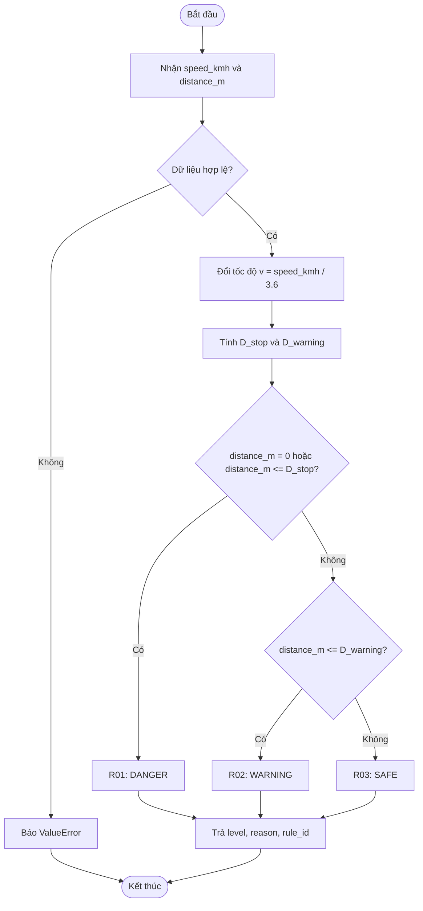

# W1-02 – THIẾT KẾ BỘ LUẬT AI CẢNH BÁO VA CHẠM

## 1. Mục tiêu

Thiết kế cơ sở tri thức và cơ chế suy diễn dựa trên luật **IF–THEN** để đánh giá nguy cơ va chạm từ hai đầu vào mô phỏng: **tốc độ phương tiện** và **khoảng cách tới vật cản**. Hệ thống đưa ra một trong ba mức:

- **SAFE – An toàn**
- **WARNING – Cảnh báo**
- **DANGER – Nguy hiểm**

Kết quả kèm lý do và mã luật được kích hoạt, phục vụ phần lập trình `src/warning_engine.py` ở Week 2.

**Phạm vi:** Xe chuyển động trên đường thẳng, hướng về **vật cản đứng yên**; tốc độ và khoảng cách do chương trình mô phỏng. Không xử lý đổi làn, phanh tự động, chuyển động của xe phía trước hoặc độ trễ cảm biến.

> **Lưu ý:** Công thức và tham số được lựa chọn cho **mô phỏng học tập**. Đây không phải mô hình an toàn giao thông đã được kiểm chứng và không được sử dụng để điều khiển hoặc đưa ra quyết định lái xe thực tế.

## 2. Cơ sở lý thuyết

### 2.1. Hệ thống dựa trên luật

Hệ thống dựa trên luật (*Rule-Based System*) biểu diễn tri thức dưới dạng các cặp **điều kiện → kết luận**:

```text
IF <điều kiện> THEN <kết luận>
```

Trong bài toán này:

| Thành phần | Vai trò |
|---|---|
| **Dữ kiện (facts)** | Tốc độ `speed_kmh`, khoảng cách `distance_m` và các giá trị suy ra |
| **Cơ sở tri thức (Knowledge Base)** | Tập luật xác định SAFE, WARNING, DANGER |
| **Bộ suy diễn (Inference Engine)** | Kiểm tra điều kiện, kích hoạt luật phù hợp |
| **Kết luận** | Mức cảnh báo, mã luật và giải thích |

Hướng tiếp cận này có thể giải thích trực tiếp vì sao một cảnh báo xuất hiện, không cần huấn luyện mô hình Machine Learning.

### 2.2. Cách suy diễn

Hệ thống thực hiện **suy diễn tiến (forward chaining) theo dữ kiện đầu vào**: bắt đầu với tốc độ và khoảng cách, tính các ngưỡng, xét điều kiện của các luật, sau đó kết luận mức cảnh báo.

Liên hệ kiến thức môn TTNT: cơ sở tri thức lưu luật; chương trình tiếp nhận dữ kiện mới, suy diễn và xuất ra kết quả (có thể giải thích qua chu trình TELL/ASK ở mức khái niệm).

## 3. Đầu vào, đầu ra và giả định

### 3.1. Đầu vào

| Tên biến | Ý nghĩa | Kiểu | Đơn vị | Điều kiện |
|---|---|---|---|---|
| `speed_kmh` | Tốc độ xe | Số hữu hạn | km/h | `>= 0` |
| `distance_m` | Khoảng cách tới vật cản | Số hữu hạn | m | `>= 0` |

Dữ liệu `None`, chuỗi không phải số, NaN, vô cực và số âm đều **không hợp lệ**. Boolean cũng không được coi là tốc độ hoặc khoảng cách hợp lệ.

### 3.2. Đầu ra

Khi dữ liệu hợp lệ, hàm AI trả về một `dict`:

| Trường | Ý nghĩa | Ví dụ |
|---|---|---|
| `level` | Mức cảnh báo | `"WARNING"` |
| `reason` | Giải thích ngắn gọn | `"Khoảng cách nằm trong vùng cảnh báo"` |
| `rule_id` | Mã luật được kích hoạt | `"R02"` |

**Quy ước liên module:** `evaluate_warning(speed_kmh, distance_m) -> dict`.

Khi dữ liệu không hợp lệ, hàm **phát sinh `ValueError`** với thông báo dễ hiểu; giao diện sẽ bắt lỗi và yêu cầu người dùng nhập lại. Đây là quy ước đề xuất cần được xác nhận chung trước khi code.

### 3.3. Giả định tính ngưỡng

Để các mức cảnh báo **phụ thuộc đồng thời vào tốc độ và khoảng cách**, chọn một mô hình khoảng cách dừng lý tưởng hóa:

- Thời gian phản ứng giả định: `t = 1,0 s`.
- Độ lớn gia tốc hãm giả định: `a = 5,0 m/s²`.
- Hệ số mở rộng vùng cảnh báo: `k = 1,5`.
- Vật cản đứng yên và xe đang tiến về phía vật cản.
- Bỏ qua thời tiết, độ dốc, độ bám đường, tải trọng và sai số đo.

Các giá trị trên **do nhóm đề xuất cho bài mô phỏng**, không được yêu cầu cụ thể trong đề tài. Có thể điều chỉnh sau khi nhóm thống nhất.

## 4. Phương pháp xây dựng ngưỡng

Đổi tốc độ từ km/h sang m/s:

\[
v = \frac{\text{speed\_kmh}}{3.6}
\]

Khoảng cách dừng tham khảo trong mô hình:

\[
D_{\text{stop}} = v \times t + \frac{v^2}{2a}
\]

Ngưỡng cảnh báo mở rộng:

\[
D_{\text{warning}} = k \times D_{\text{stop}}
\]

Với các tham số đã chọn:

\[
D_{\text{stop}} = v + \frac{v^2}{10}
\]

\[
D_{\text{warning}} = 1.5 \times D_{\text{stop}}
\]

**Ý nghĩa trong chương trình:** Khi tốc độ tăng, khoảng cách dừng ước tính tăng; do đó cùng một khoảng cách có thể dẫn đến mức nguy cơ khác nhau khi tốc độ thay đổi.

**Quy ước đặc biệt:** Nếu `distance_m == 0`, hệ thống luôn trả `DANGER`, kể cả khi tốc độ bằng 0, vì đối tượng đang ở vị trí tiếp xúc với vật cản trong mô hình.

## 5. Cơ sở tri thức – Bộ luật IF–THEN

| Mã | Điều kiện | Kết luận | Giải thích |
|---|---|---|---|
| **R01** | `distance_m == 0` **hoặc** `distance_m <= D_stop` | **DANGER** | Khoảng cách bằng 0 hoặc không vượt khoảng cách dừng ước tính |
| **R02** | `D_stop < distance_m <= D_warning` | **WARNING** | Đã vượt vùng nguy hiểm nhưng vẫn trong vùng cảnh báo |
| **R03** | `distance_m > D_warning` | **SAFE** | Khoảng cách vượt ngưỡng cảnh báo của mô hình |

Dữ liệu phải được kiểm tra hợp lệ **trước khi** áp dụng các luật.

### 5.1. Thứ tự ưu tiên

Mức ưu tiên: **DANGER > WARNING > SAFE**.

Để không có hai kết quả trái ngược nhau, bộ suy diễn áp dụng lần lượt **R01 → R02 → R03** và dừng tại luật đầu tiên thỏa mãn. Ba điều kiện được xây dựng loại trừ lẫn nhau đối với đầu vào hợp lệ.

### 5.2. Trường hợp tốc độ bằng 0

Khi `speed_kmh = 0`:

- `D_stop = 0`, `D_warning = 0`.
- `distance_m = 0` → **DANGER**.
- `distance_m > 0` → **SAFE**.

Đây là **quy ước của bản mô phỏng**, không có nghĩa xe đứng yên ngoài thực tế luôn an toàn.

## 6. Sơ đồ suy diễn bằng Mermaid

### 6.1. Sơ đồ luồng ra quyết định



### 6.2. Sơ đồ các thành phần AI


## 7. Minh họa suy diễn với dữ liệu cụ thể

Sử dụng `t = 1 s`, `a = 5 m/s²`, `k = 1,5`. Các ngưỡng làm tròn **chỉ để trình bày**; khi lập trình phải so sánh với giá trị chưa làm tròn.

| TC | Tốc độ (km/h) | Khoảng cách (m) | `D_stop` (m) | `D_warning` (m) | Luật | Kết quả |
|---|---:|---:|---:|---:|---|---|
| 01 | 30 | 30 | 15,28 | 22,92 | R03 | SAFE |
| 02 | 30 | 20 | 15,28 | 22,92 | R02 | WARNING |
| 03 | 30 | 10 | 15,28 | 22,92 | R01 | DANGER |
| 04 | 60 | 90 | 44,44 | 66,67 | R03 | SAFE |
| 05 | 60 | 50 | 44,44 | 66,67 | R02 | WARNING |
| 06 | 60 | 20 | 44,44 | 66,67 | R01 | DANGER |
| 07 | 0 | 5 | 0 | 0 | R03 | SAFE |
| 08 | 0 | 0 | 0 | 0 | R01 | DANGER |

### Ví dụ suy diễn chi tiết: TC05

**Dữ kiện:** Tốc độ `60 km/h`, khoảng cách `50 m`.

1. Đổi đơn vị: `v = 60 / 3,6 ≈ 16,67 m/s`.
2. Khoảng cách dừng: `D_stop ≈ 44,44 m`.
3. Ngưỡng cảnh báo: `D_warning ≈ 66,67 m`.
4. Đối chiếu luật:
   - R01: `50 <= 44,44` → **Sai**.
   - R02: `44,44 < 50 <= 66,67` → **Đúng**.
5. **Kết luận:** `WARNING`, kích hoạt `R02`.

**Thông điệp giải thích đề xuất:** “Khoảng cách hiện tại đã vượt mức nguy hiểm nhưng vẫn thuộc vùng cảnh báo theo ngưỡng tốc độ đã chọn.”

### Ví dụ về sự kết hợp giữa tốc độ và khoảng cách

Cùng khoảng cách **30 m**:

| Tốc độ | So với ngưỡng | Kết quả |
|---|---|---|
| 30 km/h | `30 > 22,92` | SAFE |
| 60 km/h | `30 <= 44,44` | DANGER |

Như vậy hệ thống không chỉ dựa vào khoảng cách, mà kết hợp **cả tốc độ và khoảng cách** đúng với yêu cầu đề tài.

## 8. Các trường hợp biên cần kiểm thử

| Nhóm kiểm thử | Dữ liệu / Điều kiện | Kết quả mong đợi |
|---|---|---|
| Tại ngưỡng nguy hiểm | `distance_m == D_stop` | DANGER |
| Ngay trên ngưỡng nguy hiểm | `distance_m > D_stop` và `<= D_warning` | WARNING |
| Tại ngưỡng cảnh báo | `distance_m == D_warning` khi tốc độ > 0 | WARNING |
| Vượt ngưỡng cảnh báo | `distance_m > D_warning` | SAFE |
| Tốc độ bằng 0, còn khoảng cách | `speed_kmh = 0`, `distance_m > 0` | SAFE |
| Vị trí tiếp xúc | `distance_m = 0` | DANGER |
| Tốc độ âm | `speed_kmh < 0` | ValueError |
| Khoảng cách âm | `distance_m < 0` | ValueError |
| Sai kiểu / NaN / vô cực | Dữ liệu không hợp lệ | ValueError |

**Chú ý khi triển khai:** Do số thực có sai số biểu diễn, test ngưỡng nên lấy chính giá trị ngưỡng mà chương trình tính ra, thay vì nhập giá trị đã làm tròn hai chữ số.

## 9. Quy ước giao tiếp với các module Week 2

Hàm AI dự kiến:

```python
evaluate_warning(speed_kmh, distance_m)
```

Ví dụ đầu vào:

```python
speed_kmh = 60
distance_m = 50
```

Ví dụ đầu ra:

```json
{
  "level": "WARNING",
  "reason": "Khoảng cách nằm trong vùng cảnh báo theo tốc độ hiện tại.",
  "rule_id": "R02"
}
```

| Thành viên/mảng | Nội dung cần thống nhất |
|---|---|
| **W1-01 – Kiến trúc** | Tên hàm, cách gọi module, cấu trúc `dict`, xử lý lỗi |
| **W1-03 – Mô phỏng** | Dữ liệu `speed_kmh`, `distance_m` và đơn vị |
| **W1-04 – Giao diện** | Ba mức cảnh báo, phần giải thích, trường hợp nhập sai |
| **W1-05 – Kiểm thử** | Bảng luật, giá trị biên, các kết quả mong đợi |

Khi sang Week 2, `warning_engine.py` phải xử lý độc lập, **không phụ thuộc Streamlit**, để dễ dàng gọi từ giao diện và viết unit test.

## 10. Giới hạn và hướng mở rộng

**Giới hạn hiện tại:**

- Chỉ xử lý khoảng cách đến vật cản **đứng yên**.
- Không có dữ liệu về vận tốc tương đối với phương tiện phía trước.
- Không mô phỏng thực tế lực phanh hay xác suất tai nạn.
- Ngưỡng được chọn theo **giả định giáo dục**, không phải ngưỡng an toàn được xác thực.

**Có thể mở rộng sau khi đáp ứng đủ yêu cầu:** mô phỏng khoảng cách biến thiên theo thời gian, hiển thị biểu đồ hoặc thêm luật cho các kịch bản khác. Các chức năng này **không bắt buộc** ở Week 2.

## 11. Kết luận

Bộ luật đề xuất phân loại nguy cơ va chạm thành ba mức **SAFE, WARNING, DANGER** bằng cách kết hợp tốc độ và khoảng cách. Hệ thống sử dụng cơ sở tri thức và quy trình suy diễn IF–THEN, có mã luật và giải thích cho từng kết luận.

Tài liệu này là **bản thiết kế W1-02**. Trước khi triển khai code, các tham số `t`, `a`, `k` và giao diện hàm cần được cả nhóm xem xét, xác nhận trong tài liệu tổng hợp Week 1 (`system_design.md`).

---

## 12. Tài liệu đối chiếu

1. **BTL_TTNT.pdf** – Đề tài số 36, “Mô phỏng hệ thống cảnh báo va chạm”: mô phỏng dữ liệu tốc độ/khoảng cách, luật suy diễn, ngưỡng cảnh báo, ba mức và so sánh ít nhất ba tình huống.
2. **TTNT_Chuong3_Slide_Bai_Giang** – Các nội dung tác tử dựa trên tri thức, cơ sở tri thức, TELL/ASK, logic và suy diễn.
3. **TTNT_Chuong1_Slide_Bai_Giang** – Kiến thức nền về tác tử thông minh.

**Phân biệt nguồn:** Yêu cầu bài toán và kỹ thuật trọng tâm được xác định theo đề tài số 36. Công thức khoảng cách dừng, giá trị `t = 1 s`, `a = 5 m/s²`, hệ số `k = 1,5` và các luật R01–R03 là **thiết kế đề xuất của nhóm**, không phải thông số do giảng viên quy định.
